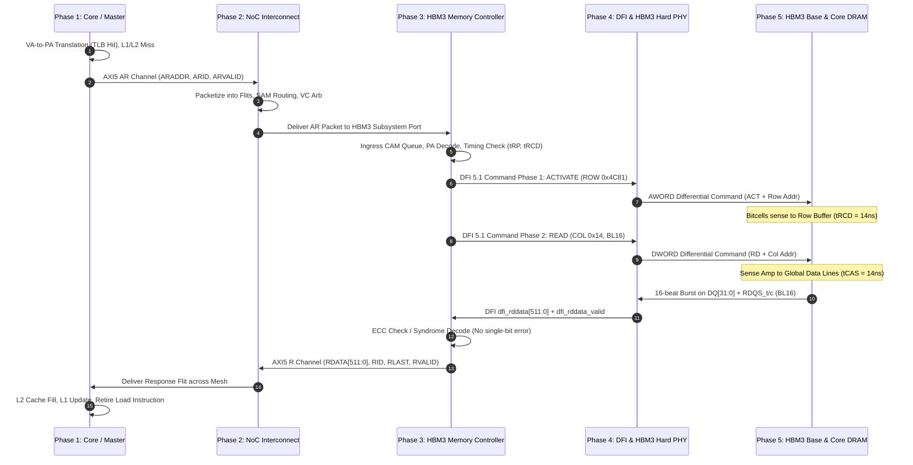

# SoC Master to HBM3 Read Transaction: End-to-End Architectural Walkthrough

## 1. System Overview & Scenario Setup

This document specifies the exact microarchitectural and signal-level progression of an end-to-end memory read transaction in a modern high-performance System-on-Chip (SoC). 

### 1.1 Real-World Hardware Context
* **SoC Master:** AI Tensor Accelerator Core (Cluster 0, Core 2) executing a matrix multiplication kernel (`GEMM`).
* **Interconnect:** AMBA AXI5 / Coherent Network-on-Chip (NoC) running at $2.0\text{ GHz}$.
* **Memory Subsystem:** HBM3 Controller + DFI 5.1 PHY + 2.5D Silicon Interposer (e.g., TSMC CoWoS-S).
* **Memory Device:** JEDEC HBM3 DRAM Stack (12-Hi 24GB stack, 16 physical channels, 32 pseudo-channels, operating at $6.4\text{ Gbps/pin}$).
* **Transaction Size:** Standard 64-byte ($512\text{ bits}$) cache line read.

```
+---------------------------------------------------------------------------------------------------------+
|                                              SoC DIE                                                    |
|                                                                                                         |
|  +--------------------+       +----------------------+       +---------------------------------------+  |
|  |  AI Compute Core   | ----> | 2D Mesh NoC Router   | ----> | HBM3 Memory Controller (MC)           |  |
|  |  (Master Node 0)   |  AXI5 | (Packetized Transport) | AXI5 | - Command Queue & Arbiter (FR-FCFS)    |  |
|  |  - Load Execution  |       | - Credit Flow / SAM  |       | - Address Decoder & Timing Engine     |  |
|  |  - L1/L2 Miss      |       | - Virtual Channel 2  |       | - Reorder Buffer & ECC Engine         |  |
|  +--------------------+       +----------------------+       +---------------------------------------+  |
|                                                                                  |                      |
|                                                                           DFI 5.1| Interface            |
|                                                                                  v                      |
|                                                              +---------------------------------------+  |
|                                                              | HBM3 Hard PHY Layer                   |  |
|                                                              | - TX Command Serializer / ZQ Driver   |  |
|                                                              | - RX Data Deserializer & Deskew DLL   |  |
|                                                              +---------------------------------------+  |
+-----------------------------------------------------------------------------------|---------------------+
                                                                           Microbumps (~35 um pitch)
====================================================================================|=====================
                                2.5D SILICON INTERPOSER (Sub-micron routing traces) |
====================================================================================|=====================
                                                                           Microbumps (~35 um pitch)
+-----------------------------------------------------------------------------------|---------------------+
|                                          HBM3 STACK                               v                     |
|  +---------------------------------------------------------------------------------------------------+  |
|  | Base / Logic Die: Command Receiver, Test/BIST, TSV Drivers, Repair Redirection                    |  |
|  +---------------------------------------------------------------------------------------------------+  |
|            | TSVs (Through-Silicon Vias)                                                                |
|            v                                                                                            |
|  +---------------------------------------------------------------------------------------------------+  |
|  | DRAM Core Die 0..11: Pseudo-Channel 0..31 -> Bank Group -> Bank -> Sense Amps -> Row Buffer Latch|  |
|  +---------------------------------------------------------------------------------------------------+  |
+---------------------------------------------------------------------------------------------------------+
```

---

## 2. Concrete Address Decomposition & Bit Budget

The AI Core issues a load targeting memory holding a weight tensor element.

* **Virtual Address (VA):** `0x0000_7FFF_94A2_8840` (64-bit)
* **Physical Address (PA):** `0x0000_2A14_C814_0840` (48-bit physical address space, 256 TB)
* **Access Granularity:** 64 Bytes ($512\text{ bits}$, aligned to 64B boundary $\rightarrow \text{PA}[5:0] = \text{0b000000}$).

### 2.1 48-bit Physical Address (PA) Mapping to HBM3 Topology
To maximize concurrency and bandwidth utilization, the Memory Controller interleaves adjacent cache lines across channels and banks.

$$\text{PA} = \mathtt{0x0000\_2A14\_C814\_0840} = \mathtt{0010\_1010\_0001\_0100\_1100\_1000\_0001\_0100\_0000\_1000\_0100\_0000_2}$$

| Field Name | Bit Range | Width | Extracted Value (Bin / Hex) | Physical HBM3 Destination |
| :--- | :--- | :--- | :--- | :--- |
| **Byte Offset** | `PA[5:0]` | 6 bits | `000000` (`0x00`) | Byte 0 of 64-byte burst (aligned) |
| **Channel ID** | `PA[9:6]` | 4 bits | `0001` (`0x1`) | **Channel 1** (out of 16 channels) |
| **Pseudo-Channel (PC)** | `PA[10]` | 1 bit | `0` (`0x0`) | **Pseudo-Channel 0 (PC0)** (out of 2 per channel) |
| **Bank Address (BA)** | `PA[12:11]` | 2 bits | `01` (`0x1`) | **Bank 1** |
| **Bank Group (BG)** | `PA[15:13]` | 3 bits | `000` (`0x0`) | **Bank Group 0 (BG0)** |
| **Column Address (COL)** | `PA[21:16]` | 6 bits | `010100` (`0x14`) | **Column 20** |
| **Row Address (ROW)** | `PA[37:22]` | 16 bits | `0100_1100_1000_0001` (`0x4C81`) | **Row 19,585** |
| **DRAM Die ID (Layer)** | `PA[41:38]` | 4 bits | `0001` (`0x1`) | **Die 1** (in 12-Hi stack) |
| **Reserved / System** | `PA[47:42]` | 6 bits | `000010` (`0x02`) | Memory region attributes / SoC node ID |

---

## 3. Phase-by-Phase Execution Walkthrough



---

### Phase 1: Master Read Initiation & Address Translation

#### 1.1 Microarchitectural Progression
1. The execution pipeline of **Tensor Core 2** reaches instruction:
   $$\mathtt{LD.64\ \ R4,\ [X1]}$$
   where `X1` holds virtual address `0x0000_7FFF_94A2_8840`.
2. **Translation Lookaside Buffer (L1 D-TLB)** is probed in parallel with the L1 Data Cache tag lookup.
   * **TLB Hit:** Resolves VA `0x0000_7FFF_94A2_8840` to Physical Address `0x0000_2A14_C814_0840`.
   * Page permissions (Read/Execute, Non-Secure, Inner Shareable) validated in the Memory Management Unit (MMU).
3. **Cache Lookup:**
   * **L1 Data Cache (64KB, 4-way):** Tag mismatch $\rightarrow$ **L1 Miss**.
   * **L2 Shared Cluster Cache (2MB, 16-way):** Line not present $\rightarrow$ **L2 Miss**.
4. The Core's **Bus Interface Unit (BIU) / Miss Status Holding Register (MSHR)** allocates entry `#6` and constructs an AMBA AXI5 Master Read Request.

#### 1.2 Exact Signal State at Master Boundary (AXI5 Read Address Channel - AR)
The transaction is driven onto the master bus at rising edge of clock cycle $T_{10}$.

| Signal Name | Width | Driven Value | Direction | Microarchitectural Meaning |
| :--- | :---: | :--- | :---: | :--- |
| `ACLK` | 1 | Clock ($2.0\text{ GHz}$) | Input | System reference clock |
| `ARESETn` | 1 | `1'b1` | Input | System reset inactive |
| `ARVALID` | 1 | `1'b1` | Master $\rightarrow$ NoC | Validates control/address payload |
| `ARREADY` | 1 | `1'b1` (sampled) | NoC $\rightarrow$ Master | Slave network interface is ready |
| `ARADDR[47:0]` | 48 | `48'h0000_2A14_C814_0840` | Master $\rightarrow$ NoC | Physical address of 64B line |
| `ARID[7:0]` | 8 | `8'h42` | Master $\rightarrow$ NoC | Transaction identifier (Core 2, MSHR #6) |
| `ARLEN[7:0]` | 8 | `8'h00` | Master $\rightarrow$ NoC | Length = 1 beat (native 512-bit bus beat) |
| `ARSIZE[2:0]` | 3 | `3'b110` | Master $\rightarrow$ NoC | 64 Bytes ($2^6 = 64\text{ bytes}$) transfer size |
| `ARBURST[1:0]` | 2 | `2'b01` | Master $\rightarrow$ NoC | `INCR` (Incremental burst type) |
| `ARLOCK` | 1 | `1'b0` | Master $\rightarrow$ NoC | Normal access (non-exclusive / non-atomic) |
| `ARCACHE[3:0]` | 4 | `4'b1111` | Master $\rightarrow$ NoC | Write-Back, Read/Write Allocate, Modifiable |
| `ARPROT[2:0]` | 3 | `3'b010` | Master $\rightarrow$ NoC | Unprivileged, Non-secure, Data access |
| `ARQOS[3:0]` | 4 | `4'b1000` | Master $\rightarrow$ NoC | High Priority (Quality of Service level 8) |

*Result of Phase 1:* On clock edge $T_{11}$, both `ARVALID` and `ARREADY` are high. The handshake is complete, and the packet is absorbed by the local Network Interface Unit (NIU).

---

### Phase 2: Network-on-Chip (NoC) Transport & Routing

#### 2.1 Microarchitectural Progression
1. **Packetization:** The NIU wraps the AXI5 request into a standard NoC packet. Because the request is a single command descriptor (no write data), it fits into a single **Head/Tail Flit (Flow Control Unit)** of 128 bits.
2. **System Address Map (SAM) Decode:**
   * Address bit range `PA[47:32]` and hash configuration resolve `0x0000_2A14...` to **Memory Controller Target 0 (HBM3_MC0)**, positioned at Mesh coordinate `(X=3, Y=0)`.
   * Current Core Node coordinate is `(X=0, Y=2)`.
3. **Flit Traversal (Dimension-Order Routing - XY):**
   * Routed East: $(0,2) \rightarrow (1,2) \rightarrow (2,2) \rightarrow (3,2)$ (3 hops).
   * Routed South: $(3,2) \rightarrow (3,1) \rightarrow (3,0)$ (2 hops).
   * Total router hops = 5. Each router introduces a 1-cycle latency pipeline (Input Buffer $\rightarrow$ Route Compute $\rightarrow$ Virtual Channel Allocator $\rightarrow$ Switch Allocator $\rightarrow$ Crossbar Traversal).
4. **Clock Domain Crossing (CDC):**
   * The packet exits the NoC Mesh running at $2.0\text{ GHz}$ and enters the HBM3 Memory Controller operating at $1.0\text{ GHz}$ ($DFI\text{ clock} = 800\text{ MHz} - 1.0\text{ GHz}$).
   * Passes through an **Asynchronous Dual-Clock Credit FIFO** with Gray-coded read/write pointers.

#### 2.2 Signal Representation Across NoC Transport

| NoC Internal Link Field | Width | Encoded Value | Description |
| :--- | :---: | :--- | :--- |
| `FLIT_TYPE[1:0]` | 2 | `2'b11` | Single-flit packet (`HEAD_TAIL`) |
| `SRC_NODE_ID[7:0]` | 8 | `8'h02` | Cluster 0, Core 2 |
| `DEST_NODE_ID[7:0]` | 8 | `8'h30` | HBM3 Controller 0 Port |
| `VC_ID[2:0]` | 3 | `3'b010` | Virtual Channel 2 (Dedicated Read Request VC) |
| `QOS[3:0]` | 4 | `4'b1000` | Inherited from AXI5 `ARQOS` |
| `TRANSACTION_ID[7:0]`| 8 | `8'h42` | Forwarded `ARID` |
| `PAYLOAD_ADDR[47:0]` | 48 | `48'h0000_2A14_C814_0840` | Extracted address |
| `CREDIT_VALID` | 1 | `1'b1` | Credit return line to upstream router |

---

### Phase 3: HBM3 Memory Controller (MC) Processing & Command Scheduling

#### 3.1 Microarchitectural Progression
The HBM3 Memory Controller receives the transaction at its slave AXI front-end:
1. **Ingress CAM Queue Allocation:** The request is placed into the **Read Command Queue (RCQ)** entry `#18`.
2. **Structural Address Translation:**
   The hardware mapping unit slices the address into HBM3 hardware coordinates:
   * Target Channel: **Channel 1**
   * Target Pseudo-Channel: **PC0**
   * Target Bank Group: **BG0**
   * Target Bank: **BA1**
   * Target Row: **`0x4C81`**
   * Target Column: **`0x14`**
3. **Bank State Machine Evaluation (Page Hit/Miss/Empty):**
   * The MC checks the status of **Channel 1, PC0, BG0, Bank 1**.
   * *Current State:* Bank 1 is in **Precharged (Idle / Closed)** state.
   * *Action Required:* Must issue an **ACTIVATE (`ACT`)** command to open Row `0x4C81`, wait for Row-to-Column Delay ($t_{RCD}$), then issue a **READ (`RD`)** command.
4. **First-Ready First-Come First-Served (FR-FCFS) Arbitration:**
   * The scheduler enforces JEDEC HBM3 timing parameters:
     * $t_{RP}$ (Row Precharge Time) = Already satisfied.
     * $t_{RCDRD}$ (Row-to-Read Delay) = $14\text{ ns}$ ($\sim 14\text{ MC cycles}$).
     * $t_{CCD\_S} / t_{CCD\_L}$ (Column-to-Column Delay).
     * $t_{RRD}$ (Row-to-Row Delay across Bank Groups).
5. **DFI 5.1 Protocol Translation:**
   The MC formats the commands for the DFI 5.1 interface driving the PHY.

#### 3.2 Command Sequence & Timing Schedule

```
MC Clock Cycle:  T0           T1..T13           T14                   T14+tCL (T30)
Command Issued:  ACTIVATE      [wait tRCD]       READ (BL16)           [DRAM drives DQ]
                 (Row 0x4C81)                   (Col 0x14)
```

---

### Phase 4: DFI 5.1 & HBM3 PHY Layer Serialization

The DRAM Front-End Interface (DFI) 5.1 provides the unified standard interface between the Memory Controller logic and the physical Hard PHY.

#### 4.1 Microarchitectural Progression
1. **DFI Command Issuance:**
   * At cycle $T_0$, the MC asserts `dfi_act_n`, driving the row address to open the bank.
   * At cycle $T_{14}$ ($t_{RCD} \ge 14\text{ ns}$ elapsed), the MC asserts `dfi_cas_n` to trigger the column read.
2. **PHY Serialization & Framing:**
   * HBM3 uses separate command buses: **AWORD** for Row commands, and **DWORD** for Column commands. This allows simultaneous row activations and column reads!
   * The PHY serializer transforms parallel DFI words into high-speed command pulses transmitted across microbumps at double data rate (DDR) / single data rate (SDR) relative to the command clock `CK_t / CK_c`.
3. **Signal Transmission Across 2.5D Interposer:**
   * The signals propagate across the sub-micron copper traces of the Silicon Interposer (length $\approx 2.5\text{ mm}$, propagation delay $\approx 18\text{ ps/mm} \approx 45\text{ ps}$).
   * Impedance matching drivers (ZQ calibrated to $34\ \Omega$ or $40\ \Omega$) drive the signal across microbumps into the HBM3 Base/Logic Die.

#### 4.2 Exact Signal State at DFI 5.1 and PHY Interposer Boundary

##### A. DFI 5.1 Interface Signals (Channel 1, PC0)

| Signal Name | Width | Value at Activate ($T_0$) | Value at Read ($T_{14}$) | Direction | Description |
| :--- | :---: | :--- | :--- | :---: | :--- |
| `dfi_clk` | 1 | $1.0\text{ GHz}$ clock | $1.0\text{ GHz}$ clock | MC $\rightarrow$ PHY | Reference DFI clock |
| `dfi_cs_n[1:0]` | 2 | `2'b10` (PC0 active) | `2'b10` (PC0 active) | MC $\rightarrow$ PHY | Chip select per pseudo-channel |
| `dfi_act_n` | 1 | `1'b0` (Active Low) | `1'b1` (Inactive) | MC $\rightarrow$ PHY | Row Activate Command strobed |
| `dfi_ras_n` | 1 | `1'b0` | `1'b1` | MC $\rightarrow$ PHY | Command decode line |
| `dfi_cas_n` | 1 | `1'b1` | `1'b0` (Active Low) | MC $\rightarrow$ PHY | Column Command strobed |
| `dfi_we_n` | 1 | `1'b1` (Inactive) | `1'b1` (Read, not Write)| MC $\rightarrow$ PHY | Write Enable line |
| `dfi_bank[4:0]` | 5 | `5'b00001` (BG0, BA1) | `5'b00001` (BG0, BA1) | MC $\rightarrow$ PHY | Combined BG[2:0] and BA[1:0] |
| `dfi_address[15:0]`| 16 | `16'h4C81` (Row Addr)| `16'h0014` (Col Addr)| MC $\rightarrow$ PHY | Multiplexed row/col address |

##### B. HBM3 PHY Physical Boundary Pins (Silicon Interposer to Base Die)

| Physical Pin Group | Width | Driven State / Value | Signal Type | Architectural Function |
| :--- | :---: | :--- | :---: | :--- |
| `CK_t / CK_c` | 2 | Differential $1.6\text{ GHz}$ | Clock | Channel 1 Command reference clock |
| `ROW[5:0]` (AWORD) | 6 | `6'b010011` $\rightarrow$ serial row | Single-Ended | Row command bus (Activate Row `0x4C81`) |
| `COL[7:0]` (DWORD) | 8 | `8'b000101` $\rightarrow$ serial col | Single-Ended | Column command bus (Read Col `0x14`, BL16) |
| `CKE` | 1 | `1'b1` | CMOS | Clock Enable high |
| `PAR` | 1 | Even parity bit | Single-Ended | Command bus parity protection |

---

### Phase 5: HBM3 DRAM Die Stack Access & Data Return Loop

#### 5.1 Internal DRAM Core Progression
1. **Base Die Signal Buffering:**
   * The HBM3 Base (Logic) Die receives the differential `ROW` and `COL` commands.
   * Parity is verified by the Base Die logic engine.
   * Internal pre-decoders route the command signals to the vertical **Through-Silicon Via (TSV)** column dedicated to Channel 1.
2. **TSV Propagation to Target DRAM Die:**
   * Signals ascend the TSV stack to **DRAM Die 1** (layer 2 of the 12-die memory stack).
3. **Core Activation (Row Sense):**
   * The row decoder on Die 1 fires wordline `WL[19585]` in Bank 1 of Bank Group 0.
   * Charge from $1\text{T}-1\text{C}$ memory cells flows to the bitlines, creating a small differential voltage ($\Delta V \approx 100\text{ mV}$).
   * Sense amplifiers fire, restoring cell charge and latching the entire row into the **Row Buffer** ($2\text{ KB}$ page).
4. **Column Read & Burst Extraction:**
   * After $t_{RCDRD} = 14\text{ ns}$, the Column Read command arrives.
   * Column decoder enables Column Select Line `CSL[20]`.
   * Exactly 64 bytes ($512\text{ bits}$) are transferred from the Row Buffer latches to the internal Global Data Lines (GIO).
5. **Data Serialization on Pseudo-Channel 0 (`BL16`):**
   * A single HBM3 Pseudo-Channel has a **32-bit wide data bus (`DQ[31:0]`)**.
   * To transfer 64 bytes ($512\text{ bits}$), the DRAM core executes a **Burst Length of 16 (`BL16`)**:
     $$\text{Total Transferred Bits} = 32\text{ data lines} \times 16\text{ consecutive beats} = 512\text{ bits}\ (64\text{ Bytes})$$
   * At $6.4\text{ Gbps/pin}$, each bit beat lasts:
     $$t_{UI} = \frac{1}{6.4\text{ GHz}} = 156.25\text{ ps}$$
   * The 16-beat transfer completes in:
     $$16 \times 156.25\text{ ps} = 2.5\text{ ns}$$
   * Data is accompanied by differential Read Data Strobes: `RDQS_t` and `RDQS_c`.

```
Beats (UI):     0   1   2   3   4   5   6   7   8   9  10  11  12  13  14  15
RDQS_t/c:      _/~~\__/~~\__/~~\__/~~\__/~~\__/~~\__/~~\__/~~\__/~~\__/~~\__/~~\
DQ[31:0]:      [ B0][ B1][ B2][ B3][ B4][ B5][ B6][ B7][ B8][ B9][B10][B11]...[B15]
                <------------------ 16 beats x 32 bits = 512 bits ----------------->
```

#### 5.2 Signal Table at HBM3 DQ Interface (Base Die $\rightarrow$ Interposer $\rightarrow$ PHY)

| Signal Name | Width | Pin Values During Burst | Direction | Description |
| :--- | :---: | :--- | :---: | :--- |
| `DQ[31:0]` | 32 | 16 sequential 32-bit slices of data | DRAM $\rightarrow$ PHY | 32-bit bi-directional data bus for PC0 |
| `DBI[3:0]` | 4 | Data Bus Inversion flags (1 per byte) | DRAM $\rightarrow$ PHY | Active high when $>4$ bits toggle to cut power |
| `PAR[3:0]` | 4 | Data parity bits | DRAM $\rightarrow$ PHY | Link error detection |
| `RDQS_t / c` | 2 | $3.2\text{ GHz}$ toggle pattern | DRAM $\rightarrow$ PHY | Differential source-synchronous read strobes |

#### 5.3 Return Flow to Master (Closing the Loop)
1. **PHY Deserialization:**
   * The SoC PHY captures the 16 beats of `DQ[31:0]` using `RDQS`, deskews the lines with internal Delay-Locked Loops (DLLs), and reassembles the parallel $512\text{ bits}$ of read data.
   * Drives data onto the DFI interface:
     * `dfi_rddata[511:0]` = $512\text{ bits}$ of raw payload
     * `dfi_rddata_valid` = `1'b1`
2. **Memory Controller ECC Verification:**
   * The MC checks the Reed-Solomon / SECDED ECC syndrome.
   * Result: **Zero errors detected**.
   * Strips ECC bits and formats an AXI5 Read Data packet.
3. **AXI5 Read Data Channel Response (MC $\rightarrow$ NoC):**
   * Driven signals:
     * `RID[7:0]` = `8'h42` (matches original `ARID`)
     * `RDATA[511:0]` = The 64-byte payload
     * `RRESP[1:0]` = `2'b00` (`OKAY`)
     * `RLAST` = `1'b1` (Single beat 512-bit burst)
     * `RVALID` = `1'b1`
4. **NoC Traversal & Core Delivery:**
   * NoC converts AXI response into a data response flit and routes it back across the mesh from $(3,0)$ to $(0,2)$.
   * At Core 2, the NIU unpacks the flit and asserts `RVALID` to the core's BIU.
   * Core asserts `RREADY` $\rightarrow$ Data enters the L2 and L1 caches.
   * Target register `R4` is populated with the requested 64-bit slice from byte offset `0x00`.
   * **Instruction `LD.64 R4, [X1]` retires!**

---

## 4. End-to-End Latency & Timing Budget Breakdown

In a typical production high-performance server/AI SoC, this end-to-end read transaction spans approximately **$50\text{ to }65\text{ nanoseconds}$** of wall-clock time under an idle/uncongested memory subsystem:

| Subsystem Component | Operational Stage | Cycles | Latency Contribution |
| :--- | :--- | :---: | :---: |
| **Tensor Core Pipeline** | TLB Lookup, L1/L2 Miss Detection, MSHR Allocate | 8 cycles @ $2\text{ GHz}$ | $4.0\text{ ns}$ |
| **Master NIU & NoC** | Packetization, SAM Lookup, 5 Router Mesh Hops | 10 cycles @ $2\text{ GHz}$ | $5.0\text{ ns}$ |
| **Clock Domain Crossing** | Core Domain ($2\text{ GHz}$) to MC Domain ($1\text{ GHz}$) | 3 cycles @ $1\text{ GHz}$ | $3.0\text{ ns}$ |
| **Memory Controller** | Queue Insertion, FR-FCFS Arbitrate, Address Slicing | 6 cycles @ $1\text{ GHz}$ | $6.0\text{ ns}$ |
| **HBM3 Row Activation** | $t_{RCDRD}$ (DRAM physical wordline rise & sense amp latch) | Fixed DRAM spec | $14.0\text{ ns}$ |
| **HBM3 Column Read** | $t_{CL} / t_{CAS}$ (Column decode to DQ pin launch) | Fixed DRAM spec | $14.0\text{ ns}$ |
| **DQ Data Burst (`BL16`)** | 16 beats on `DQ[31:0]` @ $6.4\text{ Gbps}$ | 16 UI | $2.5\text{ ns}$ |
| **PHY Deserialization** | RX AFE, DLL Deskew, Deserializer to 512-bit parallel DFI | 4 cycles @ $1\text{ GHz}$ | $4.0\text{ ns}$ |
| **MC ECC & Formatting** | Syndrome check, AXI5 response packet generate | 3 cycles @ $1\text{ GHz}$ | $3.0\text{ ns}$ |
| **NoC Return Mesh Path** | 5 Router Hops back to Master Cluster | 10 cycles @ $2\text{ GHz}$ | $5.0\text{ ns}$ |
| **L1/L2 Fill & Register Write** | Cache allocation, pipeline hazard clear, register write | 4 cycles @ $2\text{ GHz}$ | $2.0\text{ ns}$ |
| **Total Round-Trip Latency** | **Issue to Instruction Retirement** | — | **$\mathbf{\approx 62.5\text{ ns}}$** |

---

## 5. Architectural Summary Table (The 5 Phases)

| Phase | Boundary / Subsystem | Primary Input | Primary Output | Key Signals Involved |
| :---: | :--- | :--- | :--- | :--- |
| **1** | **Master Core & Cache** | Virtual Address `0x0000_7FFF_94A2_8840` | AXI5 `AR` Channel Request | `ARADDR[47:0]`, `ARID[7:0]`, `ARVALID`, `ARREADY`, `ARLEN[7:0]`, `ARSIZE[2:0]` |
| **2** | **Interconnect / NoC** | AXI5 `AR` Handshake | Router Flits at MC Port | `FLIT_TYPE[1:0]`, `DEST_NODE_ID[7:0]`, `VC_ID[2:0]`, `CREDIT_VALID` |
| **3** | **Memory Controller** | Ingress AXI Request | Scheduled DFI 5.1 Commands | `dfi_act_n`, `dfi_cas_n`, `dfi_bank[4:0]`, `dfi_address[15:0]`, `dfi_cs_n[1:0]` |
| **4** | **DFI & HBM3 PHY** | Parallel DFI Commands | High-Speed Serial Interposer Pins | `ROW[5:0]`, `COL[7:0]`, `CK_t/c`, `CKE`, `PAR` |
| **5** | **HBM3 DRAM Stack & Return** | Command on TSVs (`ACT`, `RD`) | 16-beat Burst on `DQ` & Return to Core | `DQ[31:0]`, `RDQS_t/c`, `dfi_rddata[511:0]`, `RDATA[511:0]`, `RID[7:0]`, `RVALID` |
