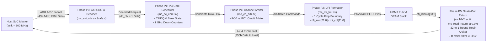

# MC16X2 Memory Controller IP
# End-to-End Read Transaction Specification (Phase P3 ➔ P1 ➔ P4 ➔ P2 ➔ P5)

---

## 1. System Overview & Exact Architectural Scope

This document specifies the exact microarchitectural steps and signal-level transitions for an SoC Master read request executed on the **MC16X2 Memory Controller IP**.

All modules, signals, bit widths, clock domains, and timing parameters strictly follow the **MC16X2 Microarchitecture Specification** and the RTL implementation in the codebase:
* **Host Interface:** 1 × AXI4 Slave Port running at `aclk = 500 MHz` ($2.0\text{ ns}$ cycle).
* **Core & DFI Interface:** 16 independent physical DFI 5.0 Channels running at `dfi_clk = 1 GHz` ($1.0\text{ ns}$ cycle).
* **Pseudo-Channels:** 32 independent Pseudo-Channels (2 PCs per Channel: `PC0` and `PC1`).
* **Bank Capacity:** 512 total memory banks across the IP (16 Channels × 2 PCs × 4 Bank Groups × 4 Banks).
* **Data Bus Widths:**
  * Host AXI Data Bus: **256 bits** (`s_axi_rdata[255:0]`, 32 bytes per beat).
  * Single Pseudo-Channel Data Stream: **32 bits** (`rddata_pc[31:0]`).
  * Physical DFI Channel Data Bus: **64 bits** (`dfi_rddata[63:0]`).



---

## 2. Address Bit Slicing & Real-Life Example Setup

### 2.1 Fixed 40-bit Address Mapping (`afe.v` / Spec Section 3.1.4)
Every address presented on `s_axi_araddr[39:0]` is combinatorially decoded by `address_decoder` in `afe.v`:

$$\mathtt{addr[39:0]} = \{\mathtt{Reserved[39:33]},\ \mathtt{CH\_SEL[32:29]},\ \mathtt{PC\_SEL[28]},\ \mathtt{ROW[27:14]},\ \mathtt{BG[13:12]},\ \mathtt{BA[11:10]},\ \mathtt{COL[9:5]},\ \mathtt{BYTE\_OFFSET[4:0]}\}$$

| Field Name | Bit Range | Bit Width | Value in Example (Bin / Hex) | Decoded Hardware Target |
| :--- | :---: | :---: | :--- | :--- |
| **`byte_offset`** | `addr[4:0]` | 5 bits | `5'b00000` (`5'h00`) | Byte 0 of 32-byte AXI beat (aligned) |
| **`col`** | `addr[9:5]` | 5 bits | `5'b01100` (`5'h0C`) | **Column 12** (out of 32 columns per row) |
| **`ba`** | `addr[11:10]` | 2 bits | `2'b10` (`2'h2`) | **Bank 2** (out of 4 banks per group) |
| **`bg`** | `addr[13:12]` | 2 bits | `2'b01` (`2'h1`) | **Bank Group 1** (out of 4 bank groups) |
| **`row`** | `addr[27:14]` | 14 bits | `14'b01_1010_0011_0101` (`14'h1A35`) | **Row 6,709** (out of 16,384 rows) |
| **`pc_sel`** | `addr[28]` | 1 bit | `1'b0` (`1'b0`) | **Pseudo-Channel 0 (`PC0`)** |
| **`ch_sel`** | `addr[32:29]` | 4 bits | `4'b0010` (`4'h2`) | **Channel 2** (out of 16 channels) |
| **`reserved`** | `addr[39:33]` | 7 bits | `7'b0000000` (`7'h00`) | Driven 0 by software |

### 2.2 Calculated Concrete Address
Combining the bit fields produces the exact 40-bit address:

$$\mathtt{s\_axi\_araddr} = \mathtt{40'b0000000\_0010\_0\_01101000110101\_01\_10\_01100\_00000} = \mathbf{40'h00\_468D\_5980}$$

---

## 3. The 5 Phases: Step-by-Step Signal & Architectural Walkthrough

---

### Phase P3: Host AXI Front-End, Decoding & Clock Domain Crossing (CDC)

#### 3.1 Architectural Execution
1. The Host SoC Master drives a single-beat 256-bit read request onto the AXI4 slave interface at `aclk = 500 MHz`.
2. **Handshake:** When `s_axi_arvalid` and `s_axi_arready` are both high at the rising edge of `aclk`, the request is accepted.
3. **Address Slicing (`address_decoder` in `afe.v`):**
   * Slices `40'h00_468D_5980` into `ch_sel = 4'h2`, `pc_sel = 1'b0`, `row = 14'h1A35`, `bg = 2'b01`, `ba = 2'b10`, `col = 5'h0C`.
4. **CDC Push (`mc_axi_cdc.sv`):**
   * The request payload (`arid`, `araddr`, `arlen`, decoded coordinates) is pushed into the **AR Async FIFO** (`72 bits wide × 8 entries`).
   * Pointers are Gray-coded and synchronized across 2 flip-flop synchronizers (`cdc_sync_2ff.sv`) into the `dfi_clk = 1 GHz` domain.
5. **Ingress Demux Router (`mc_ch_pc_router` in `afe.v`):**
   * In the `dfi_clk` domain, the router decodes `ch_sel = 4'h2` and `pc_sel = 1'b0`.
   * Drives `out_valid[2][0] = 1'b1` directly to Channel 2, Pseudo-Channel 0. All other 31 valid lines remain `1'b0`.

#### 3.2 Exact Signals at Phase P3 Boundary

| Signal Name | Width | Driven Value | Direction | Clock Domain | Description |
| :--- | :---: | :--- | :---: | :---: | :--- |
| `s_axi_arvalid` | 1 | `1'b1` | Host $\rightarrow$ MC | `aclk` (500 MHz) | Read address valid strobe |
| `s_axi_arready` | 1 | `1'b1` | MC $\rightarrow$ Host | `aclk` (500 MHz) | AR FIFO ready for input |
| `s_axi_araddr[39:0]`| 40 | `40'h00_468D_5980` | Host $\rightarrow$ MC | `aclk` (500 MHz) | 40-bit target address |
| `s_axi_arid[7:0]` | 8 | `8'hA5` | Host $\rightarrow$ MC | `aclk` (500 MHz) | Transaction ID tag |
| `s_axi_arlen[7:0]` | 8 | `8'h00` | Host $\rightarrow$ MC | `aclk` (500 MHz) | Burst length = 1 beat (256-bit beat) |
| `s_axi_arsize[2:0]`| 3 | `3'b101` | Host $\rightarrow$ MC | `aclk` (500 MHz) | 32 bytes per beat |
| `s_axi_arburst[1:0]`| 2 | `2'b01` | Host $\rightarrow$ MC | `aclk` (500 MHz) | `INCR` burst type |
| `cmd_valid` | 1 | `1'b1` | Router $\rightarrow$ PC Core | `dfi_clk` (1 GHz) | Valid strobe to target `mc_pc_core` |
| `cmd_ready` | 1 | `1'b1` | PC Core $\rightarrow$ Router | `dfi_clk` (1 GHz) | Target CMDQ has free entries |
| `cmd_is_write` | 1 | `1'b0` | Router $\rightarrow$ PC Core | `dfi_clk` (1 GHz) | Indicates read transaction |

---

### Phase P1: Pseudo-Channel Core Scheduler (`mc_pc_core.sv`)

Phase P1 is the timing and scheduling engine. It runs inside Channel 2, Pseudo-Channel 0 (`u_ch[2].u_pc0`).

#### 4.1 Architectural Execution
1. **Command Queue Ingress (`mc_cmdq`):**
   * The read request is enqueued into entry `#3` of the 32-entry `CMDQ`.
   * Stored fields: `cmd_type = RD`, `axi_id = 8'hA5`, `bg = 2'b01`, `ba = 2'b10`, `row = 14'h1A35`, `col = 5'h0C`.
2. **Bank State Evaluation (`mc_bank_state`):**
   * Checks the status of **Bank Group 1, Bank 2**:
     * Current State: **`IDLE` (Page Empty / Closed)**.
     * Required Action: The controller must issue an **ACTIVATE (`ACT`)** command to open Row `14'h1A35` before any read can occur.
3. **ACT Command Issuance & Timing Down-Counter (`mc_timing_check`):**
   * `mc_pc_core` issues an Activate candidate:
     * `row_cmd = 3'b001` (`CMD_ROW_ACT`)
     * `row_bg = 2'b01`, `row_ba = 2'b10`, `row_addr = 14'h1A35`
     * `row_valid = 1'b1`
   * Once granted by arbitration, the 1 GHz down-counter for `tRCD` is loaded:
     $$\mathtt{trcd\_cnt[1][2]} \Leftarrow \mathtt{cfg\_trcd} = 18\ \text{cycles}\ (18\text{ ns})$$
   * The down-counter decrements by `1` every clock cycle at `dfi_clk = 1 GHz`.
4. **Column Read Eligibility:**
   * While `trcd_cnt[1][2] != 0`, the Column Read command is blocked.
   * At cycle 18, `trcd_cnt[1][2] == 0`. Bank Group 1, Bank 2 transitions to **`ACTIVE`** with `open_row = 14'h1A35`.
   * `mc_pc_core` emits the timing-legal Column Read candidate:
     * `col_cmd = 2'b01` (`CMD_COL_RD`)
     * `col_bg = 2'b01`, `col_ba = 2'b10`, `col_addr = 5'h0C`
     * `col_valid = 1'b1`

#### 4.2 Exact Down-Counter Timing Configuration (Spec Table @ 1 GHz)

| Parameter | Configuration Input | Configured Cycles @ 1 GHz | Meaning in Spec |
| :--- | :--- | :---: | :--- |
| `tRCD` | `cfg_trcd[5:0]` | **18 cycles (18 ns)** | Row-to-Column delay (time to sense and open row) |
| `tRAS` | `cfg_tras[5:0]` | **34 cycles (34 ns)** | Minimum time row must remain open |
| `tRP` | `cfg_trp[5:0]` | **14 cycles (14 ns)** | Row precharge delay (time to close row) |
| `tCCD` | `cfg_tccd[3:0]` | **4 cycles (4 ns)** | Column-to-Column command spacing |

---

### Phase P4: Channel-Level Bus Arbitration (`mc_ch_arb.sv`)

#### 5.1 Architectural Execution
In each channel, Pseudo-Channel 0 (`PC0`) and Pseudo-Channel 1 (`PC1`) share a single physical Row Command Bus and a single physical Column Command Bus to the PHY.
1. **Row Bus Arbitration (`row_bus_arbiter` inside `mc_ch_arb.sv`):**
   * `candidate_valid = {row_valid_pc1, row_valid_pc0} = 2'b01`.
   * PC0 has an active Activate command; PC1 is idle.
   * Arbiter asserts `row_grant[0] = 1'b1` to PC0.
2. **Column Bus Arbitration (`col_bus_arbiter` inside `mc_ch_arb.sv`):**
   * 18 cycles later, PC0 submits `col_valid_pc0 = 1'b1` with `col_cmd = 2'b01` (`CMD_COL_RD`).
   * If both PC0 and PC1 contest the bus, the 8-bit saturating wait counters arbitrate fairly. Since PC1 is idle (`2'b01`), `col_grant[0] = 1'b1` is granted to PC0 without delay.
3. The winning commands, tagged with `pc_sel = 1'b0`, are passed to Phase P2.

---

### Phase P2: DFI 5.0 Output Formatter (`mc_dfi_fmt.sv`)

#### 6.1 Architectural Execution
At `dfi_clk = 1 GHz` ($1.0\text{ ns}$ period), combinational arbitration outputs cannot be driven directly off-chip without violating setup timing ($t_{\text{setup}}$). 

**Phase P2 inserts a 1-cycle registered boundary flop stage** that packs the signals into physical DFI vectors and registers them on clock edge $N+1$.

#### 6.2 Vector Packing & Bit Decomposition

##### A. DFI Row Command Vector (`dfi_row[21:0]`)
$$\mathtt{dfi\_row[21:0]} = \{\mathtt{row\_pc\_sel},\ \mathtt{row\_cmd[2:0]},\ \mathtt{row\_bg[1:0]},\ \mathtt{row\_ba[1:0]},\ \mathtt{row\_addr[13:0]}\}$$

* Bit `[21]` = `row_pc_sel = 1'b0` (PC0)
* Bits `[20:18]` = `row_cmd = 3'b001` (`CMD_ROW_ACT`)
* Bits `[17:16]` = `row_bg = 2'b01` (BG1)
* Bits `[15:14]` = `row_ba = 2'b10` (BA2)
* Bits `[13:0]` = `row_addr = 14'b01_1010_0011_0101` (`14'h1A35`)
* **Packed Vector:**
  $$\mathtt{dfi\_row} = \mathtt{22'b0\_001\_01\_10\_01101000110101} = \mathbf{22'h05\_68D5}$$
  Driven with `dfi_row_val = 1'b1`.

##### B. DFI Column Command Vector (`dfi_col[11:0]`)
$$\mathtt{dfi\_col[11:0]} = \{\mathtt{col\_pc\_sel},\ \mathtt{col\_cmd[1:0]},\ \mathtt{col\_bg[1:0]},\ \mathtt{col\_ba[1:0]},\ \mathtt{col\_addr[4:0]}\}$$

* Bit `[11]` = `col_pc_sel = 1'b0` (PC0)
* Bits `[10:9]` = `col_cmd = 2'b01` (`CMD_COL_RD`)
* Bits `[8:7]` = `col_bg = 2'b01` (BG1)
* Bits `[6:5]` = `col_ba = 2'b10` (BA2)
* Bits `[4:0]` = `col_addr = 5'b01100` (`5'h0C`)
* **Packed Vector:**
  $$\mathtt{dfi\_col} = \mathtt{12'b0\_01\_01\_10\_01100} = \mathbf{12'h2D4}$$
  Driven with `dfi_col_val = 1'b1`.

```
Clock Cycle (dfi_clk):    T0              T1              ...  T18             T19
dfi_row_val:              0 ------------> 1 (ACT) ---------->  0 ------------> 0
dfi_row[21:0]:            XXXXXX -------> 22'h05_68D5 ------>  XXXXXX -------> XXXXXX
dfi_col_val:              0 ------------> 0 ---------------->  0 ------------> 1 (RD)
dfi_col[11:0]:            XXXX ---------> XXXX ------------->  XXXX ---------> 12'h2D4
```

---

### Phase P5: Full 16-Channel Scale-Out & 32-to-1 Read Return Loop (`mc16x2.sv`, `mc_read_return_arb.sv`)

Phase P5 manages the full scale-out of all 16 physical channels and arbitrates the return of read data back to the host AXI bus.

#### 7.1 Architectural Execution
1. **DFI Read Data Reception (`mc_dfi_fmt.sv`):**
   * After DRAM read latency ($t_{CL}$), the HBM3 PHY presents the read data on Channel 2's 64-bit DFI data bus:
     * `dfi_rddata[63:0]` carries the data bits.
     * `dfi_rddata_valid[1:0] = 2'b01` asserts (bit 0 indicates valid data for PC0).
   * Inside `mc_dfi_fmt.sv`, the data is split:
     * `rddata_pc0[31:0] <= dfi_rddata[31:0]`
     * `rddata_valid[0]   <= dfi_rddata_valid[0]`
2. **Read Data Buffer Assembly (`mc_rdb` inside `mc_pc_core.sv`):**
   * The per-PC core collects the returning 32-bit slices into the 256-bit AXI beat buffer.
   * When the 256-bit word is complete, `mc_pc_core` asserts its read return interface:
     * `rvalid_axi = 1'b1`
     * `rdata_axi[255:0] = 256'hDEAD_BEEF_...`
     * `rid_axi[7:0] = 8'hA5` (matching incoming `s_axi_arid`)
     * `rresp_axi[1:0] = 2'b00` (`OKAY`)
     * `rlast_axi = 1'b1`
3. **32-to-1 Fair Read Return Arbitration (`mc_read_return_arb.sv`):**
   * All 32 Pseudo-Channels present their `rvalid_axi` lines to `mc_read_return_arb`:
     $$\mathtt{client\_valid[31:0]}$$
   * The client index for Channel 2, PC0 is:
     $$\mathtt{Client\ Index} = \text{Channel} \times 2 + \text{PC} = 2 \times 2 + 0 = \mathbf{4}$$
   * The round-robin arbiter evaluates `client_valid[4] = 1'b1` and grants Client 4 (`grant_idx = 5'd4`).
   * **Burst Lock:** The arbiter locks onto Client 4 until `rlast_axi` is observed, ensuring beats from different channels are never interleaved on the AXI bus.
4. **CDC Egress to Host (`mc_axi_cdc.sv`):**
   * The granted read beat is pushed into the **R Async FIFO** (`267 bits wide × 16 entries`).
   * Synchronized across Gray pointers from `dfi_clk = 1 GHz` back to `aclk = 500 MHz`.
5. **Host AXI Read Data Channel (R) Completion:**
   * At the host interface, `mc_axi_cdc` asserts:
     * `s_axi_rvalid = 1'b1`
     * `s_axi_rdata[255:0] = 256-bit read data`
     * `s_axi_rid[7:0] = 8'hA5`
     * `s_axi_rresp[1:0] = 2'b00` (`OKAY`)
     * `s_axi_rlast = 1'b1`
   * The Host asserts `s_axi_rready = 1'b1`. The read transaction successfully completes!

---

## 4. Phase-by-Phase Signal Mapping Summary

| Phase | Module Name | Primary Inputs | Primary Outputs | Key Signals & Exact Bit Values |
| :---: | :--- | :--- | :--- | :--- |
| **P3** | `mc_axi_cdc.sv`<br/>`afe.v` | Host AXI4 Read Address (`aclk`) | Decoded CMDQ request (`dfi_clk`) | `s_axi_araddr[39:0] = 40'h00_468D_5980`<br/>`s_axi_arid[7:0] = 8'hA5`<br/>`ch_sel = 4'h2`, `pc_sel = 1'b0` |
| **P1** | `mc_pc_core.sv` | Decoded request from P3 | Timing-legal Row/Col candidates | `trcd_cnt[1][2] = 18`<br/>`row_cmd = 3'b001` (ACT)<br/>`col_cmd = 2'b01` (RD) |
| **P4** | `mc_ch_arb.sv` | Candidates from PC0 and PC1 | Channel-arbitrated Row/Col | `row_grant[0] = 1'b1`<br/>`col_grant[0] = 1'b1` |
| **P2** | `mc_dfi_fmt.sv` | Arbitrated commands | Registered physical DFI 5.0 vectors | `dfi_row[21:0] = 22'h05_68D5`<br/>`dfi_col[11:0] = 12'h2D4` |
| **P5** | `mc16x2.sv`<br/>`mc_read_return_arb.sv` | `dfi_rddata[63:0]` from PHY | Host AXI4 Read Data (`s_axi_rdata`) | `client_valid[4] = 1'b1`<br/>`s_axi_rdata[255:0] = 256b payload`<br/>`s_axi_rid[7:0] = 8'hA5`, `s_axi_rlast = 1'b1` |
