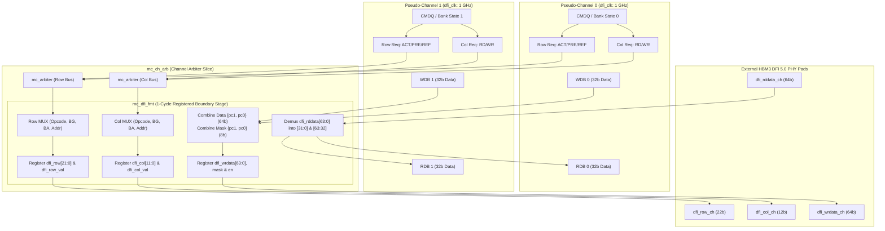
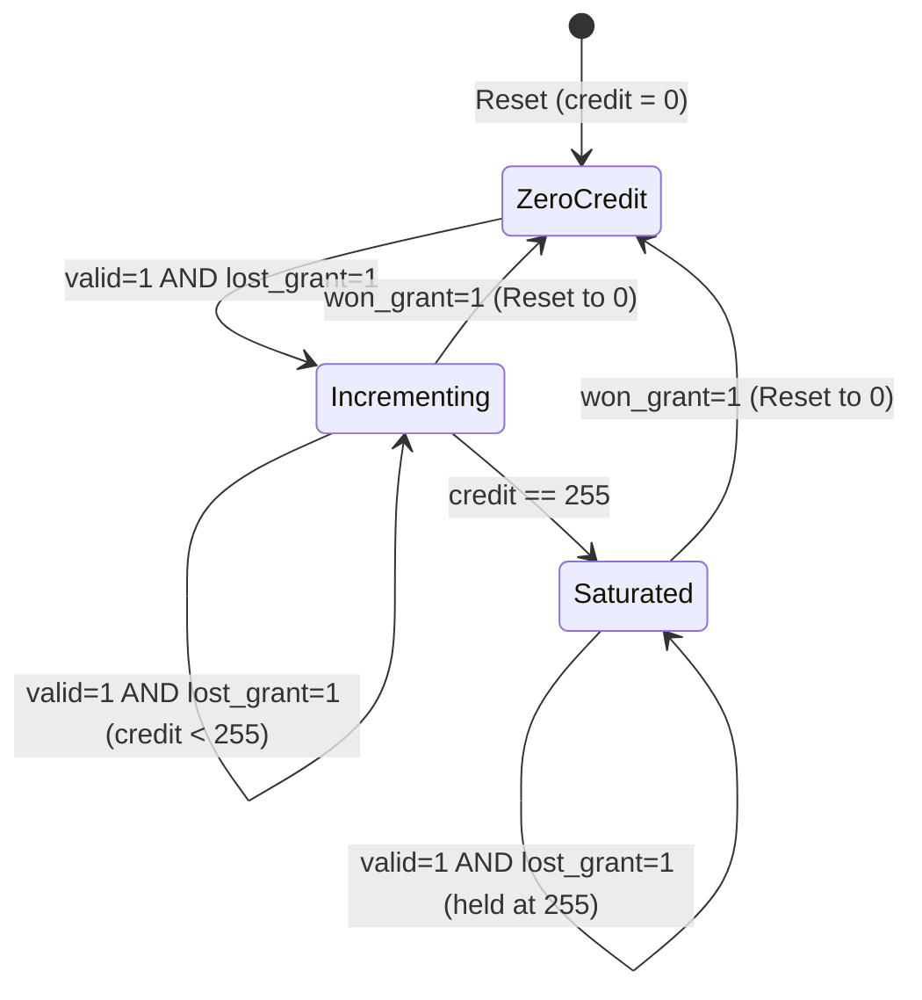

# MC16X2 Channel Arbiter & DFI Formatter Deep Dive
## Root-Level Microarchitecture & RTL Code Guide (Phase P2 & P4)

---

## 1. Executive Summary & Root-Level Problem Statement

In the **MC16X2 Memory Controller IP**, each of the 16 physical HBM3 channels must interface with **High-Bandwidth Memory (HBM3, JEDEC JESD238)** via a **DFI 5.0 PHY**. 

However, HBM3 channels are divided into **two independent Pseudo-Channels (PC0 and PC1)**:
* **The Problem**: PC0 and PC1 each have their own independent command queue (`CMDQ`), write data buffer (`WDB`), read data buffer (`RDB`), bank state table (16 banks), and timing down-counters. They operate as **two completely autonomous brains**. But physically, the HBM3 channel PHY provides:
  * Only **ONE shared Row Command Bus** (`dfi_row`, 22 bits).
  * Only **ONE shared Column Command Bus** (`dfi_col`, 12 bits).
  * A single **64-bit Write/Read Data Bus** (`dfi_wrdata` / `dfi_rddata`, where lower 32 bits belong to PC0 and upper 32 bits belong to PC1).
* **The Solution**: 
  1. **The Channel Arbiter ([`mc_ch_arb.sv`](file:///home/dell/MC16/mc_ch_arb.sv))**: Resolves the cycle-by-cycle contention between PC0 and PC1 for the shared row and column command buses using a **credit-counter starvation avoidance algorithm** with **emergency refresh preemption**.
  2. **The DFI Formatter ([`mc_dfi_fmt.sv`](file:///home/dell/MC16/mc_dfi_fmt.sv))**: Sits at the physical egress boundary as a **1-cycle registered flip-flop stage**, packing internal arbitrated signals into standard DFI 5.0 protocol frames, isolating 1 GHz core timing from the PHY pads, managing 8-bit write masks, and demultiplexing read returns.



---

## 2. The Credit-Based Starvation Avoidance Arbiter (`mc_arbiter.sv`)

### 2.1 Why Simple Arbitration Fails
* **Strict Priority**: If PC0 always had priority over PC1, a continuous stream of requests targeting PC0 would completely starve PC1 from accessing the DRAM for thousands of cycles.
* **Pure Round-Robin**: Standard round-robin works well only if requests arrive synchronously. If one PC issues sparse requests while the other issues back-to-back bursts, traditional round-robin state machines can cause unnecessary 1-cycle latency bubbles.
* **The Spec Solution (Section 5.2 & 5.6)**: A **credit-counter starvation avoidance arbiter** that tracks accumulated wait cycles with an **8-bit saturating credit counter** (`CREDIT_MAX = 255`), combined with an **unconditional refresh override**.

---

### 2.2 Mathematical Mechanics of the Credit Counter

Inside [`mc_arbiter.sv`](file:///home/dell/MC16/mc_arbiter.sv):

1. **Parameters & State Registers**:
   * `parameter int CREDIT_CTR_WIDTH = 8`
   * `CREDIT_MAX = 8'hFF` ($255$)
   * `credit_pc0`: 8-bit saturating counter tracking PC0's wait penalty.
   * `credit_pc1`: 8-bit saturating counter tracking PC1's wait penalty.

2. **Counter Reset & Accumulation Rules (`always_ff` block)**:
   * **When Reset (`!reset_n`)**: Both counters clear to `0`.
   * **When Granted (`grant[i] == 1`)**: Candidate $i$'s credit counter **resets to 0 immediately**:
     $$\text{credit}_i \longleftarrow 0$$
   * **When Denied Under Contention (`candidate_valid[i] == 1` but `grant[winner] == 1`)**:
     Candidate $i$ had a valid request, but lost. Its credit counter increments by 1, saturating at 255:
     $$\text{credit}_i \longleftarrow \min(\text{credit}_i + 1, \text{CREDIT\_MAX})$$
   * **When Idle (`candidate_valid[i] == 0`)**: The counter holds its previous value without incrementing.



---

### 2.3 Grant Decision Logic (`always_comb` block)

Every clock cycle at 1 GHz, the arbiter evaluates the candidates in pure combinational logic:

```systemverilog
always_comb begin
    grant = 2'b00;

    case (candidate_valid)
        2'b01: grant = 2'b01;  // Only PC0 is requesting -> Instant grant to PC0
        2'b10: grant = 2'b10;  // Only PC1 is requesting -> Instant grant to PC1
        2'b11: begin           // Contention! Both PC0 and PC1 are requesting
            // Rule 1: Emergency Refresh Preemption
            if (refresh_pending[0] || refresh_pending[1]) begin
                if (refresh_pending[0])
                    grant = 2'b01;
                else
                    grant = 2'b10;
            // Rule 2: Credit Comparison
            end else if (credit_pc1 > credit_pc0) begin
                grant = 2'b10;  // PC1 has waited longer -> PC1 wins
            end else begin
                grant = 2'b01;  // PC0 has equal or greater credits -> PC0 wins
            end
        end
        default: grant = 2'b00;
    endcase
end
```

#### The Tie-Breaking Elegance
Notice line 30: `end else begin grant = 2'b01;`.
* When both candidates start at `credit_pc0 == 0` and `credit_pc1 == 0`, **PC0 wins by default**.
* But look at what happens on that exact cycle:
  * PC0 won: `credit_pc0 <= 0`.
  * PC1 lost: `credit_pc1 <= 0 + 1 = 1`.
* On the very next cycle (if both still request):
  * `credit_pc1 (1) > credit_pc0 (0)` is **TRUE**!
  * **PC1 wins!**
  * PC1's credit resets to 0, PC0's credit increments to 1.
* **Result**: Under continuous heavy traffic, the credit system naturally produces **flawless, ping-pong round-robin alternation (`PC0 -> PC1 -> PC0 -> PC1`)** with zero wasted cycles!
* **Starvation Upper Bound**: A candidate can never be denied more than **255 consecutive cycles**.

---

### 2.4 Emergency Refresh Preemption

DRAM cells are tiny capacitors that leak charge. If a bank is not refreshed within the JEDEC $t_{\text{REFI}}$ deadline (3.9 µs), data will be irreversibly lost.

Therefore, the arbiter includes an **unconditional override**:
* If `refresh_pending` is asserted by either PC:
  * The arbiter **completely ignores credit counters**.
  * The refresh request is granted immediately.
  * If both PCs assert refresh at the same exact cycle, PC0 is granted first, followed immediately by PC1.

---

## 3. The Channel Arbiter Architecture (`mc_ch_arb.sv`)

### 3.1 Two Orthogonal Arbiters (Row vs. Column)

In HBM3, the Row Command Bus and Column Command Bus are **physically separate and independent**:
* **Row Commands**: `ACT` (Activate row), `PRE` (Precharge bank), `PREALL`, `REF` (Refresh).
* **Column Commands**: `RD` (Read burst), `WR` (Write burst).

Because they are physically separate, [`mc_ch_arb.sv`](file:///home/dell/MC16/mc_ch_arb.sv#L71-L85) instantiates **TWO separate `mc_arbiter` instances**:

```systemverilog
// 1. Independent Row Bus Arbiter
mc_arbiter row_bus_arbiter (
    .clk              (dfi_clk),
    .reset_n          (dfi_reset_n),
    .candidate_valid  ({row_valid_pc1, row_valid_pc0}),
    .refresh_pending  ({row_refresh_pc1, row_refresh_pc0}),
    .grant            (row_grant)
);

// 2. Independent Column Bus Arbiter
mc_arbiter col_bus_arbiter (
    .clk              (dfi_clk),
    .reset_n          (dfi_reset_n),
    .candidate_valid  ({col_valid_pc1, col_valid_pc0}),
    .refresh_pending  (2'b00), // Refresh never targets column bus
    .grant            (col_grant)
);
```

#### Why Orthogonal Arbitration Maximizes Bandwidth
Because the arbiters are separate:
* **Cycle N**: PC0 can win the Row Bus (issuing an `ACT` to open Bank 2), while PC1 simultaneously wins the Column Bus (issuing a `RD` to Bank 0)!
* This allows **100% concurrent dual-issue capability per channel**, achieving theoretical maximum HBM3 bus utilization.

---

### 3.2 Combinational Multiplexing Logic

Once `row_grant` and `col_grant` are determined by the arbiters, [`mc_ch_arb.sv`](file:///home/dell/MC16/mc_ch_arb.sv#L87-L121) steers the winning PC's address and opcode onto internal shared buses:

```systemverilog
always_comb begin
    selected_row_cmd     = '0;
    selected_row_bg      = '0;
    selected_row_ba      = '0;
    selected_row_addr    = '0;

    if (row_grant[0]) begin
        selected_row_cmd  = row_cmd_pc0;
        selected_row_bg   = row_bg_pc0;
        selected_row_ba   = row_ba_pc0;
        selected_row_addr = row_addr_pc0;
    end else if (row_grant[1]) begin
        selected_row_cmd  = row_cmd_pc1;
        selected_row_bg   = row_bg_pc1;
        selected_row_ba   = row_ba_pc1;
        selected_row_addr = row_addr_pc1;
    end

    selected_col_cmd     = '0;
    selected_col_bg      = '0;
    selected_col_ba      = '0;
    selected_col_addr    = '0;

    if (col_grant[0]) begin
        selected_col_cmd  = col_cmd_pc0;
        selected_col_bg   = col_bg_pc0;
        selected_col_ba   = col_ba_pc0;
        selected_col_addr = col_addr_pc0;
    end else if (col_grant[1]) begin
        selected_col_cmd  = col_cmd_pc1;
        selected_col_bg   = col_bg_pc1;
        selected_col_ba   = col_ba_pc1;
        selected_col_addr = col_addr_pc1;
    end
end
```

---

### 3.3 Data Path Bundling & Split Read Returns

While command buses are shared and multiplexed, **the data path is split**:
* **Write Path Bundling (Controller $\to$ PHY)**:
  * PC0 drives lower 32 bits: `wrdata_pc0[31:0]`.
  * PC1 drives upper 32 bits: `wrdata_pc1[31:0]`.
  * [`mc_ch_arb.sv`](file:///home/dell/MC16/mc_ch_arb.sv#L123-L126) bundles them together:
    ```systemverilog
    assign combined_wrdata      = {wrdata_pc1, wrdata_pc0};         // 64 bits
    assign combined_wrdata_mask = {wrdata_mask_pc1, wrdata_mask_pc0}; // 8 bits
    assign combined_wrdata_en   = {wrdata_en_pc1, wrdata_en_pc0};     // 2 bits
    assign combined_rddata_en   = {rddata_en_pc1, rddata_en_pc0};     // 2 bits
    ```
* **Read Path Demuxing (PHY $\to$ Controller)**:
  * When the PHY returns 64-bit read data (`dfi_rddata[63:0]`), [`mc_dfi_fmt`](file:///home/dell/MC16/mc_dfi_fmt.sv#L63-L64) splits it:
    * `rddata_pc0 = dfi_rddata[31:0]` $\longrightarrow$ returned directly to PC0's RDB.
    * `rddata_pc1 = dfi_rddata[63:32]` $\longrightarrow$ returned directly to PC1's RDB.

---

## 4. The DFI Formatter Architecture (`mc_dfi_fmt.sv`)

### 4.1 The 1 GHz Timing Closure Problem

At an undivided **1 GHz clock (`dfi_clk` = 1.0 ns period)**, signal propagation delay across silicon leaves virtually zero margin:
* Internal scheduler logic (CMDQ, 16-bank state checks, down-counter decrements, credit-counter comparisons, multiplexing) takes approximately **5 to 6 logic levels**.
* If the multiplexed command were driven directly to external PHY pads without a register, the internal logic delays would add to pad driver delays, violating setup time ($t_{\text{setup}}$) to the PHY.
* **The Role of `mc_dfi_fmt`**: Acts as a **1-cycle registered boundary isolation stage**. Every single signal entering or exiting the PHY is flopped.
  * **Cycle $N$**: Core schedulers and `mc_ch_arb` arbitrate and multiplex.
  * **Cycle $N+1$**: `mc_dfi_fmt` launches clean, registered edges directly into the PHY pads with zero gate delay and zero glitching.

---

### 4.2 DFI 5.0 Bus Bit-Packing Specifications

[`mc_dfi_fmt.sv`](file:///home/dell/MC16/mc_dfi_fmt.sv#L54-L67) packs internal signals into the exact bit order specified by Section 3.3.2a of the microarchitecture spec:

#### 1. Row Command Bus (`dfi_row[21:0]`) — 22 Bits
$$\mathbf{dfi\_row[21:0]} = \{\mathbf{row\_pc\_sel},\ \mathbf{row\_cmd}[2:0],\ \mathbf{row\_bg}[1:0],\ \mathbf{row\_ba}[1:0],\ \mathbf{row\_addr}[13:0]\}$$

```
Bits:     [21]       [20:18]       [17:16]      [15:14]            [13:0]
      ┌──────────┬──────────────┬────────────┬───────────┬────────────────────────┐
Field:│row_pc_sel│   row_cmd    │   row_bg   │  row_ba   │        row_addr        │
      │ (1 bit)  │   (3 bits)   │  (2 bits)  │ (2 bits)  │       (14 bits)        │
      └──────────┴──────────────┴────────────┴───────────┴────────────────────────┘
```
* **`[21]` `row_pc_sel`**: Target Pseudo-Channel (`0` = PC0, `1` = PC1). Driven by `row_grant[1]`.
* **`[20:18]` `row_cmd`**: 3-bit command opcode:
  * `3'b001` = `ACT` (Activate / Open Row)
  * `3'b010` = `PRE` (Precharge single bank)
  * `3'b011` = `PREALL` (Precharge all banks)
  * `3'b100` = `REF` (All-bank refresh)
  * `3'b101` = `MRW` (Mode register write)
* **`[17:16]` `row_bg`**: Bank Group address ($0$ to $3$).
* **`[15:14]` `row_ba`**: Bank address within group ($0$ to $3$).
* **`[13:0]` `row_addr`**: 14-bit DRAM Row address ($0$ to $16,383$).

#### 2. Column Command Bus (`dfi_col[11:0]`) — 12 Bits
$$\mathbf{dfi\_col[11:0]} = \{\mathbf{col\_pc\_sel},\ \mathbf{col\_cmd}[1:0],\ \mathbf{col\_bg}[1:0],\ \mathbf{col\_ba}[1:0],\ \mathbf{col\_addr}[4:0]\}$$

```
Bits:     [11]       [10:9]        [8:7]        [6:5]             [4:0]
      ┌──────────┬──────────────┬────────────┬───────────┬────────────────────────┐
Field:│col_pc_sel│   col_cmd    │   col_bg   │  col_ba   │        col_addr        │
      │ (1 bit)  │   (2 bits)   │  (2 bits)  │ (2 bits)  │        (5 bits)        │
      └──────────┴──────────────┴────────────┴───────────┴────────────────────────┘
```
* **`[11]` `col_pc_sel`**: Target Pseudo-Channel (`0` = PC0, `1` = PC1). Driven by `col_grant[1]`.
* **`[10:9]` `col_cmd`**: 2-bit column opcode:
  * `2'b01` = `RD` (Read burst)
  * `2'b10` = `WR` (Write burst)
* **`[8:7]` `col_bg`**: Bank Group address ($0$ to $3$).
* **`[6:5]` `col_ba`**: Bank address within group ($0$ to $3$).
* **`[4:0]` `col_addr`**: 5-bit Column beat address ($0$ to $31$, selecting one 32-byte chunk).

---

### 4.3 Deep Dive: The Write Mask (`dfi_wrdata_mask[7:0]`)

In DRAM, write operations operate on physical 32-bit (4-byte) or 64-bit (8-byte) words. If a software thread writes a single byte or a 16-bit halfword, overwriting the entire 64-bit word would corrupt neighboring variables.

`dfi_wrdata_mask[7:0]` acts as **hardware painter's tape**:
* Each bit directly controls write permission for **1 byte (8 bits)** of the 64-bit data bus:

| Mask Bit | Governs Data Slice | Governed Byte | Pseudo-Channel Owner |
| :---: | :---: | :---: | :---: |
| `dfi_wrdata_mask[0]` | `dfi_wrdata[7:0]` | Byte 0 | **PC0** |
| `dfi_wrdata_mask[1]` | `dfi_wrdata[15:8]` | Byte 1 | **PC0** |
| `dfi_wrdata_mask[2]` | `dfi_wrdata[23:16]` | Byte 2 | **PC0** |
| `dfi_wrdata_mask[3]` | `dfi_wrdata[31:24]` | Byte 3 | **PC0** |
| `dfi_wrdata_mask[4]` | `dfi_wrdata[39:32]` | Byte 4 | **PC1** |
| `dfi_wrdata_mask[5]` | `dfi_wrdata[47:40]` | Byte 5 | **PC1** |
| `dfi_wrdata_mask[6]` | `dfi_wrdata[55:48]` | Byte 6 | **PC1** |
| `dfi_wrdata_mask[7]` | `dfi_wrdata[63:56]` | Byte 7 | **PC1** |

* If `mask bit == 1`: DRAM sense amplifiers write the new byte into the cell capacitors.
* If `mask bit == 0`: DRAM sense amplifiers **leave the existing byte untouched**.
* This eliminates the need for expensive **Read-Modify-Write (RMW)** cycles, preserving memory bandwidth.

---

### 4.4 PHY Latency Handshakes (`tphy_wrlat` & `tphy_rdlat`)

In DFI 5.0, data is not driven in the same cycle as the command:
1. **Write Data Latency (`tphy_wrlat`)**:
   * When a `WR` column command is dispatched on cycle $T$, the write data cannot arrive at the DRAM pins immediately.
   * Upstream core logic delays write data assertions by exactly `tphy_wrlat` cycles.
   * At cycle $T + \text{tphy\_wrlat}$, `dfi_wrdata_en` asserts high, signaling to the PHY that valid write data and byte masks are present on `dfi_wrdata` and `dfi_wrdata_mask`.
2. **Read Data Latency (`tphy_rdlat`)**:
   * When a `RD` command is dispatched on cycle $T$, the controller asserts `dfi_rddata_en` at cycle $T + \text{tphy\_rdlat}$ to tell the PHY to expect returning data.
   * Several cycles later, the PHY drives `dfi_rddata_valid[1:0]` high along with the 64-bit `dfi_rddata`.
   * [`mc_dfi_fmt`](file:///home/dell/MC16/mc_dfi_fmt.sv) captures this on a rising clock edge and immediately demuxes it to `rddata_pc0` and `rddata_pc1`.

---

## 5. Walkthrough of the RTL Code in the Repository

### 5.1 Code Structure of `mc_arbiter.sv`
Lines 16–53 of [`mc_arbiter.sv`](file:///home/dell/MC16/mc_arbiter.sv):
* **Lines 16–36 (`always_comb`)**: Evaluates `candidate_valid`. If `2'b11`, first checks `refresh_pending`. If no refresh, compares `credit_pc1 > credit_pc0`. Decides `grant` in $< 0.4\text{ ns}$ of combinational delay.
* **Lines 38–53 (`always_ff`)**: Sequential credit tracking. Checks `grant[0]` and `grant[1]`. The winner's counter clears to `0`; the loser's counter increments by `+1` unless already equal to `CREDIT_MAX`.

### 5.2 Code Structure of `mc_ch_arb.sv`
Lines 71–164 of [`mc_ch_arb.sv`](file:///home/dell/MC16/mc_ch_arb.sv):
* **Lines 71–85**: Instantiates `row_bus_arbiter` and `col_bus_arbiter`.
* **Lines 87–121 (`always_comb`)**: Evaluates `row_grant` and `col_grant` to drive `selected_row_*` and `selected_col_*`.
* **Lines 123–126**: Bit-concatenates write data (`{wrdata_pc1, wrdata_pc0}`) and byte masks (`{wrdata_mask_pc1, wrdata_mask_pc0}`).
* **Lines 128–164**: Instantiates `mc_dfi_fmt dfi_formatter`, connecting arbitrated winners to DFI packing logic.

### 5.3 Code Structure of `mc_dfi_fmt.sv`
Lines 40–68 of [`mc_dfi_fmt.sv`](file:///home/dell/MC16/mc_dfi_fmt.sv):
* **Lines 41–53**: Active-low asynchronous reset (`!dfi_reset_n`) clearing all DFI output valids and data buses to 0.
* **Lines 54–67**: Synchronous register stage packing:
  * `dfi_row_val <= row_valid;`
  * `dfi_row <= {row_pc_sel, row_cmd, row_bg, row_ba, row_addr};`
  * `dfi_col_val <= col_valid;`
  * `dfi_col <= {col_pc_sel, col_cmd, col_bg, col_ba, col_addr};`
  * `dfi_wrdata <= wrdata;`
  * `dfi_wrdata_mask <= wrdata_mask;`
  * `dfi_wrdata_en <= wrdata_en;`
  * `rddata_pc0 <= dfi_rddata[31:0];`
  * `rddata_pc1 <= dfi_rddata[63:32];`
  * `dfi_rddata_en <= rddata_en;`
  * `rddata_valid <= dfi_rddata_valid;`

---

## 6. Verification & Testbench Scenarios

The workspace includes two dedicated unit testbenches verifying these blocks:

### 6.1 `tb_mc_ch_arb.sv` Test Scenarios
In [`tb_mc_ch_arb.sv`](file:///home/dell/MC16/tb_mc_ch_arb.sv):
1. **Reset Verification (Lines 98–104)**: Asserts reset, verifies all DFI valids and enables clear to `0`.
2. **Single Candidate Priority (Lines 110–125)**: Asserts only PC0, verifies `row_grant = 2'b01`. Asserts only PC1, verifies `row_grant = 2'b10`.
3. **Credit Buildup & Alternation Under Contention (Lines 130–160)**:
   * Asserts both PC0 and PC1 valid continuously.
   * Verifies that PC0 wins first (due to tie-break).
   * Verifies that PC1 wins on cycle 2 (due to `credit_pc1 (1) > credit_pc0 (0)`).
   * Verifies that the arbiter continues to alternate strictly `PC0 -> PC1 -> PC0 -> PC1`.
4. **Emergency Refresh Override (Lines 165–185)**:
   * Generates a state where PC1 has higher credits (`credit_pc1 > credit_pc0`).
   * Asserts `row_refresh_pc0 = 1`.
   * Verifies that PC0 **preempts** PC1 immediately despite having lower credits, proving the safety override works.
5. **Concurrent Orthogonal Issue (Lines 190–205)**:
   * Asserts `row_valid_pc0 = 1` and `col_valid_pc1 = 1`.
   * Verifies that `row_grant = 2'b01` AND `col_grant = 2'b10` simultaneously in the exact same clock cycle.

### 6.2 `tb_dfi_formatter.sv` Test Scenarios
In [`tb_dfi_formatter.sv`](file:///home/dell/MC16/tb_dfi_formatter.sv):
1. **Bit Packing Exactness (Lines 93–97)**: Drives known patterns (`row_addr = 14'h2A5B`, `col_addr = 5'b10110`, etc.) and performs bitwise comparison to ensure no bit shifts or misalignments occur.
2. **Data Path & Byte Mask Integrity (Lines 98–101)**: Drives `64'h0123_4567_89AB_CDEF` and `wrdata_mask = 8'hA5`, verifying that data and byte masks pass through uncorrupted.
3. **Read Demuxing (Lines 102–115)**: Drives `64'hFEDC_BA98_7654_3210` on `dfi_rddata`, verifying that `rddata_pc0 == 32'h7654_3210` and `rddata_pc1 == 32'hFEDC_BA98`.

---

## 7. Summary & Architectural Takeaways

| Feature | Channel Arbiter ([`mc_ch_arb`](file:///home/dell/MC16/mc_ch_arb.sv)) | DFI Formatter ([`mc_dfi_fmt`](file:///home/dell/MC16/mc_dfi_fmt.sv)) |
| :--- | :--- | :--- |
| **Pipeline Role** | Decision & multiplexing slice | Registered physical PHY interface |
| **Clock Domain** | `dfi_clk` (1 GHz, 1.0 ns period) | `dfi_clk` (1 GHz, 1.0 ns period) |
| **Starvation Avoidance** | 8-bit saturating credit counter (Max 255 cycles) | N/A (Pure pipeline flop) |
| **Refresh Handling** | Preemptive top-priority override | Passes through `REF` opcode in `dfi_row` |
| **Concurrency** | Independent row and column arbiters (dual-issue) | Concurrent 22b row + 12b col output registers |
| **Data Width** | Combines two 32-bit PC lanes into 64 bits | Flops 64b write data & 8b byte mask to PHY |
| **Read Return** | Directs demuxed 32b buses back to PC0 & PC1 RDBs | Slices 64b `dfi_rddata` into `[31:0]` and `[63:32]` |
