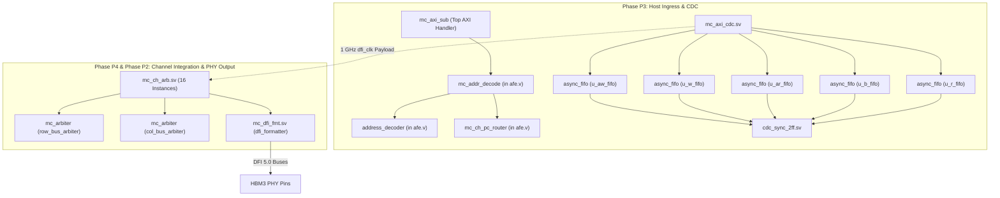

# MC16X2 Memory Controller IP
# Codebase Guide: Verilog Design Architecture & Module Reference

---

## 1. Repository Inventory & Overview

This guide documents all SystemVerilog/Verilog design and verification files available in the `/home/dell/MC16` repository for the **MC16X2 Memory Controller IP** (HBM3 / DFI 5.0).

### 1.1 Complete File Inventory

| File Name | Type | Phase | Primary Modules Defined | Modules Instantiated | Description |
| :--- | :---: | :---: | :--- | :--- | :--- |
| **[`afe.v`](file:///home/dell/MC16/afe.v)** | Design | P3 | `address_decoder` `mc_ch_pc_router` `mc_addr_decode` | `address_decoder` `mc_ch_pc_router` | Fixed 40-bit address decoder and transaction router. |
| **[`cdc_sync_2ff.sv`](file:///home/dell/MC16/cdc_sync_2ff.sv)** | Design | P3 | `cdc_sync_2ff` | None (Primitive) | Parameterized 2-FF Gray pointer synchronizer. |
| **[`async_fifo.sv`](file:///home/dell/MC16/async_fifo.sv)** | Design | P3 | `async_fifo` | `cdc_sync_2ff` (×2) | Dual-clock Gray-code FIFO with FWFT & occupancy. |
| **[`mc_axi_cdc.sv`](file:///home/dell/MC16/mc_axi_cdc.sv)** | Design | P3 | `mc_axi_cdc` | `async_fifo` (×5) | AXI4-to-Core CDC bridge (500 MHz ↔ 1 GHz). |
| **[`mc_arbiter.sv`](file:///home/dell/MC16/mc_arbiter.sv)** | Design | P1 / P4 | `mc_arbiter` | None (Core Logic) | 2-candidate credit-counter arbiter with refresh override. |
| **[`mc_ch_arb.sv`](file:///home/dell/MC16/mc_ch_arb.sv)** | Design | P4 | `mc_ch_arb` | `mc_arbiter` (×2) `mc_dfi_fmt` (×1) | Channel-level row/col bus arbiter & 64b data combiner. |
| **[`mc_dfi_fmt.sv`](file:///home/dell/MC16/mc_dfi_fmt.sv)** | Design | P2 | `mc_dfi_fmt` | None (Flop Stage) | Registered 1-cycle DFI 5.0 boundary formatter. |
| **[`tb_mc_axi_cdc.sv`](file:///home/dell/MC16/tb_mc_axi_cdc.sv)** | Testbench | P3 | `tb_mc_axi_cdc` | `mc_axi_cdc` | Testbench for 5 async FIFOs across 500 MHz / 1 GHz. |
| **[`tb_mc_ch_arb.sv`](file:///home/dell/MC16/tb_mc_ch_arb.sv)** | Testbench | P4 | `tb_mc_ch_arb` | `mc_ch_arb` | Testbench for dual-bus arbitration & credit saturation. |
| **[`tb_dfi_formatter.sv`](file:///home/dell/MC16/tb_dfi_formatter.sv)** | Testbench | P2 | `tb_dfi_formatter` | `mc_dfi_fmt` | Testbench for DFI pin vector packing & lane routing. |

---

## 2. Module Instantiation & Hierarchy Tree

The following diagram illustrates the exact parent-child instantiation relationships among the Verilog design files:

---

## 3. Detailed File-by-File Design Reference

---

### 3.1 [`afe.v`](file:///home/dell/MC16/afe.v) — AXI Front-End Address Decoder & Router

* **Roadmap Phase**: Phase P3 (AXI Front End)
* **Spec Reference**: Section 3.1.4 (Address Decode → CH/PC Mapping)

#### Modules Defined in File:
1. `address_decoder`: Purely combinational bit-slicer extracting HBM3 geometric fields from a 40-bit host address.
2. `mc_ch_pc_router`: Demultiplexes valid and muxes ready backpressure across 16 Channels × 2 Pseudo-Channels (32 destinations).
3. `mc_addr_decode`: Top-level wrapper integrating `address_decoder` and `mc_ch_pc_router`.

#### Sub-Modules Instantiated:
* `address_decoder` (instantiated as `u_decoder` inside `mc_addr_decode`).
* `mc_ch_pc_router` (instantiated as `u_router` inside `mc_addr_decode`).

#### Port List & Parameters (`mc_addr_decode`):
| Port Name | Direction | Width | Description |
| :--- | :---: | :---: | :--- |
| `in_valid` | Input | 1 | Incoming AXI request valid |
| `in_ready` | Output | 1 | Backpressure ready back to AXI master |
| `in_addr` | Input | 40 | 40-bit AXI address (`awaddr` or `araddr`) |
| `ch_sel` | Output | 4 | Decoded Channel select (`addr[32:29]`, Channels 0–15) |
| `pc_sel` | Output | 1 | Decoded Pseudo-Channel select (`addr[28]`, 0=PC0, 1=PC1) |
| `row` | Output | 14 | Decoded Row address (`addr[27:14]`) |
| `bg` | Output | 2 | Decoded Bank Group (`addr[13:12]`) |
| `ba` | Output | 2 | Decoded Bank Address (`addr[11:10]`) |
| `col` | Output | 5 | Decoded Column address (`addr[9:5]`) |
| `byte_offset` | Output | 5 | Beat offset within 32-byte beat (`addr[4:0]`) |
| `out_valid` | Output | [0:15][0:1] | 2D valid flag routed to target [CH][PC] |
| `out_ready` | Input | [0:15][0:1] | 2D ready flag from target [CH][PC] |

#### Detailed Use Cases:
* **Zero-Lookup Routing**: Decodes flat host physical addresses directly into memory channels without configurable registers or hashing tables.
* **Point-to-Point Backpressure**: If Channel 3, PC1 is backpressured (CMDQ full), only requests targeting `[3][1]` receive `in_ready = 0`; other channels continue running unhindered.

---

### 3.2 [`cdc_sync_2ff.sv`](file:///home/dell/MC16/cdc_sync_2ff.sv) — 2-Flip-Flop CDC Synchronizer

* **Roadmap Phase**: Phase P3 (CDC Infrastructure)
* **Spec Reference**: Section 6.2.3 (CDC Design Rules, `CDC_SYNC_STAGES = 2`)

#### Modules Defined:
* `cdc_sync_2ff`: Parameterized multi-bit register chain for synchronizing signals crossing asynchronous clock domains.

#### Sub-Modules Instantiated:
* None (primitive sequential registers).

#### Parameters & Ports:
* `parameter int WIDTH = 1`: Bus width of synchronized signal.
* `parameter int STAGES = 2`: Number of synchronization flop stages.
* Inputs: `clk`, `rst_n`, `din[WIDTH-1:0]`.
* Output: `dout[WIDTH-1:0]`.

#### Detailed Use Cases:
* **Gray-Code Pointer Synchronization**: Synchronizes write pointers into read clock domain, and read pointers into write clock domain inside `async_fifo`.
* **Lint & Synthesis Tags**: Annotated with `// CDC_MODULE` and `(* ASYNC_REG = "TRUE" *)` for tools like SpyGlass CDC and Vivado.

---

### 3.3 [`async_fifo.sv`](file:///home/dell/MC16/async_fifo.sv) — Dual-Clock Parameterized FIFO

* **Roadmap Phase**: Phase P3 (CDC Infrastructure)
* **Spec Reference**: Section 6.2.2 & 6.2.3 (Gray-Code Asynchronous FIFO)

#### Modules Defined:
* `async_fifo`: Dual-clock asynchronous FIFO with Gray-code pointers, First-Word Fall-Through (FWFT) ready/valid handshaking, and occupancy reporting.

#### Sub-Modules Instantiated:
* `cdc_sync_2ff` (instantiated as `u_sync_rptr_to_wclk` to bring `rptr_gray` into `wclk`).
* `cdc_sync_2ff` (instantiated as `u_sync_wptr_to_rclk` to bring `wptr_gray` into `rclk`).

#### Parameters & Ports:
* `parameter int DATA_WIDTH = 32`: Payload width.
* `parameter int DEPTH = 16`: Depth (must be power of 2).
* `parameter int SYNC_STAGES = 2`: Synchronizer stages.
* **Write Domain (`wclk`, `wrst_n`)**:
  * `wvalid`, `wready`, `wdata[DATA_WIDTH-1:0]`, `wfull`, `wcount[$clog2(DEPTH):0]`.
* **Read Domain (`rclk`, `rrst_n`)**:
  * `rready`, `rvalid`, `rdata[DATA_WIDTH-1:0]`, `rempty`, `rcount[$clog2(DEPTH):0]`.

#### Detailed Use Cases:
* **FWFT Handshake**: Data is combinational at the read output whenever `!rempty`. Reading occurs immediately upon `rready && rvalid` without an extra latency cycle.
* **Binary-Gray CDC Safety**: Pointers use Gray code to guarantee that at most 1 bit changes per clock cycle, preventing multi-bit CDC glitches.
* **Real-time Occupancy**: Converts synchronized Gray pointers back to binary (`gray2bin`) to calculate `wcount` (in write clock) and `rcount` (in read clock) for CSR status.

---

### 3.4 [`mc_axi_cdc.sv`](file:///home/dell/MC16/mc_axi_cdc.sv) — 5-Channel AXI CDC Bridge

* **Roadmap Phase**: Phase P3 (AXI Front End & CDC)
* **Spec Reference**: Section 6.2.1 & 6.2.2 (The 5 Fixed Asynchronous FIFOs)

#### Modules Defined:
* `mc_axi_cdc`: Instantiates all 5 FIFOs bridging `aclk` (500 MHz) and `dfi_clk` (1 GHz).

#### Sub-Modules Instantiated:
1. `async_fifo #(72, 8, 2) u_aw_fifo`: AXI Write Address (`aclk` → `dfi_clk`).
2. `async_fifo #(289, 16, 2) u_w_fifo`: AXI Write Data (`aclk` → `dfi_clk`, RAM-based).
3. `async_fifo #(72, 8, 2) u_ar_fifo`: AXI Read Address (`aclk` → `dfi_clk`).
4. `async_fifo #(10, 8, 2) u_b_fifo`: AXI Write Response (`dfi_clk` → `aclk`, posted `bresp`).
5. `async_fifo #(267, 16, 2) u_r_fifo`: AXI Read Data (`dfi_clk` → `aclk`, RAM-based).

#### Detailed Use Cases:
* **Clock Isolation**: Isolates the variable/asynchronous SoC interconnect (`aclk`) from the controller core and DFI interface (`dfi_clk`).
* **Zero Core CDC**: Guarantees that downstream scheduling, channel arbiters, and DFI formatters operate purely in a synchronous 1 GHz clock domain.
* **FIFO Occupancy Export**: Exposes `aw_fifo_occupancy`, `w_fifo_occupancy`, `ar_fifo_occupancy`, `b_fifo_occupancy`, and `r_fifo_occupancy` for CSR monitoring.

---

### 3.5 [`mc_arbiter.sv`](file:///home/dell/MC16/mc_arbiter.sv) — Credit-Counter Arbiter Core

* **Roadmap Phase**: Phase P1 (Scheduler) & Phase P4 (Channel Arbiter)
* **Spec Reference**: Section 5.2 (Arbitration Policy — Credit-Counter Starvation Avoidance)

#### Modules Defined:
* `mc_arbiter`: 2-candidate arbiter implementing starvation avoidance via saturating wait counters and top-priority refresh bypass.

#### Sub-Modules Instantiated:
* None (pure combinational muxing + sequential credit counters).

#### Parameters & Ports:
* `parameter int CREDIT_CTR_WIDTH = 8`: Wait counter bit width (saturates at 255).
* Ports: `clk`, `reset_n`, `candidate_valid[1:0]`, `refresh_pending[1:0]`, `grant[1:0]`.

#### Detailed Use Cases:
* **Core Reuse**:
  * Instantiated inside `mc_pc_core` (P1) to select between CMDQ candidates.
  * Instantiated twice inside `mc_ch_arb` (P4) to arbitrate between PC0 and PC1 for row and column buses.
* **Arbitration Rules**:
  1. If either PC has `refresh_pending`, refresh wins immediately.
  2. If both candidates valid and non-refresh: the candidate with the larger credit counter (`credit_pc1 > credit_pc0`) wins.
  3. Equal credit tie-break: grants PC0 (`grant = 2'b01`).
  4. Losing candidate increments credit by `+1` (saturates at 255); winning candidate resets credit to `0`.

---

### 3.6 [`mc_ch_arb.sv`](file:///home/dell/MC16/mc_ch_arb.sv) — Channel-Level Bus Arbiter & Formatter

* **Roadmap Phase**: Phase P4 (Channel Integration)
* **Spec Reference**: Section 5.6 (Channel-Level DFI Row/Column Bus Arbitration)

#### Modules Defined:
* `mc_ch_arb`: Channel integration block coupling PC0 and PC1 to the shared DFI interface.

#### Sub-Modules Instantiated:
1. `mc_arbiter row_bus_arbiter`: Arbitrates row commands (`ACT`, `PRE`, `REF`) between PC0 and PC1.
2. `mc_arbiter col_bus_arbiter`: Arbitrates column commands (`RD`, `WR`) between PC0 and PC1.
3. `mc_dfi_fmt dfi_formatter`: Captures arbitrated commands and drives external DFI pins.

#### Detailed Use Cases:
* **Dual-Bus Simultaneous Issue**: Row and Column command buses are arbitrated independently. PC0 can issue a row command while PC1 issues a column command in the exact same cycle.
* **Non-Blocking Concurrent Data Lanes**: PC0 write/read data (`[31:0]`) and PC1 write/read data (`[63:32]`) flow concurrently through the channel's 64-bit data bus even when command issue is serialized.

---

### 3.7 [`mc_dfi_fmt.sv`](file:///home/dell/MC16/mc_dfi_fmt.sv) — DFI Output Formatter

* **Roadmap Phase**: Phase P2 (DFI Formatter)
* **Spec Reference**: Section 3.3 (DFI Interface — PHY-Facing Master)

#### Modules Defined:
* `mc_dfi_fmt`: 1-cycle registered output boundary stage formatting commands and data onto physical DFI pins.

#### Sub-Modules Instantiated:
* None (output registers and bit concatenations).

#### Detailed Use Cases:
* **DFI Pin Packing**:
  * Packs 22-bit row bus: `dfi_row = {row_pc_sel, row_cmd[2:0], row_bg[1:0], row_ba[1:0], row_addr[13:0]}`.
  * Packs 12-bit col bus: `dfi_col = {col_pc_sel, col_cmd[1:0], col_bg[1:0], col_ba[1:0], col_addr[4:0]}`.
* **Data Lane Multiplexing/Demultiplexing**:
  * Concatenates write data: `dfi_wrdata = {wrdata_pc1, wrdata_pc0}`.
  * Splits returning read data: `rddata_pc0 = dfi_rddata[31:0]`, `rddata_pc1 = dfi_rddata[63:32]`.
* **Timing Isolation**: Registers all outgoing signals to isolate internal scheduler/arbiter combinational paths from external board/PHY setup constraints.

---

## 4. Verification Testbench Reference

### 4.1 [`tb_mc_axi_cdc.sv`](file:///home/dell/MC16/tb_mc_axi_cdc.sv)
* **Target DUT**: [`mc_axi_cdc.sv`](file:///home/dell/MC16/mc_axi_cdc.sv) (incorporating [`async_fifo.sv`](file:///home/dell/MC16/async_fifo.sv) and [`cdc_sync_2ff.sv`](file:///home/dell/MC16/cdc_sync_2ff.sv)).
* **Clocking Environment**:
  * `aclk` = 500 MHz (2000 ps period).
  * `dfi_clk` = 1000 MHz (1000 ps period) with an intentional 350 ps phase skew.
* **Key Verification Scenarios**:
  1. AW metadata transfer and payload preservation across clock boundary.
  2. Multi-beat write data bursts (4 beats) with `wlast` alignment.
  3. B channel posted write response generation and receipt.
  4. AR metadata transfer with burst length and protection attributes.
  5. Multi-beat read data returns from core domain to AXI host.
  6. Backpressure & Full Verification: Fills W FIFO to capacity (16 beats), verifies `s_axi_wready = 0`, drains FIFO, and verifies backpressure deassertion.

### 4.2 [`tb_mc_ch_arb.sv`](file:///home/dell/MC16/tb_mc_ch_arb.sv)
* **Target DUT**: [`mc_ch_arb.sv`](file:///home/dell/MC16/mc_ch_arb.sv) (incorporating [`mc_arbiter.sv`](file:///home/dell/MC16/mc_arbiter.sv) and [`mc_dfi_fmt.sv`](file:///home/dell/MC16/mc_dfi_fmt.sv)).
* **Key Verification Scenarios**:
  1. Simultaneous independent grants: PC0 wins row bus while PC1 wins column bus in the same clock cycle.
  2. Credit-counter alternating fairness under sustained back-to-back contention.
  3. Fixed tie-break priority to PC0 when credits are equal.
  4. Refresh preemption: Pending refresh commands override wait counters.
  5. Credit saturation: Under 260 cycles of sustained refresh preemption, confirms losing PC's wait counter saturates at `8'hFF` (255) without rolling over, and receives immediate grant upon refresh clearance.

### 4.3 [`tb_dfi_formatter.sv`](file:///home/dell/MC16/tb_dfi_formatter.sv)
* **Target DUT**: [`mc_dfi_fmt.sv`](file:///home/dell/MC16/mc_dfi_fmt.sv).
* **Key Verification Scenarios**:
  1. Verifies reset clears all DFI strobes and outputs.
  2. Bit-exact vector checks for `dfi_row[21:0]` and `dfi_col[11:0]`.
  3. Preservation of 64-bit write data, byte masks, and per-PC data enables (`dfi_wrdata_en[1:0]`).
  4. Correct steering of 64-bit `dfi_rddata` into PC0 (`[31:0]`) and PC1 (`[63:32]`) read lanes.
