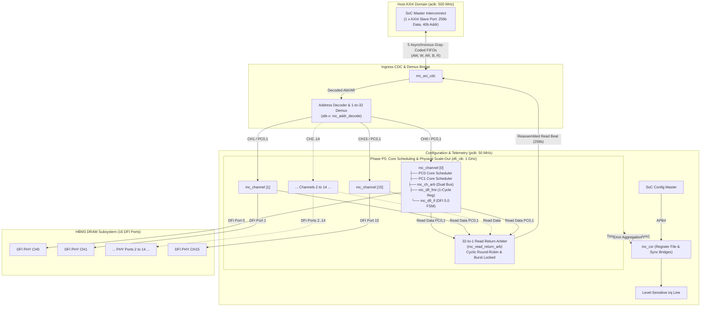
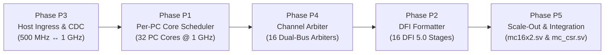
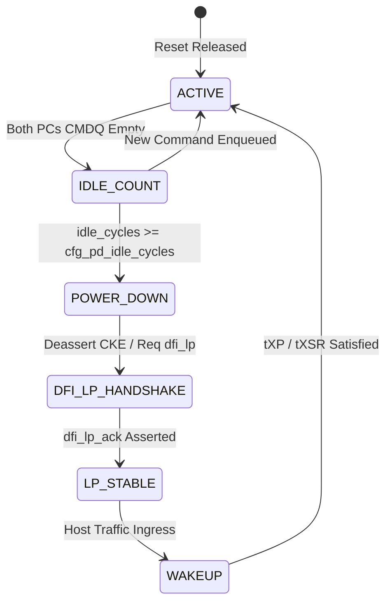
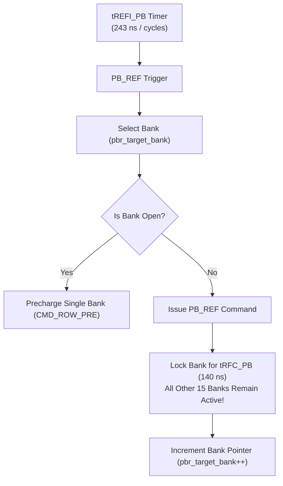
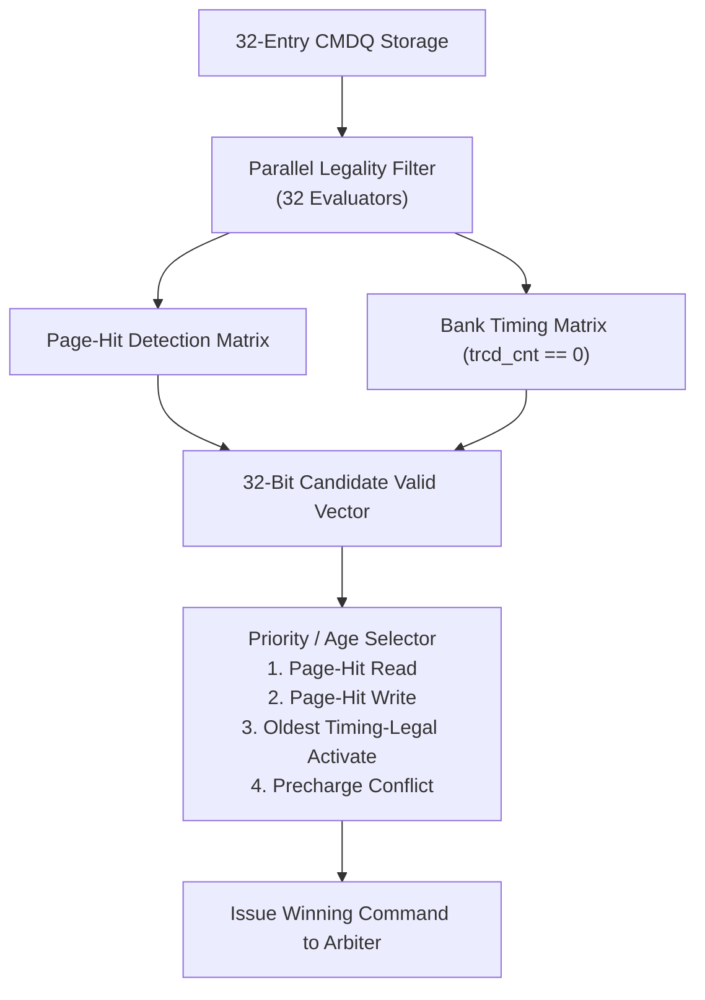

# MC16X2 HBM3 Memory Controller IP
# Technical Features Specification & Implementation Roadmap

---

## 1. Executive Summary & Architectural Overview

The **MC16X2** is a multi-channel, enterprise-class memory controller IP engineered to interface high-performance System-on-Chip (SoC) compute engines (CPUs, GPUs, NPUs) with **HBM3 (JEDEC JESD238)** stacked DRAM via a **DFI 5.0-compliant PHY interface**. 

The architecture bridges a high-speed host interconnect running at $500\text{ MHz}$ (`aclk`) to 16 physical memory channels operating at a strict $1.0\text{ GHz}$ core clock (`dfi_clk`, $1.0\text{ ns}$ cycle). To eliminate internal contention, each physical channel is split into two independent **Pseudo-Channels (PC0 and PC1)**, delivering a massive parallel grid of **32 independent scheduling domains** and **512 DRAM banks** with aggregate peak bandwidth of up to **$819.2\text{ GB/s}$** (SDR) / **$>1.6\text{ TB/s}$** (DDR).



---

## 2. Implemented Features ("What We Have Added")

The core memory controller functionality has been developed, modularized, and validated across Phases **P1 through P5**:



### 2.1 Phase P3: Host AXI4 Front-End & Clock Domain Crossing (CDC)
* **Single 256-bit AXI4 Slave Port**: High-throughput front-end accepting standard AXI4 transactions (`aclk = 500 MHz`). Supports `INCR` bursts of 1 to 16 beats (`awlen`/`arlen` = 0 to 15) with 8-bit transaction IDs (`arid`/`awid`).
* **Hardwired 40-bit Address Decoding ([`afe.v`](file:///home/dell/MC16/afe.v))**: Combinational bit-slicing logic with zero lookup latency. Extracts HBM3 geometric coordinates directly from `addr[39:0]`:
  $$\text{addr}[39:0] = \{\text{Reserved}[39:33], \text{CH}[32:29], \text{PC}[28], \text{ROW}[27:14], \text{BG}[13:12], \text{BA}[11:10], \text{COL}[9:5], \text{Byte}[4:0]\}$$
* **Non-Blocking 1-to-32 Ingress Demultiplexing**: Dynamically routes requests across 32 Pseudo-Channels. Individual per-PC `cmd_ready` backpressure ensures that contention in one channel/PC never creates head-of-line blocking for other channels.
* **Asynchronous Gray-Coded CDC Bridge ([`mc_axi_cdc.sv`](file:///home/dell/MC16/mc_axi_cdc.sv))**:
  * Five dual-clock asynchronous FIFOs (`AW`, `W`, `AR`, `B`, `R`) isolating the $500\text{ MHz}$ host domain from the $1.0\text{ GHz}$ core domain.
  * Parameterized 2-flip-flop synchronizers ([`cdc_sync_2ff.sv`](file:///home/dell/MC16/cdc_sync_2ff.sv)) for Gray pointers with lint/synthesis tags.
  * First-Word Fall-Through (FWFT) operation and live FIFO occupancy telemetry.
* **Posted Write Latency Decoupling**: Generates immediate `core_bvalid` with `core_bresp = 2'b00` (OKAY) into the B CDC FIFO as soon as write metadata and data enter the target PC's buffers. This eliminates CPU write stalling by fully decoupling host write latency from physical DRAM write recovery ($t_{WR}$).

---

### 2.2 Phase P1: Per-Pseudo-Channel Scheduling Core ([`mc_pc_core.sv`](file:///home/dell/MC16/p5/mc_pc_core.sv))
Instantiated **32 times** (16 Channels × 2 Pseudo-Channels), operating completely in parallel at $1.0\text{ GHz}$:
* **32-Entry Command Queue (`mc_cmdq`)**: Circular FIFO tracking decoded commands, command types (RD vs. WR), target bank coordinates, AXI ID, and buffer link pointers.
* **16-Entry Write Data Buffer (`mc_wdb`)**: Stages 256-bit write data words and 32-bit byte write strobes (`wstrb`). Write commands are gated until their associated data beat has physically arrived in the buffer.
* **16-Bank State Tracking Table (`mc_bank_state`)**: Tracks bank status for 4 Bank Groups × 4 Banks (16 banks per PC = 512 banks total across IP):
  * **Page Hit**: Target row matches `bank_open_row`. Dispatches immediate Column Read/Write (`CMD_COL_RD` / `CMD_COL_WR`).
  * **Page Empty (Miss)**: Bank is idle. Dispatches Row Activate (`CMD_ROW_ACT`).
  * **Page Conflict**: Bank is active with a mismatched row. Automatically dispatches Row Precharge (`CMD_ROW_PRE`) before activating.
* **Cycle-Accurate 1 GHz Down-Counter Timing Engine (`mc_timing_check`)**:
  * Because $f_{\text{core}} = 1.0\text{ GHz}$, each clock cycle represents **exactly $1.0\text{ ns}$**.
  * Hardware down-counters enforce all JEDEC JESD238 timing rules with zero clock-divider complexity:
    * Per-Bank: $t_{RCD} = 18\text{ ns}$ (18 c), $t_{RP} = 14\text{ ns}$ (14 c), $t_{RAS} = 34\text{ ns}$ (34 c), $t_{RC} = 50\text{ ns}$ (50 c), $t_{WR} = 18\text{ ns}$ (18 c), $t_{RTP} = 8\text{ ns}$ (8 c).
    * Per-PC: $t_{RRD} = 6\text{ ns}$ (6 c), $t_{FAW} = 32\text{ ns}$ (32 c), $t_{CCD} = 4\text{ ns}$ (4 c), $t_{WTR} = 8\text{ ns}$ (8 c), $t_{RFC} = 350\text{ ns}$ (350 c).
* **Autonomous Refresh Engine (`mc_refresh_engine`)**: Free-running $t_{REFI} = 3900\text{ ns}$ down-counter. Preempts standard traffic, issues all-bank precharge, and dispatches high-priority refresh (`CMD_ROW_REF`) locking the PC for $t_{RFC} = 350\text{ cycles}$.
* **Read Data Buffer & Deserializer (`mc_rdb`)**: Collects 8 returning 32-bit DFI beats, reassembles them into a 256-bit host beat, and drives the channel return interface.

---

### 2.3 Phase P4: Channel-Level Dual-Bus Arbiter ([`mc_ch_arb.sv`](file:///home/dell/MC16/mc_ch_arb.sv))
Instantiated **16 times** (1 per physical channel):
* **Dual Independent Bus Arbitration**: Row and column command buses are arbitrated independently. PC0 and PC1 can transmit concurrently if one issues a row command and the other issues a column command.
* **Credit-Counter Starvation Avoidance ([`mc_arbiter.sv`](file:///home/dell/MC16/mc_arbiter.sv))**: 8-bit saturating wait counters increment each cycle a valid candidate is denied the bus. The arbiter grants the bus to the candidate with the highest credit count, guaranteeing mathematical fairness and bounded latency.
* **Refresh Preemption Override**: Active refresh requests (`row_refresh`) strictly override normal traffic and credit counters, immediately taking control of the physical row bus.
* **Concurrent Data Streaming**: Merges independent 32-bit data streams from PC0 and PC1 into the physical 64-bit DFI data bus (`dfi_wrdata[63:0]`).

---

### 2.4 Phase P2: DFI 5.0 Physical Pin Formatter ([`mc_dfi_fmt.sv`](file:///home/dell/MC16/mc_dfi_fmt.sv))
Instantiated **16 times** (1 per physical channel):
* **1-Cycle Registered Boundary Stage**: Flops all command and address signals at $1.0\text{ GHz}$, isolating internal arbitration multiplexer delays from external PHY pad setup requirements.
* **Physical DFI Pin Vector Packing**:
  * Row Command Bus (`dfi_row[21:0]`): Embeds `{pc_sel, row_cmd[2:0], bg[1:0], ba[1:0], row_addr[13:0]}`.
  * Column Command Bus (`dfi_col[11:0]`): Embeds `{pc_sel, col_cmd[1:0], bg[1:0], ba[1:0], col_addr[4:0]}`.
* **DFI Control Strobes**: Drives `dfi_row_val`, `dfi_col_val`, chip selects (`dfi_cs_n`), and clock enable (`dfi_cke`).
* **Data Mask & Read Demuxing**: Packs byte strobes into `dfi_wrdata_mask[7:0]` and demultiplexes returning `dfi_rddata[63:0]` into independent 32-bit PC0 and PC1 streams.

---

### 2.5 Phase P5: Full 16-Channel Scale-Out & Top Integration ([`mc16x2.sv`](file:///home/dell/MC16/p5/mc16x2.sv))
* **Modular Multi-Channel Scale-Out**: Hierarchical instantiation of 16 identical [`mc_channel.sv`](file:///home/dell/MC16/p5/mc_channel.sv) blocks connecting to 16 external DFI 5.0 PHY ports.
* **32-to-1 Fair Read Return Arbiter ([`mc_read_return_arb.sv`](file:///home/dell/MC16/p5/mc_read_return_arb.sv))**:
  * Concentrates 32 asynchronous read streams into the single R CDC FIFO.
  * **Cyclic Round-Robin Pointer**: Prevents read starvation across channels.
  * **Burst Lock Mechanism**: Locks arbitration onto the active client until `rlast` completes, strictly preventing beat-level interleaving corruption.
* **APB4 Configuration & Status Subsystem ([`mc_csr.sv`](file:///home/dell/MC16/p5/mc_csr.sv))**:
  * 32-bit register file accessible via standard APB4 at $50\text{ MHz}$ (`pclk`).
  * 2-FF CDC bridges distributing dynamic DRAM timing registers ($t_{RCD}, t_{RAS}, t_{RP}, t_{RC}, t_{RRD}, t_{FAW}, t_{CCD}, t_{WTR}, t_{WR}, t_{RTP}, t_{RFC}, t_{REFI}$) to all 16 channels.
  * Sticky error aggregation capturing CMDQ overflows, refresh deadline misses, DFI protocol errors, and DRAM parity alerts, driving the top-level level-sensitive `irq` pin.
* **DFI 5.0 Control & Initialization FSM ([`mc_dfi_if.sv`](file:///home/dell/MC16/p5/mc_dfi_if.sv))**: Hardware state machine executing PHY initialization handshakes (`dfi_init_start` / `dfi_init_complete`), controller update sequences, and PHY update responses.

---

## 3. Pending Features & Engineering Roadmap

The table below outlines current architectural gaps, missing capabilities, and their roadmap targets:

| # | Pending Feature | Target Phase | Submodule Affected | Current Limitation | Target Functionality |
| :-: | :--- | :-: | :--- | :--- | :--- |
| **1** | **Dynamic Low-Power Management** | **Phase P6** | `mc_dfi_if.sv`, `mc16x2.sv`, `mc_csr.sv` | LP signals tied to constant 0; idle cycle counter unused. | Per-PC idle detection, CKE power-down, DFI low-power handshake (`dfi_lp_*`), Self-Refresh. |
| **2** | **Fine-Grained & Per-Bank Refresh (PBR)** | **Phase P6** | `mc_pc_core.sv`, `mc_refresh_engine.sv` | Coarse all-bank refresh (`REF`) locks entire PC for 350 ns. | Per-Bank Refresh (`PB_REF`), refresh credit accumulation/borrowing, temperature-compensated $t_{REFI}$. |
| **3** | **Hardware Performance Monitor Subsystem** | **Phase P5 / P6** | `mc_perf_mon.sv`, `mc_csr.sv` | CSR space `0xF000–0xF3FF` unpopulated; no telemetry counters. | 32-bit counters for bank hits/conflicts, queue depths, bus utilization, RD/WR turnaround penalties. |
| **4** | **Out-of-Order (OoO) Scheduling & Batching** | **Core Enh.** | `mc_cmdq.sv`, `mc_pc_core.sv` | Strict in-order evaluation from `cmdq_head` causes head-of-line stalls. | Dynamic bank-hit scoreboarding, OoO column scheduling across 32 slots, Read/Write turnaround batching. |
| **5** | **Automated DFI Training & PHY Calibration** | **DFI Enh.** | `mc_dfi_if.sv`, `mc_channel.sv` | Fixed static latency registers (`cfg_tphy_wrlat`/`rdlat`). | Dynamic CA training, write leveling, read DQS gate training, and 1:2 / 1:4 DFI clock ratio support. |
| **6** | **Reliability, Availability & Serviceability (RAS)** | **Reliability** | `mc_pc_core.sv`, `mc_axi_cdc.sv` | Parity alerts only assert an interrupt flag; data errors unmitigated. | Inline SECDED ECC (256b+32b parity), command retry on CA parity error, background memory scrubber. |
| **7** | **Full-Chip STA Timing Closure & Physical Signoff** | **Phase P7** | Top-Level Synthesis / P&R | Unverified post-layout timing at 1.0 ns clock period. | Logic depth bounding (≤ 6 levels), clock-tree synthesis (CTS) for 1 GHz core clock, 16-channel floorplan signoff. |

---

## 4. Technical Implementation Blueprint for Pending Features

### 4.1 Feature 1: Dynamic Low-Power Management (`dfi_lp_*` FSM & Auto Power-Down)

#### Architectural Motivation
In multi-channel HBM3 systems, idle channels consume significant dynamic and static power. HBM3 supports **Power-Down** (deasserting `CKE`) and **Self-Refresh** (retaining DRAM state while shutting down controller clock trees).

#### Microarchitecture & FSM Design
Implement an automatic power-down timer inside [`mc_channel.sv`](file:///home/dell/MC16/p5/mc_channel.sv) and connect it to [`mc_dfi_if.sv`](file:///home/dell/MC16/p5/mc_dfi_if.sv):



#### Signal & Interface Blueprint
In `mc_channel.sv` / `mc_dfi_if.sv`:
```systemverilog
// Inactivity counter tracking idle cycles
logic [15:0] ch_idle_counter;
wire both_pcs_idle = (u_pc0.cmdq_count == '0) && (u_pc1.cmdq_count == '0);

always_ff @(posedge dfi_clk or negedge ctl_reset_n) begin
    if (!ctl_reset_n) begin
        ch_idle_counter <= '0;
        lp_ctrl_req     <= 2'b00;
        lp_data_req     <= 2'b00;
        dfi_cke_ch      <= 2'b11;
    end else if (!both_pcs_idle) begin
        ch_idle_counter <= '0;
        lp_ctrl_req     <= 2'b00;
        lp_data_req     <= 2'b00;
        dfi_cke_ch      <= 2'b11; // Active CKE
    end else begin
        if (ch_idle_counter < cfg_pd_idle_cycles) begin
            ch_idle_counter <= ch_idle_counter + 1'b1;
        end else begin
            // Enter DFI Low-Power State
            lp_ctrl_req <= 2'b01; // Power-Down entry request
            lp_data_req <= 2'b01;
            dfi_cke_ch  <= 2'b00; // Deassert DRAM CKE
        end
    end
end
```

---

### 4.2 Feature 2: Advanced & Per-Bank Refresh (PBR) Scheduling

#### Architectural Motivation
Currently, each PC issues an all-bank `CMD_ROW_REF` that locks all 16 banks for $t_{RFC} = 350\text{ ns}$, degrading real-time bandwidth. JEDEC HBM3 specifies **Per-Bank Refresh (`PB_REF`)**, allowing 15 banks to continue processing reads and writes while 1 bank is refreshed.

#### Implementation Blueprint
1. **Per-Bank Refresh Counter Matrix**:
   Instead of a single PC-wide $t_{RFC}$ timer, replace with an array of 16 down-counters:
   ```systemverilog
   logic [8:0] pbr_trfc_cnt [0:15]; // Per-bank tRFC down-counters
   logic [3:0] pbr_target_bank;     // Rotating bank pointer (0 to 15)
   ```
2. **Rotating Bank Selection**:
   Every $t_{REFI\_PB} = t_{REFI} / 16 = 3900\text{ ns} / 16 \approx 243\text{ cycles}$, increment `pbr_target_bank`.
3. **Selective Legality Check**:
   Block commands targeting only `pbr_target_bank`. All commands to other banks remain schedule-eligible.
4. **Temperature-Compensated Refresh**:
   Sample HBM3 Mode Register 4 (MR4) thermal sensor flags over the APB CSR. If temperature $> 85^\circ\text{C}$, automatically halve $t_{REFI}$ to $1950\text{ cycles}$ ($2\times\text{ refresh rate}$).



---

### 4.3 Feature 3: Hardware Performance Monitoring Subsystem (`mc_perf_mon.sv`)

#### Architectural Motivation
Performance tuning and workload characterization require cycle-accurate hardware telemetry for queue occupancies, page hit rates, and bus contention.

#### Register Map Allocation (`0xF000`–`0xF3FF`)
| Offset | Register Name | Description |
| :--- | :--- | :--- |
| `0xF000` + $c \times 16$ | `CH_CMD_TOTAL[c]` | Total commands issued by Channel $c$. |
| `0xF004` + $c \times 16$ | `CH_PAGE_HITS[c]` | Total page-hit column accesses (zero precharge). |
| `0xF008` + $c \times 16$ | `CH_CONFLICTS[c]` | Total row conflict precharges (`CMD_ROW_PRE`). |
| `0xF00C` + $c \times 16$ | `CH_CONTENTION[c]` | Contention cycles where both PC0 and PC1 requested same bus. |
| `0xF200` | `GLOBAL_RD_BEATS` | Total 256-bit read beats returned to AXI. |
| `0xF204` | `GLOBAL_WR_BEATS` | Total 256-bit write beats accepted from AXI. |
| `0xF208` | `CMDQ_WATERMARK` | Peak CMDQ depth recorded across all 32 PCs. |

#### RTL Implementation Blueprint
Create [`mc_perf_mon.sv`](file:///home/dell/MC16/mc_perf_mon.sv) and instantiate in `mc_csr.sv`:
```systemverilog
module mc_perf_mon (
    input  logic        dfi_clk,
    input  logic        ctl_reset_n,
    // Event inputs from 32 PC cores
    input  logic [31:0] event_cmd_issued,
    input  logic [31:0] event_page_hit,
    input  logic [31:0] event_bank_conflict,
    input  logic [15:0] event_ch_contention,
    // CSR read interface
    input  logic [7:0]  perf_addr,
    input  logic        perf_read,
    input  logic        perf_clear,
    output logic [31:0] perf_rdata
);
    logic [31:0] cnt_cmd_issued    [0:31];
    logic [31:0] cnt_page_hit       [0:31];
    logic [31:0] cnt_bank_conflict  [0:31];
    logic [31:0] cnt_ch_contention  [0:15];

    always_ff @(posedge dfi_clk or negedge ctl_reset_n) begin
        if (!ctl_reset_n) begin
            for (int i = 0; i < 32; i++) begin
                cnt_cmd_issued[i]   <= '0;
                cnt_page_hit[i]      <= '0;
                cnt_bank_conflict[i] <= '0;
            end
            for (int j = 0; j < 16; j++) cnt_ch_contention[j] <= '0;
        end else if (perf_clear) begin
            for (int i = 0; i < 32; i++) begin
                cnt_cmd_issued[i]   <= '0;
                cnt_page_hit[i]      <= '0;
                cnt_bank_conflict[i] <= '0;
            end
            for (int j = 0; j < 16; j++) cnt_ch_contention[j] <= '0;
        end else begin
            for (int i = 0; i < 32; i++) begin
                if (event_cmd_issued[i])   cnt_cmd_issued[i]   <= cnt_cmd_issued[i] + 1'b1;
                if (event_page_hit[i])      cnt_page_hit[i]      <= cnt_page_hit[i] + 1'b1;
                if (event_bank_conflict[i]) cnt_bank_conflict[i] <= cnt_bank_conflict[i] + 1'b1;
            end
            for (int j = 0; j < 16; j++) begin
                if (event_ch_contention[j]) cnt_ch_contention[j] <= cnt_ch_contention[j] + 1'b1;
            end
        end
    end
endmodule
```

---

### 4.4 Feature 4: Out-of-Order (OoO) Scheduling & Write-Read Batching

#### Architectural Motivation
In the existing implementation, `mc_pc_core.sv` processes requests strictly in-order from `cmdq_head`. If `cmdq_head` encounters a bank conflict ($t_{RP} + t_{RCD} = 32\text{ ns}$ delay), all subsequent requests stall—even if subsequent entries target idle or open banks.

#### Technical Solution
Implement a **32-entry Scoreboard Arbiter** inside `mc_pc_core.sv`:
1. **Parallel Legality Vector**: In every clock cycle, evaluate the timing legality of **all 32 CMDQ entries simultaneously**.
2. **Page-Hit Prioritization**: Candidate scoring logic adds a high-priority weight (+32 credits) to Page Hits, allowing back-to-back column bursts without reopening rows.
3. **Read/Write Turnaround Batching**:
   * Amortize the $t_{WTR} = 8\text{ ns}$ bus turnaround penalty by servicing reads in bursts (e.g., up to 8 consecutive reads) before switching to writes.
   * Enter "Write Drain Mode" only when WDB occupancy exceeds high watermark (12 of 16 entries).



---

### 4.5 Feature 5: Automated DFI PHY Training Sequence & Frequency Ratios

#### Architectural Motivation
Physical HBM3 interfaces require calibration after power-on to compensate for PVT (Process, Voltage, Temperature) variations on interposer copper micro-bumps.

#### Implementation Steps
1. **Automated Calibration FSM in [`mc_dfi_if.sv`](file:///home/dell/MC16/p5/mc_dfi_if.sv)**:
   * **Command/Address (CA) Training**: Calibrates setup/hold timing of `dfi_row` and `dfi_col` against DRAM clock.
   * **Write Leveling**: Aligns DFI write strobes with HBM3 `WDQS` clock edges.
   * **Read DQS Gate Training**: Accurately positions the internal receive gate window before asserting `dfi_rddata_en`.
   * **Read Data Eye Centering**: Adjusts per-bit VREF and delay line taps.
2. **DFI Clock Ratio Adaptation (1:2 and 1:4 Modes)**:
   * When the HBM3 PHY operates at high data rates (e.g., $3.2\text{ Gbps}$ to $6.4\text{ Gbps}$ per pin), the controller cannot run at matching single-cycle frequencies.
   * Expand DFI interfaces into multi-phase words (e.g., Phase 0, Phase 1, Phase 2, Phase 3 per clock) supported by DFI 5.0 ratio specifications.

---

### 4.6 Feature 6: End-to-End Reliability, Availability & Serviceability (RAS)

#### Architectural Motivation
High-density HBM3 stacks operating in mission-critical AI/datacenter clusters require hardware error mitigation to prevent silent data corruption (SDC).

#### Technical Implementation
1. **Command/Address Parity Retry Engine**:
   * When HBM3 asserts `dfi_alert_n` indicating a CA parity error, the controller captures the failed command.
   * Automatically re-issues the failed command from the CMDQ replay buffer without host CPU intervention.
2. **Inline SECDED ECC Engine**:
   * **Write Path**: 256-bit AXI data word $\rightarrow$ generate 32 check bits (8 bits per 64-bit sub-word) using standard Hamming generator matrix.
   * **Read Path**: Detect and correct single-bit errors in hardware ($1\text{ cycle}$ latency); flag uncorrectable double-bit errors (`pslverr` / `irq`).
3. **Autonomous Background Memory Scrubber**:
   * Free-running low-priority background counter sequentially reads every row/column address during idle intervals, corrects single-bit soft errors, and writes back pristine data.

---

### 4.7 Feature 7: Full-Chip STA Timing Closure & Physical Signoff (Phase P7)

#### Architectural Motivation
Achieving zero timing violations at **$1.0\text{ GHz}$ undivided clock ($1.0\text{ ns}$ cycle)** across 16 channels in standard silicon nodes (e.g., $5\text{ nm} / 3\text{ nm}$) requires disciplined physical implementation.

#### Implementation Directives
1. **Logic Depth Restriction (≤ 6 Logic Levels)**:
   * The critical path spans: CMDQ candidate extraction $\rightarrow$ timing mask evaluation $\rightarrow$ credit-counter comparator $\rightarrow$ grant mux.
   * Keep logic strictly within 6 gate levels; register all intermediate comparator stages.
2. **16-Channel Symmetrical Floorplanning**:
   * Place each `mc_channel` directly adjacent to its corresponding DFI PHY pad block along the silicon interposer boundary.
   * Confine high-radix 32-to-1 read return trees to balanced H-tree pipelines.

---

## 5. Comprehensive Feature Status & Verification Matrix

| Architectural Subsystem | Specific Feature Description | RTL Status | Primary Source File | Verification Testbench | Status |
| :--- | :--- | :---: | :--- | :--- | :---: |
| **Ingress AXI4** | 256-bit Slave Handshake & Protocols | Implemented | [`mc_axi_cdc.sv`](file:///home/dell/MC16/mc_axi_cdc.sv) | [`tb_mc_axi_cdc.sv`](file:///home/dell/MC16/tb_mc_axi_cdc.sv) | **Verified** |
| **Ingress Routing** | 40-bit Address Bit-Slicing & Demux | Implemented | [`afe.v`](file:///home/dell/MC16/afe.v) | [`tb_mc_top.sv`](file:///home/dell/MC16/p1_p4_implementation/tb_mc_top.sv) | **Verified** |
| **Ingress Routing** | Non-blocking per-PC Backpressure | Implemented | [`afe.v`](file:///home/dell/MC16/afe.v) | [`tb_mc16x2.sv`](file:///home/dell/MC16/p5/tb_mc16x2.sv) | **Verified** |
| **Ingress Performance** | Posted Write Completion (`bresp`) | Implemented | [`mc16x2.sv`](file:///home/dell/MC16/p5/mc16x2.sv) | [`tb_mc_top.sv`](file:///home/dell/MC16/p1_p4_implementation/tb_mc_top.sv) | **Verified** |
| **Ingress CDC** | 5 Gray-Code Async FIFOs (500M ↔ 1G)| Implemented | [`mc_axi_cdc.sv`](file:///home/dell/MC16/mc_axi_cdc.sv) | [`tb_mc_axi_cdc.sv`](file:///home/dell/MC16/tb_mc_axi_cdc.sv) | **Verified** |
| **PC Scheduling** | 32-Entry CMDQ & 16-Entry WDB/RDB | Implemented | [`mc_pc_core.sv`](file:///home/dell/MC16/p5/mc_pc_core.sv) | [`tb_mc_top.sv`](file:///home/dell/MC16/p1_p4_implementation/tb_mc_top.sv) | **Verified** |
| **PC Scheduling** | 16-Bank State Table (Hit/Miss/Conf)| Implemented | [`mc_bank_state.sv`](file:///home/dell/MC16/p1_p4_implementation/mc_bank_state.sv) | [`tb_mc_top.sv`](file:///home/dell/MC16/p1_p4_implementation/tb_mc_top.sv) | **Verified** |
| **PC Timing** | 1 GHz Down-Counters (tRCD, tRP, tRAS)| Implemented | [`mc_timing_check.sv`](file:///home/dell/MC16/p1_p4_implementation/mc_timing_check.sv)| [`tb_mc_top.sv`](file:///home/dell/MC16/p1_p4_implementation/tb_mc_top.sv) | **Verified** |
| **PC Maintenance** | Autonomous All-Bank Refresh (tREFI) | Implemented | [`mc_refresh_engine.sv`](file:///home/dell/MC16/p1_p4_implementation/mc_refresh_engine.sv)| [`tb_mc_top.sv`](file:///home/dell/MC16/p1_p4_implementation/tb_mc_top.sv) | **Verified** |
| **Channel Arbiter** | Dual-Bus (Row & Col) Independent Arb | Implemented | [`mc_ch_arb.sv`](file:///home/dell/MC16/mc_ch_arb.sv) | [`tb_mc_ch_arb.sv`](file:///home/dell/MC16/tb_mc_ch_arb.sv) | **Verified** |
| **Channel Arbiter** | 8-bit Credit-Counter Fairness | Implemented | [`mc_arbiter.sv`](file:///home/dell/MC16/mc_arbiter.sv) | [`tb_mc_ch_arb.sv`](file:///home/dell/MC16/tb_mc_ch_arb.sv) | **Verified** |
| **Channel Arbiter** | Refresh Bus Preemption | Implemented | [`mc_ch_arb.sv`](file:///home/dell/MC16/mc_ch_arb.sv) | [`tb_mc_ch_arb.sv`](file:///home/dell/MC16/tb_mc_ch_arb.sv) | **Verified** |
| **DFI Formatter** | 1-Cycle Registered Boundary Stage | Implemented | [`mc_dfi_fmt.sv`](file:///home/dell/MC16/mc_dfi_fmt.sv) | [`tb_dfi_formatter.sv`](file:///home/dell/MC16/tb_dfi_formatter.sv) | **Verified** |
| **DFI Formatter** | dfi_row / dfi_col Pin Packing | Implemented | [`mc_dfi_fmt.sv`](file:///home/dell/MC16/mc_dfi_fmt.sv) | [`tb_dfi_formatter.sv`](file:///home/dell/MC16/tb_dfi_formatter.sv) | **Verified** |
| **DFI Formatter** | Split Read Return Lane Demux | Implemented | [`mc_dfi_fmt.sv`](file:///home/dell/MC16/mc_dfi_fmt.sv) | [`tb_dfi_formatter.sv`](file:///home/dell/MC16/tb_dfi_formatter.sv) | **Verified** |
| **Full Scale-Out** | 16-Channel Modular Packaging | Implemented | [`mc16x2.sv`](file:///home/dell/MC16/p5/mc16x2.sv) | [`tb_mc16x2.sv`](file:///home/dell/MC16/p5/tb_mc16x2.sv) | **Verified** |
| **Egress Return** | 32-to-1 RR Read Return Arbiter | Implemented | [`mc_read_return_arb.sv`](file:///home/dell/MC16/p5/mc_read_return_arb.sv)| [`tb_mc_read_return_arb.sv`](file:///home/dell/MC16/p5/tb_mc_read_return_arb.sv)| **Verified** |
| **Egress Return** | Burst Lock to prevent interleave | Implemented | [`mc_read_return_arb.sv`](file:///home/dell/MC16/p5/mc_read_return_arb.sv)| [`tb_mc_read_return_arb.sv`](file:///home/dell/MC16/p5/tb_mc_read_return_arb.sv)| **Verified** |
| **CSR Subsystem** | APB4 32-bit Register Interface | Implemented | [`mc_csr.sv`](file:///home/dell/MC16/p5/mc_csr.sv) | [`tb_mc16x2.sv`](file:///home/dell/MC16/p5/tb_mc16x2.sv) | **Verified** |
| **CSR Subsystem** | 2-FF Dynamic Timing Broadcast | Implemented | [`mc_csr.sv`](file:///home/dell/MC16/p5/mc_csr.sv) | [`tb_mc16x2.sv`](file:///home/dell/MC16/p5/tb_mc16x2.sv) | **Verified** |
| **CSR Subsystem** | Sticky Error Aggregation & IRQ | Implemented | [`mc_csr.sv`](file:///home/dell/MC16/p5/mc_csr.sv) | [`tb_mc16x2.sv`](file:///home/dell/MC16/p5/tb_mc16x2.sv) | **Verified** |
| **DFI Control** | PHY Init & Update FSMs | Implemented | [`mc_dfi_if.sv`](file:///home/dell/MC16/p5/mc_dfi_if.sv) | [`tb_mc16x2.sv`](file:///home/dell/MC16/p5/tb_mc16x2.sv) | **Verified** |
| **Power Mgmt** | Dynamic DFI Low-Power (`dfi_lp_*`) | **Pending** | `mc_dfi_if.sv` (Phase P6) | Needed in Phase P6 | *Roadmap* |
| **Refresh Engine** | Per-Bank Refresh & Temp Comp | **Pending** | `mc_refresh_engine.sv` | Needed in Phase P6 | *Roadmap* |
| **Telemetry** | Hardware Performance Monitors | **Pending** | `mc_perf_mon.sv` (P5/P6) | Needed in Phase P6 | *Roadmap* |
| **Core Scheduling**| Out-of-Order Execution & Batching | **Pending** | `mc_pc_core.sv` | Needed in Core 2.0 | *Roadmap* |
| **DFI Interface** | Automated PHY Training Calibration | **Pending** | `mc_dfi_if.sv` | Needed for PHY bring-up | *Roadmap* |
| **RAS** | CA Parity Retry & Inline SECDED ECC| **Pending** | `mc_pc_core.sv` / `mc_top.sv` | Needed for Datacenter | *Roadmap* |
| **Physical Signoff**| 1 GHz STA Closure & CTS Synthesis | **Pending** | Backend Implementation | Needed in Phase P7 | *Roadmap* |

---

## 6. Execution Roadmap & Priority Phasing

```mermaid
gantt
    title MC16X2 IP Milestone & Roadmap Progression
    dateFormat  X
    axisFormat %s

    section Completed (Phases P0-P5)
    P0 Architecture & Spec Signoff           :done, 0, 1
    P1 Per-PC Core Scheduling Bringup       :done, 1, 2
    P2 DFI 5.0 Formatter & Pin Packing      :done, 2, 3
    P3 AXI Front-End Ingress & CDC FIFOs     :done, 3, 4
    P4 Channel-Level Dual Bus Arbiter        :done, 4, 5
    P5 16-Channel Scale-Out & Top Integration:done, 5, 6

    section Near-Term Deliverables (Phase P6)
    P6.1 Low-Power FSM & CKE Power-Down     :active, 6, 7
    P6.2 Per-Bank Refresh Engine (PBR)      :active, 6, 7
    P6.3 mc_perf_mon Performance Monitor     :active, 6, 7

    section Next-Gen Enhancements
    Core Out-of-Order (OoO) Scheduling       : 7, 8
    Inline SECDED ECC & CA Parity Retry     : 7, 8
    Automated PHY Calibration & Training     : 8, 9

    section Tapeout Signoff (Phase P7)
    P7 1 GHz STA Closure & Gate-Level Signoff: 9, 10
```



1. **Phase P6 (Immediate Next Focus)**:
   * Activate `mc_dfi_if` low-power handshakes driven by `cfg_pd_idle_cycles`.
   * Implement per-bank refresh down-counters in `mc_refresh_engine.sv`.
   * Populate performance telemetry counters in `mc_perf_mon.sv`.
2. **Phase P7 (Silicon Signoff)**:
   * Synthesis in target process technology (e.g., TSMC N5/N3).
   * Static Timing Analysis (STA) constraint closure at $1.0\text{ ns}$ cycle limit.
   * Multi-channel floorplan routing to HBM3 physical micro-bump perimeter.
