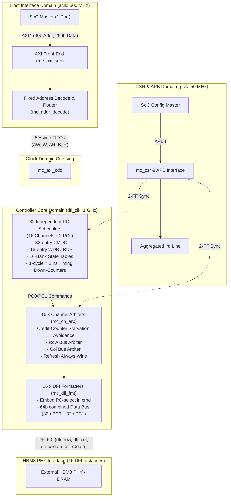
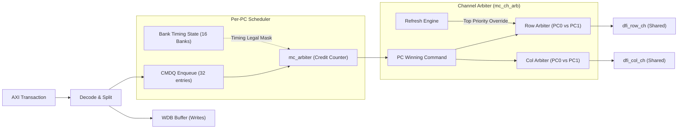

# MC16X2 Multi-Channel Memory Controller IP
## Architectural & Microarchitecture Specification Guide (Rev 0.4)

---

## 1. Executive Summary & Document Scope

The **MC16X2** is a high-performance **16-Channel / 2-Pseudo-Channel Memory Controller IP** designed to bridge an SoC host interconnect with high-bandwidth stacked memory (**HBM3, JEDEC JESD238**) via a **DFI 5.0-compliant PHY interface**.

### Key IP Highlights
* **Standards Compliance**: JEDEC JESD238 (HBM3) and DFI 5.0 (adapted for split row/column command buses with embedded pseudo-channel select).
* **Architecture Scale**: 16 memory channels × 2 pseudo-channels = **32 independent scheduling domains**.
* **Host Interface**: Single 256-bit AXI4 slave port with fixed parameters and hardwired address decode.
* **PHY Interface**: 16 DFI instances (one shared instance per channel; PC0 and PC1 share row and col command buses with independent 32-bit data lanes).
* **Clock Frequencies**: Fixed 3-domain system: `aclk` (500 MHz), `dfi_clk` (1 GHz, 1 ns period), and `pclk` (50 MHz).
* **Scheduling & Arbitration**: Simplified credit-counter starvation avoidance (8-bit saturating counter) replacing multi-factor QoS schemes.
* **Write Completion Policy**: Posted write responses (`bresp` issued upon enqueue into WDB/CMDQ).

---

## 2. Top-Level Architectural Overview



---

## 3. Interface Specifications

### 3.1 Host AXI4 Slave Interface (`aclk` = 500 MHz)
The controller presents **exactly one AXI4 slave port** to simplify the front-end interconnect and CDC topology.
* **Address Bus**: 40 bits (covers complete 16-channel address space).
* **Data Bus**: 256 bits (32 bytes per beat).
* **ID Width**: 8 bits (up to 256 distinct in-flight transactions).
* **Burst Constraints**:
  * `INCR` bursts only (`awburst`/`arburst` = `2'b01`). `WRAP` and `FIXED` are rejected with `SLVERR`/`DECERR`.
  * Burst length: 1 to 16 beats (`awlen`/`arlen` = 0 to 15).
  * No exclusive access (`EXOKAY` never returned).
  * No write interleaving allowed per ID.
* **Outstanding Depth**: Up to 64 outstanding requests per PC, bounded by the CMDQ depth.

### 3.2 Fixed Address Decode & Routing
The address decode is **strictly hardwired** in RTL (no hashing, no CSR remapping table). Every address directly bit-slices to destination channel, pseudo-channel, bank group, bank, row, and column:

| Address Bits | Field | Width | Description / Destination |
| :---: | :---: | :---: | :--- |
| `[4:0]` | **Byte Offset** | 5 | Byte position within 32-byte AXI beat |
| `[9:5]` | **COL** | 5 | Column address within the active open row |
| `[11:10]` | **BA** | 2 | Bank address within bank group (4 banks) |
| `[13:12]` | **BG** | 2 | Bank group address (4 bank groups) |
| `[27:14]` | **ROW** | 14 | Row address (16,384 rows per bank) |
| `[28]` | **PC_SEL** | 1 | Pseudo-Channel select: `0` = PC0, `1` = PC1 |
| `[32:29]` | **CH_SEL** | 4 | Channel select: Channels 0 to 15 |
| `[39:33]` | **Reserved** | 7 | Must be driven 0 by software (reserved for rank extensions) |

### 3.3 APB4 Configuration Interface (`pclk` = 50 MHz)
* 32-bit data bus, 20-bit address bus (`paddr[19:0]`).
* Standard 2-phase APB transfer (`SETUP` + `ACCESS`) with `pready` wait-state extension (up to 16 cycles for CDC transfers).
* **Register Map Layout**:
  * `0x0000 - 0x0FFF`: Global IP ID, version, enables, timeouts.
  * `0x1000 - 0x1FFF` (× 16): Per-Channel blocks (CH0–CH15), 4KB stride.
  * Within each Channel: Per-PC sub-blocks (PC0, PC1) for timing CSRs and power-down idle cycles.
  * `0xF000 - 0xF3FF`: Performance monitoring (command counts, bank conflicts, latency).
  * `0xF400 - 0xF4FF`: Interrupt enables and error status.

### 3.4 DFI 5.0 Master Interface (`dfi_clk` = 1 GHz)
* **16 DFI Instances**: Exactly 1 DFI instance per channel.
* **Shared Command / Address Buses**:
  * `dfi_row_ch<N>[21:0]`: `[21]` = `pc_sel`, `[20:18]` = command (`ACT`, `PRE`, `PREALL`, `REF`, `MRW`, `NOP`), `[17:16]` = `bankgroup`, `[15:14]` = `bank`, `[13:0]` = `row_addr`.
  * `dfi_col_ch<N>[11:0]`: `[11]` = `pc_sel`, `[10:9]` = command (`RD`, `WR`, `WRA`, `RDA`, `NOP`), `[8:7]` = `bankgroup`, `[6:5]` = `bank`, `[4:0]` = `col_addr`.
  * Qualified by `dfi_row_val_ch<N>` and `dfi_col_val_ch<N>`.
* **Split Data Paths**:
  * Write data `dfi_wrdata_ch<N>[63:0]`: `[31:0]` = PC0, `[63:32]` = PC1.
  * Read data `dfi_rddata_ch<N>[63:0]`: `[31:0]` = PC0, `[63:32]` = PC1.
  * Per-PC enables: `dfi_wrdata_en_ch<N>[1:0]`, `dfi_rddata_en_ch<N>[1:0]`, `dfi_rddata_valid_ch<N>[1:0]`.

---

## 4. Scheduling & Command Microarchitecture



### 4.1 Arbitration Policy: Credit-Counter Starvation Avoidance
The specification replaces multi-factor QoS weighting with a single, deterministically verifiable mechanism:
1. **Wait Counter**: Every pending and timing-legal command possesses an 8-bit saturating counter (`CREDIT_CTR_WIDTH = 8`).
2. **Increment**: Every cycle a candidate is ready and legal but not granted, its counter increments by 1 (saturating at 255).
3. **Selection**: The candidate with the highest counter value among legal candidates is granted.
4. **Reset**: Upon grant, the winning candidate's counter resets to 0.
5. **Tie-Breaker**:
   * PC Level: Lowest CMDQ entry index wins.
   * Channel Level: PC0 wins over PC1.
6. **Refresh Rule**: A pending `REF` command bypasses wait counters and **always wins immediately**.

### 4.2 DRAM Timing Legality Checks
Because `dfi_clk` is fixed at 1 GHz, **1 clock cycle corresponds to exactly 1.0 ns**. Down-counters initialized upon command issuance enforce timing constraints before marking commands eligible:

| Parameter | Description | Value (ns) | Cycles @ 1 GHz | Counter Target |
| :--- | :--- | :---: | :---: | :--- |
| `tRCD` | Row to column delay (`ACT` → `RD`/`WR`) | 18 | 18 | Per-bank |
| `tRAS` | Minimum row active time (`ACT` → `PRE`) | 34 | 34 | Per-bank |
| `tRP` | Row precharge time (`PRE` → `ACT`) | 14 | 14 | Per-bank |
| `tRC` | Full row cycle (`ACT` → `ACT` same bank) | 50 | 50 | Per-bank |
| `tRRD` | ACT-to-ACT spacing (different banks) | 6 | 6 | Per-PC |
| `tFAW` | Four-Activate Window (max 4 ACTs) | 32 | 32 | Per-PC (sliding window) |
| `tCCD` | Column-to-column spacing (`RD`/`WR` commands) | 4 | 4 | Per-PC |
| `tWTR` | Write-to-read turnaround delay | 8 | 8 | Per-PC |
| `tWR` | Write recovery time (last write → `PRE`) | 18 | 18 | Per-bank |
| `tRTP` | Read-to-precharge delay (`RD` → `PRE`) | 8 | 8 | Per-bank |
| `tRFC` | Refresh recovery cycle time | 350 | 350 | Per-PC (all-bank) |
| `tREFI` | Average refresh interval per bank | 3900 | 3900 | Per-PC |

### 4.3 Write Completion Policy
* **Posted `bresp`**: The controller issues AXI `bresp`/`bvalid` as soon as write data is buffered in the `WDB` and the write command is enqueued into `CMDQ`.
* **Asynchronous Error Reporting**: Downstream errors occurring at the PHY or DRAM array after `bvalid` assertion are signaled through the aggregated `irq` line.

---

## 5. Clocking & Clock Domain Crossing (CDC)

### 5.1 Clock Domain Architecture

| Clock Signal | Frequency | Period | Reset Signal | Domain Usage |
| :--- | :---: | :---: | :--- | :--- |
| `aclk` | 500 MHz | 2.0 ns | `aresetn` (sync) | AXI4 slave port & AXI-side CDC FIFO stages |
| `pclk` | 50 MHz | 20.0 ns | `presetn` (sync) | APB4 CSR slave block |
| `dfi_clk` | 1000 MHz | 1.0 ns | `ctl_reset_n` / `dfi_reset_n` | All 32 PC schedulers, channel arbiters, DFI formatters |

> [!IMPORTANT]
> **Strict CDC Boundary**: There are **zero clock domain crossings** inside the controller core or DFI path. Everything downstream of the AXI front-end runs synchronously at 1 GHz (`dfi_clk`).

### 5.2 The 5 Asynchronous FIFOs

All crossings between `aclk` (500 MHz) and `dfi_clk` (1 GHz) are handled by exactly 5 Gray-coded async FIFOs with 2-stage synchronizers (`CDC_SYNC_STAGES = 2`):

```
SoC AXI4 Domain (aclk: 500 MHz)                 Controller Core Domain (dfi_clk: 1 GHz)
┌────────────────────────────────┐               ┌───────────────────────────────────────┐
│ AW Channel (Metadata)          ├──[ 72b x 8  ]►│ Command Queue Allocation & Decoder    │
│ W Channel (Data & Strobes)     ├──[ 289b x 16]►│ Write Data Buffers (RAM-based FIFO)   │
│ AR Channel (Metadata)          ├──[ 72b x 8  ]►│ Command Queue Allocation & Decoder    │
│ B Channel (Posted Response)    │◄─[ 10b x 8  ]─┤ Write Commit Logic                    │
│ R Channel (Read Return Data)   │◄─[ 267b x 16]─┤ Read Data Buffers (RAM-based FIFO)    │
└────────────────────────────────┘               └───────────────────────────────────────┘
```

1. **AW FIFO** (`aclk` → `dfi_clk`): 72 bits wide × 8 entries (burst metadata only).
2. **W FIFO** (`aclk` → `dfi_clk`): 289 bits wide × 16 entries (256b data + 32b strb + 1b last; RAM-based).
3. **AR FIFO** (`aclk` → `dfi_clk`): 72 bits wide × 8 entries (read request metadata).
4. **B FIFO** (`dfi_clk` → `aclk`): 10 bits wide × 8 entries (8b BID + 2b BRESP).
5. **R FIFO** (`dfi_clk` → `aclk`): 267 bits wide × 16 entries (8b RID + 256b RDATA + 2b RRESP + 1b RLAST; RAM-based).

### 5.3 Reset Sequencing
1. Assert `presetn`, `ctl_reset_n`, `dfi_reset_n`, and `aresetn`.
2. Release `presetn` → Boot firmware writes initial CSR configuration and DFI timing values.
3. Release `ctl_reset_n` → Schedulers and bank state machines initialize.
4. Execute PHY initialization handshake via DFI → Poll `dfi_init_complete`.
5. Release `aresetn` → AXI interface starts accepting transactions.

---

## 6. RTL Module Hierarchy & Workspace Mapping

The module hierarchy outlined in Section 13.1 directly maps onto existing files in `/home/dell/MC16`:

```
mc16x2 (Top Level)
├── mc_axi_sub
│   └── mc_addr_decode ................... [afe.v] (address_decoder & mc_ch_pc_router)
├── mc_axi_cdc (5 Async FIFOs)
├── mc_pc_core [0:31] (32 Instances)
│   ├── mc_cmdq (32-entry queue)
│   ├── mc_wdb (16 entries)
│   ├── mc_rdb (16 entries)
│   ├── mc_bank_state (16 banks)
│   ├── mc_arbiter ....................... [mc_arbiter.sv] (Credit counter core)
│   ├── mc_timing_check (Down-counters)
│   └── mc_refresh_engine (tREFI timer)
├── mc_ch_arb [0:15] ..................... [mc_ch_arb.sv] (Instantiates mc_arbiter)
├── mc_dfi_fmt [0:15] .................... [mc_dfi_fmt.sv] (DFI output stage)
├── mc_dfi_if [0:15] (DFI control/LP/Init)
├── mc_csr (APB4 registers & bridges)
└── mc_perf_mon (Counters)
```

### Current Workspace Implementation Status

* **[afe.v](file:///home/dell/MC16/afe.v)**: Implements `address_decoder` and `mc_ch_pc_router` matching Section 3.1.4 address bit slices.
* **[mc_arbiter.sv](file:///home/dell/MC16/mc_arbiter.sv)**: Implements candidate grant logic, saturating credit counters, and top-priority refresh bypass matching Section 5.2.
* **[mc_ch_arb.sv](file:///home/dell/MC16/mc_ch_arb.sv)**: Implements channel arbiter combining PC0/PC1 row and column command buses and aggregating 32-bit data streams.
* **[mc_dfi_fmt.sv](file:///home/dell/MC16/mc_dfi_fmt.sv)**: Implements the registered DFI output formatting stage matching Section 3.3.
* **[tb_mc_ch_arb.sv](file:///home/dell/MC16/tb_mc_ch_arb.sv)** & **[tb_dfi_formatter.sv](file:///home/dell/MC16/tb_dfi_formatter.sv)**: Unit-level verification testbenches for channel arbitration and DFI formatting.

---

## 7. Verification & UVM Architecture (Section 14)

* **UVM Testbench Architecture (`mc16x2_tb`)**:
  * `axi4_agent`: Drives AXI4 stimulus (configurable backpressure, burst lengths up to 16).
  * 16 `dfi_agent` instances: Models HBM3 DRAM behavior, checks JEDEC timing parameters, and asserts DFI protocol responses.
  * `apb_agent`: Configuration and CSR verification (UVM RAL model `mc16x2_reg_block`).
  * `mc_scoreboard`: Verifies end-to-end data integrity, order preservation, and timing compliance.
* **Key Assertions (SVA)**:
  * `axi_aw_stable`: Stability of `awaddr` and `awid` while waiting for `awready`.
  * `dfi_row_cmd_legal`: Checks legal encodings for row commands (`ACT`, `PRE`, `PREALL`, `REF`, `MRW`, `NOP`).
  * Maximum 1 row command and 1 col command issued per channel per clock.
  * Data enables (`dfi_wrdata_en_ch<N>`) strictly match PHY training delays (`tphy_wrlat`).

---

## 8. Development Roadmap & Engineering Risks

### 8.1 Roadmap Phases
* **P0**: Specification sign-off & vendor timing verification.
* **P1**: Single-PC core bring-up (CMDQ, scheduler, timing check, refresh).
* **P2**: DFI formatter integration and protocol assertion pass.
* **P3**: AXI front-end, fixed address decode, and CDC async FIFOs.
* **P4**: Channel integration (2 PCs + `mc_ch_arb` + DFI instance).
* **P5**: Full scale-out to 16 channels × 2 PCs (32 PCs total).
* **P6**: Low-power (`dfi_lp_*`) and refresh engine tuning.
* **P7**: Full-chip STA timing closure and gate-level signoff.

### 8.2 Critical Implementation Risks & Mitigations

> [!WARNING]
> **1 GHz Undivided Core Clock Timing Closure**:
> The scheduling pipeline and channel arbiters run at a 1.0 ns clock cycle without clock dividers. Combinational paths between CMDQ legality evaluation, credit-counter comparison, and grant generation must be restricted to **≤ 6 logic levels**. Early synthesis runs are essential.

> [!NOTE]
> **Posted `bresp` Error Handling**:
> Because write completions are issued as soon as data enters the WDB, errors occurring during DRAM array write must be reported via `irq` rather than AXI response channels.
