```mermaid
flowchart TD
    TOP["mc16x2 (Top Level)"]

    subgraph FrontEnd ["Host & CDC Domain"]
        TOP --> AXI_SUB["mc_axi_sub (AXI4 Slave Port Handler)"]
        AXI_SUB --> ADDR_DEC["mc_addr_decode (Address Decoder & Router)"]
        TOP --> AXI_CDC["mc_axi_cdc (5 Async FIFOs: AW, W, AR, B, R)"]
    end

    subgraph CoreDomain ["Core Scheduling Domain (32 PCs)"]
        TOP --> PC_CORE["mc_pc_core [0:31] (Per-PC Core, 32 Instances)"]
        PC_CORE --> CMDQ["mc_cmdq (Command Queue, 32 entries)"]
        PC_CORE --> WDB["mc_wdb (Write Data Buffer, 16 entries)"]
        PC_CORE --> RDB["mc_rdb (Read Data Buffer, 16 entries)"]
        PC_CORE --> BANK["mc_bank_state (Bank State Table, 16 banks)"]
        PC_CORE --> PC_ARB["mc_arbiter (Credit-Counter Arbiter)"]
        PC_CORE --> TIMING["mc_timing_check (1 GHz Down-Counters)"]
        PC_CORE --> REF["mc_refresh_engine (tREFI Refresh Engine)"]
    end

    subgraph ChannelDomain ["Channel Arbitration & DFI Domain (16 Channels)"]
        TOP --> CH_ARB["mc_ch_arb [0:15] (Channel Arbiter, 16 Instances)"]
        CH_ARB --> ROW_ARB["mc_arbiter (row_bus_arbiter)"]
        CH_ARB --> COL_ARB["mc_arbiter (col_bus_arbiter)"]
        CH_ARB --> DFI_FMT["mc_dfi_fmt (DFI Output Formatter)"]
        
        TOP --> DFI_IF["mc_dfi_if [0:15] (DFI Control / Init / LP / Update)"]
    end

    subgraph ConfigDomain ["Configuration & Telemetry"]
        TOP --> CSR["mc_csr (APB4 Register Block)"]
        CSR --> APB_IF["mc_apb_if (APB Slave Interface)"]
        CSR --> SYNC_DFI["mc_sync_dfi (2-FF Pulse Synchronizers)"]
        TOP --> PERF["mc_perf_mon (Performance Counters)"]
    end
```

# MC16X2 Memory Controller IP
## Module Hierarchy & Complete I/O Signal Specification (Section 13.1)

---

## 1. Overview & Structural Hierarchy

This document provides a comprehensive, pin-by-pin interface specification for every module and submodule defined in **Section 13.1 (Module Hierarchy)** of the **MC16X2 Microarchitecture Specification (Rev 0.4)**.

---

## 2. Top-Level Module: `mc16x2`

The top-level entity exposes the single host-facing AXI4 slave port, the APB4 configuration port, the interrupt line, and the 16 independent channel DFI 5.0 master interfaces to the external HBM3 PHY.

### 2.1 Clocks & Resets
| Signal Name | Dir | Width | Clock Domain | Description |
| :--- | :---: | :---: | :---: | :--- |
| `aclk` | Input | 1 | `aclk` (500 MHz) | AXI interconnect clock. |
| `aresetn` | Input | 1 | `aclk` | AXI synchronous active-low reset. |
| `pclk` | Input | 1 | `pclk` (50 MHz) | APB configuration clock. |
| `presetn` | Input | 1 | `pclk` | APB asynchronous/synchronous active-low reset. |
| `dfi_clk` | Input | 1 | `dfi_clk` (1 GHz) | Core scheduling and DFI master clock (1.0 ns period). |
| `ctl_reset_n` | Input | 1 | `dfi_clk` | Core controller synchronous active-low reset. |

### 2.2 Host AXI4 Slave Interface
| Signal Name | Dir | Width | Clock Domain | Description |
| :--- | :---: | :---: | :---: | :--- |
| **Write Address Channel (AW)** | | | | |
| `s_axi_awid` | Input | 8 | `aclk` | Write address transaction ID. |
| `s_axi_awaddr` | Input | 40 | `aclk` | Write address (40-bit memory address space). |
| `s_axi_awlen` | Input | 8 | `aclk` | Burst length (0 to 15 supported = 1 to 16 beats). |
| `s_axi_awsize` | Input | 3 | `aclk` | Burst size (must be `3'b101` = 32 bytes/beat). |
| `s_axi_awburst` | Input | 2 | `aclk` | Burst type (must be `2'b01` = `INCR`). |
| `s_axi_awlock` | Input | 1 | `aclk` | Lock type (tied unused, no exclusive access). |
| `s_axi_awcache` | Input | 4 | `aclk` | Memory attribute / bufferable indicators. |
| `s_axi_awprot` | Input | 3 | `aclk` | Protection attributes (Privileged, Secure, Data). |
| `s_axi_awqos` | Input | 4 | `aclk` | Quality of Service (passed through, unused by arbiter). |
| `s_axi_awvalid` | Input | 1 | `aclk` | Write address valid handshake. |
| `s_axi_awready` | Output | 1 | `aclk` | Write address ready handshake (backpressure). |
| **Write Data Channel (W)** | | | | |
| `s_axi_wdata` | Input | 256 | `aclk` | Write data beat (32 bytes). |
| `s_axi_wstrb` | Input | 32 | `aclk` | Write byte strobes (1 bit per byte). |
| `s_axi_wlast` | Input | 1 | `aclk` | Last beat indicator of write burst. |
| `s_axi_wvalid` | Input | 1 | `aclk` | Write data valid handshake. |
| `s_axi_wready` | Output | 1 | `aclk` | Write data ready handshake (backpressure). |
| **Write Response Channel (B)** | | | | |
| `s_axi_bid` | Output | 8 | `aclk` | Write response transaction ID. |
| `s_axi_bresp` | Output | 2 | `aclk` | Write response status (`2'b00` = `OKAY`, `SLVERR`, `DECERR`). |
| `s_axi_bvalid` | Output | 1 | `aclk` | Write response valid handshake (posted). |
| `s_axi_bready` | Input | 1 | `aclk` | Write response ready handshake. |
| **Read Address Channel (AR)** | | | | |
| `s_axi_arid` | Input | 8 | `aclk` | Read address transaction ID. |
| `s_axi_araddr` | Input | 40 | `aclk` | Read address (40-bit memory address space). |
| `s_axi_arlen` | Input | 8 | `aclk` | Burst length (0 to 15 = 1 to 16 beats). |
| `s_axi_arsize` | Input | 3 | `aclk` | Burst size (must be `3'b101` = 32 bytes/beat). |
| `s_axi_arburst` | Input | 2 | `aclk` | Burst type (must be `2'b01` = `INCR`). |
| `s_axi_arlock` | Input | 1 | `aclk` | Lock type (tied unused). |
| `s_axi_arcache` | Input | 4 | `aclk` | Memory attributes. |
| `s_axi_arprot` | Input | 3 | `aclk` | Protection attributes. |
| `s_axi_arqos` | Input | 4 | `aclk` | Quality of Service. |
| `s_axi_arvalid` | Input | 1 | `aclk` | Read address valid handshake. |
| `s_axi_arready` | Output | 1 | `aclk` | Read address ready handshake. |
| **Read Data Channel (R)** | | | | |
| `s_axi_rid` | Output | 8 | `aclk` | Read data transaction ID. |
| `s_axi_rdata` | Output | 256 | `aclk` | Read data beat (32 bytes). |
| `s_axi_rresp` | Output | 2 | `aclk` | Read response status (`OKAY`, `SLVERR`, `DECERR`). |
| `s_axi_rlast` | Output | 1 | `aclk` | Last beat indicator of read burst. |
| `s_axi_rvalid` | Output | 1 | `aclk` | Read data valid handshake. |
| `s_axi_rready` | Input | 1 | `aclk` | Read data ready handshake. |

### 2.3 APB4 Configuration & Interrupt Interface
| Signal Name | Dir | Width | Clock Domain | Description |
| :--- | :---: | :---: | :---: | :--- |
| `paddr` | Input | 20 | `pclk` | Register byte address (`0x00000` to `0xFFFFF`). |
| `psel` | Input | 1 | `pclk` | APB peripheral select. |
| `penable` | Input | 1 | `pclk` | APB transfer strobe (active on 2nd phase). |
| `pwrite` | Input | 1 | `pclk` | Access direction: `1` = Write, `0` = Read. |
| `pwdata` | Input | 32 | `pclk` | APB write data. |
| `pstrb` | Input | 4 | `pclk` | APB byte strobes. |
| `pready` | Output | 1 | `pclk` | Slave ready (extends access phase up to 16 cycles). |
| `prdata` | Output | 32 | `pclk` | APB read data. |
| `pslverr` | Output | 1 | `pclk` | Slave error response (decode/timeout error). |
| `irq` | Output | 1 | `pclk` | Aggregated level-sensitive interrupt line. |

### 2.4 DFI 5.0 PHY Master Interfaces (16 Channel Instances, `CH0` to `CH15`)
*Signals below are replicated for each channel instance `[0:15]`.*
| Signal Name | Dir | Width | Clock Domain | Description |
| :--- | :---: | :---: | :---: | :--- |
| `dfi_reset_n_ch[i]` | Output | 1 | `dfi_clk` | PHY reset sequencing signal for channel `i`. |
| `dfi_row_ch[i]` | Output | 22 | `dfi_clk` | Shared row command: `[21]`=pc_sel, `[20:18]`=cmd, `[17:16]`=bg, `[15:14]`=ba, `[13:0]`=row. |
| `dfi_row_val_ch[i]` | Output | 1 | `dfi_clk` | Row command valid strobe. |
| `dfi_col_ch[i]` | Output | 12 | `dfi_clk` | Shared col command: `[11]`=pc_sel, `[10:9]`=cmd, `[8:7]`=bg, `[6:5]`=ba, `[4:0]`=col. |
| `dfi_col_val_ch[i]` | Output | 1 | `dfi_clk` | Column command valid strobe. |
| `dfi_cs_n_ch[i]` | Output | 1 | `dfi_clk` | Chip select (single rank). |
| `dfi_cke_ch[i]` | Output | 2 | `dfi_clk` | Clock enable: `[0]`=PC0, `[1]`=PC1. |
| `dfi_parity_in_ch[i]` | Output | 2 | `dfi_clk` | Command parity: `[0]`=row bus, `[1]`=col bus. |
| `dfi_wrdata_ch[i]` | Output | 64 | `dfi_clk` | Combined write data: `[31:0]`=PC0 lane, `[63:32]`=PC1 lane. |
| `dfi_wrdata_mask_ch[i]`| Output | 8 | `dfi_clk` | Byte-level write mask: `[3:0]`=PC0, `[7:4]`=PC1. |
| `dfi_wrdata_en_ch[i]` | Output | 2 | `dfi_clk` | Write data valid strobe: `[0]`=PC0, `[1]`=PC1 (`tphy_wrlat` cycles post-command). |
| `dfi_wrdata_cs_ch[i]` | Output | 1 | `dfi_clk` | Write rank select. |
| `dfi_rddata_ch[i]` | Input | 64 | `dfi_clk` | Combined read data: `[31:0]`=PC0 lane, `[63:32]`=PC1 lane. |
| `dfi_rddata_en_ch[i]` | Output | 2 | `dfi_clk` | Expected read enable: `[0]`=PC0, `[1]`=PC1 (`tphy_rdlat` offset). |
| `dfi_rddata_valid_ch[i]`| Input | 2 | `dfi_clk` | PHY read data valid strobe: `[0]`=PC0, `[1]`=PC1. |
| `dfi_rddata_cs_ch[i]` | Output | 1 | `dfi_clk` | Read rank select. |
| `dfi_rddata_dbi_n_ch[i]`| Input | 8 | `dfi_clk` | Data Bus Inversion indicators. |
| `dfi_phyupd_req_ch[i]`| Input | 1 | `dfi_clk` | PHY-initiated update request. |
| `dfi_phyupd_ack_ch[i]`| Output | 1 | `dfi_clk` | Controller acknowledge of PHY update. |
| `dfi_phyupd_type_ch[i]`| Input | 2 | `dfi_clk` | PHY update type code. |
| `dfi_ctrlupd_req_ch[i]`| Output | 1 | `dfi_clk` | Controller-initiated periodic update request. |
| `dfi_ctrlupd_ack_ch[i]`| Input | 1 | `dfi_clk` | PHY acknowledge of controller update. |
| `dfi_lp_ctrl_req_ch[i]`| Output | 2 | `dfi_clk` | Low-power control request: `[0]`=PC0, `[1]`=PC1. |
| `dfi_lp_data_req_ch[i]`| Output | 2 | `dfi_clk` | Low-power data request: `[0]`=PC0, `[1]`=PC1. |
| `dfi_lp_ack_ch[i]` | Input | 2 | `dfi_clk` | PHY low-power acknowledge: `[0]`=PC0, `[1]`=PC1. |
| `dfi_lp_wakeup_ch[i]` | Output | 3 | `dfi_clk` | Encoded wake latency requirement. |
| `dfi_init_start_ch[i]` | Output | 1 | `dfi_clk` | Controller-initiated PHY initialization trigger. |
| `dfi_init_complete_ch[i]`| Input| 1 | `dfi_clk` | PHY initialization complete flag. |
| `dfi_error_ch[i]` | Input | 2 | `dfi_clk` | PHY-reported error status. |
| `dfi_alert_n_ch[i]` | Input | 1 | `dfi_clk` | CA parity / CRC alert line from DRAM. |

---

## 3. Host Ingress Submodules

### 3.1 `mc_axi_sub` (AXI4 Slave Port Handler)
* **Clock & Reset**: `aclk`, `aresetn`.
* **Host Ports**: Directly connects to `s_axi_*` on `mc16x2`.
* **Internal Ports (to `mc_addr_decode`)**:
  * `decode_addr[39:0]`: Output to address decoder.
  * `decode_valid`: Output request strobe.
  * `decode_ready`: Input backpressure from router.
  * `decoded_ch[3:0]`, `decoded_pc`, `decoded_row[13:0]`, `decoded_bg[1:0]`, `decoded_ba[1:0]`, `decoded_col[4:0]`: Decoded fields from router.
* **Internal Ports (to `mc_axi_cdc`)**:
  * Pushes AW, W, AR transactions into CDC FIFOs.
  * Samples posted `bresp` from B FIFO and read data from R FIFO.

---

### 3.2 `mc_addr_decode` (Address Decoder & Router)
*Implemented in [`afe.v`](file:///home/dell/MC16/afe.v).*
| Signal Name | Dir | Width | Clock Domain | Description |
| :--- | :---: | :---: | :---: | :--- |
| `in_valid` | Input | 1 | `aclk` | Ingress transaction valid. |
| `in_ready` | Output | 1 | `aclk` | Demultiplexed backpressure ready from target PC. |
| `in_addr` | Input | 40 | `aclk` | Host address bus. |
| `ch_sel` | Output | 4 | `aclk` | Channel index (0–15). |
| `pc_sel` | Output | 1 | `aclk` | Pseudo-Channel select (`0`=PC0, `1`=PC1). |
| `row` | Output | 14 | `aclk` | Bank row address. |
| `bg` | Output | 2 | `aclk` | Bank group index. |
| `ba` | Output | 2 | `aclk` | Bank index. |
| `col` | Output | 5 | `aclk` | Column address. |
| `byte_offset` | Output | 5 | `aclk` | Byte position inside beat (`addr[4:0]`). |
| `out_valid` | Output | [0:15][0:1] | `aclk` | 2D valid flag routed to target `[channel][pc]`. |
| `out_ready` | Input | [0:15][0:1] | `aclk` | 2D backpressure ready from each `[channel][pc]`. |

---

### 3.3 `mc_axi_cdc` (AXI-to-Core CDC Bridge)
*Implemented in [`mc_axi_cdc.sv`](file:///home/dell/MC16/mc_axi_cdc.sv).* Bridges the 5 AXI channels across `aclk` (500 MHz) and `dfi_clk` (1 GHz).
| Signal Group | Signal Name | Dir | Width | Domain | Description |
| :--- | :--- | :---: | :---: | :--- | :--- |
| **Clocks/Resets** | `aclk`, `aresetn` | Input | 1, 1 | `aclk` | AXI domain clock and reset. |
| | `dfi_clk`, `ctl_reset_n` | Input | 1, 1 | `dfi_clk` | Core domain clock and reset. |
| **AXI Ingress (AW)** | `s_axi_aw*` (id, addr, len, size, burst, qos, cache, prot) | Input | 72 | `aclk` | Packed write metadata vector. |
| | `s_axi_awvalid` / `s_axi_awready` | In/Out | 1, 1 | `aclk` | AW handshake. |
| **Core Egress (AW)** | `core_aw*` (id, addr, len, size, burst, qos, cache, prot) | Output | 72 | `dfi_clk` | Cross-domain write metadata. |
| | `core_awvalid` / `core_awready` | Out/In | 1, 1 | `dfi_clk` | Core AW handshake. |
| **AXI Ingress (W)** | `s_axi_wdata`, `s_axi_wstrb`, `s_axi_wlast` | Input | 289 | `aclk` | Packed write data beat. |
| | `s_axi_wvalid` / `s_axi_wready` | In/Out | 1, 1 | `aclk` | W handshake. |
| **Core Egress (W)** | `core_wdata`, `core_wstrb`, `core_wlast` | Output | 289 | `dfi_clk` | Cross-domain write data beat. |
| | `core_wvalid` / `core_wready` | Out/In | 1, 1 | `dfi_clk` | Core W handshake. |
| **Core Ingress (B)** | `core_bid[7:0]`, `core_bresp[1:0]` | Input | 10 | `dfi_clk` | Core write commit completion. |
| | `core_bvalid` / `core_bready` | In/Out | 1, 1 | `dfi_clk` | Core B handshake. |
| **AXI Egress (B)** | `s_axi_bid[7:0]`, `s_axi_bresp[1:0]` | Output | 10 | `aclk` | Posted AXI write response. |
| | `s_axi_bvalid` / `s_axi_bready` | Out/In | 1, 1 | `aclk` | AXI B handshake. |
| **AXI Ingress (AR)** | `s_axi_ar*` (id, addr, len, size, burst, qos, cache, prot) | Input | 72 | `aclk` | Packed read metadata vector. |
| | `s_axi_arvalid` / `s_axi_arready` | In/Out | 1, 1 | `aclk` | AR handshake. |
| **Core Egress (AR)** | `core_ar*` (id, addr, len, size, burst, qos, cache, prot) | Output | 72 | `dfi_clk` | Cross-domain read metadata. |
| | `core_arvalid` / `core_arready` | Out/In | 1, 1 | `dfi_clk` | Core AR handshake. |
| **Core Ingress (R)** | `core_rid[7:0]`, `core_rdata[255:0]`, `core_rresp[1:0]`, `core_rlast` | Input | 267 | `dfi_clk` | Reassembled read return data. |
| | `core_rvalid` / `core_rready` | In/Out | 1, 1 | `dfi_clk` | Core R handshake. |
| **AXI Egress (R)** | `s_axi_rid[7:0]`, `s_axi_rdata[255:0]`, `s_axi_rresp[1:0]`, `s_axi_rlast` | Output | 267 | `aclk` | AXI read data beat. |
| | `s_axi_rvalid` / `s_axi_rready` | Out/In | 1, 1 | `aclk` | AXI R handshake. |
| **Telemetry** | `*_fifo_occupancy` (AW:4b, W:5b, AR:4b, B:4b, R:5b) | Output | Various | `aclk`/`dfi_clk`| Real-time occupancy exported to CSRs. |

---

## 4. Per-PC Scheduling Core (`mc_pc_core [0:31]`) & Submodules

`mc_pc_core` is instantiated **32 times** (16 channels × 2 PCs). Everything runs synchronously in `dfi_clk` (1 GHz).

### 4.1 `mc_pc_core` Top-Level Ports
| Signal Name | Dir | Width | Domain | Description |
| :--- | :---: | :---: | :---: | :--- |
| `dfi_clk` | Input | 1 | `dfi_clk` | 1 GHz core clock. |
| `ctl_reset_n` | Input | 1 | `dfi_clk` | Synchronous core reset. |
| **Request Ingress (from CDC)** | | | | |
| `cmd_valid` | Input | 1 | `dfi_clk` | Enqueue strobe for this PC. |
| `cmd_ready` | Output | 1 | `dfi_clk` | PC queue availability (backpressure). |
| `cmd_is_write` | Input | 1 | `dfi_clk` | `1` = Write, `0` = Read. |
| `cmd_axi_id` | Input | 8 | `dfi_clk` | AXI transaction ID. |
| `cmd_row` | Input | 14 | `dfi_clk` | Target row address. |
| `cmd_bg` | Input | 2 | `dfi_clk` | Target bank group. |
| `cmd_ba` | Input | 2 | `dfi_clk` | Target bank. |
| `cmd_col` | Input | 5 | `dfi_clk` | Target column address. |
| `cmd_wdata` | Input | 256 | `dfi_clk` | Write data beat. |
| `cmd_wstrb` | Input | 32 | `dfi_clk` | Write byte strobes. |
| `cmd_wlast` | Input | 1 | `dfi_clk` | Last write beat flag. |
| **Channel Arbiter Interface (to `mc_ch_arb`)** | | | | |
| `row_valid` | Output | 1 | `dfi_clk` | Candidate row command ready. |
| `row_refresh` | Output | 1 | `dfi_clk` | Candidate is a high-priority `REF` command. |
| `row_cmd` | Output | 3 | `dfi_clk` | Row command opcode (`ACT`, `PRE`, `REF`). |
| `row_bg` | Output | 2 | `dfi_clk` | Target bank group for row command. |
| `row_ba` | Output | 2 | `dfi_clk` | Target bank for row command. |
| `row_addr` | Output | 14 | `dfi_clk` | Target row address for row command. |
| `row_grant` | Input | 1 | `dfi_clk` | Grant from channel row arbiter. |
| `col_valid` | Output | 1 | `dfi_clk` | Candidate column command ready. |
| `col_cmd` | Output | 2 | `dfi_clk` | Column opcode (`RD`, `WR`). |
| `col_bg` | Output | 2 | `dfi_clk` | Target bank group for column command. |
| `col_ba` | Output | 2 | `dfi_clk` | Target bank for column command. |
| `col_addr` | Output | 5 | `dfi_clk` | Target column address. |
| `col_grant` | Input | 1 | `dfi_clk` | Grant from channel column arbiter. |
| **DFI Data Path Connections** | | | | |
| `wrdata_pc` | Output | 32 | `dfi_clk` | 32-bit serialized write data for this PC's lane. |
| `wrdata_mask_pc` | Output | 4 | `dfi_clk` | 4-bit byte strobe for write data. |
| `wrdata_en_pc` | Output | 1 | `dfi_clk` | Write data valid strobe (`tphy_wrlat` aligned). |
| `rddata_pc` | Input | 32 | `dfi_clk` | 32-bit read data returning from PHY. |
| `rddata_valid_pc` | Input | 1 | `dfi_clk` | Read data strobe from PHY. |
| `rddata_en_pc` | Output | 1 | `dfi_clk` | Read data expected strobe (`tphy_rdlat` aligned). |
| **AXI Completion Return (to CDC)** | | | | |
| `rdata_axi` | Output | 256 | `dfi_clk` | Reassembled 256-bit read beat. |
| `rid_axi` | Output | 8 | `dfi_clk` | Read transaction ID. |
| `rresp_axi` | Output | 2 | `dfi_clk` | Read response (`OKAY`, `SLVERR`). |
| `rlast_axi` | Output | 1 | `dfi_clk` | Last beat flag for read burst. |
| `rvalid_axi` | Output | 1 | `dfi_clk` | Read data valid strobe to R CDC FIFO. |
| `rready_axi` | Input | 1 | `dfi_clk` | Backpressure from R CDC FIFO. |
| `write_committed` | Output | 1 | `dfi_clk` | Enqueue commit strobe to post AXI `bresp`. |

---

### 4.2 Submodule: `mc_cmdq` (Command Queue — 32 Entries)
| Signal Name | Dir | Width | Domain | Description |
| :--- | :---: | :---: | :---: | :--- |
| `clk`, `reset_n` | Input | 1, 1 | `dfi_clk` | Core clock and reset. |
| `enqueue_valid` | Input | 1 | `dfi_clk` | Write/read request enqueue strobe. |
| `enqueue_cmd` | Input | 1 | `dfi_clk` | Command type: `1` = Write, `0` = Read. |
| `enqueue_row` | Input | 14 | `dfi_clk` | Target row address. |
| `enqueue_bg` | Input | 2 | `dfi_clk` | Target bank group. |
| `enqueue_ba` | Input | 2 | `dfi_clk` | Target bank. |
| `enqueue_col` | Input | 5 | `dfi_clk` | Target column address. |
| `enqueue_axi_id` | Input | 8 | `dfi_clk` | Host transaction ID. |
| `enqueue_wdb_ptr`| Input | 4 | `dfi_clk` | Buffer entry index in `mc_wdb` (for writes). |
| `slot_pop_ack` | Input | 32 | `dfi_clk` | 1-hot retire strobe from scheduler. |
| `queue_full` | Output | 1 | `dfi_clk` | High when all 32 queue slots are occupied. |
| `occupancy` | Output | 6 | `dfi_clk` | Number of currently active entries (0 to 32). |
| `slot_valid` | Output | 32 | `dfi_clk` | Bitmask of valid queue slots. |
| `slot_is_write` | Output | 32 | `dfi_clk` | Per-slot write/read indicator. |
| `slot_row` | Output | 32×14 | `dfi_clk` | Per-slot row addresses. |
| `slot_bg`, `slot_ba`| Output | 32×2, 32×2| `dfi_clk` | Per-slot bank group and bank addresses. |
| `slot_col` | Output | 32×5 | `dfi_clk` | Per-slot column addresses. |
| `slot_axi_id` | Output | 32×8 | `dfi_clk` | Per-slot transaction IDs. |
| `slot_wdb_ptr` | Output | 32×4 | `dfi_clk` | Per-slot write buffer pointers. |

---

### 4.3 Submodule: `mc_wdb` (Write Data Buffer — 16 Entries)
| Signal Name | Dir | Width | Domain | Description |
| :--- | :---: | :---: | :---: | :--- |
| `clk`, `reset_n` | Input | 1, 1 | `dfi_clk` | Core clock and reset. |
| `wdata_push` | Input | 1 | `dfi_clk` | Ingress write data valid strobe from CDC. |
| `wdata_in` | Input | 256 | `dfi_clk` | 256-bit write data beat from CDC. |
| `wstrb_in` | Input | 32 | `dfi_clk` | 32-bit byte write strobes. |
| `wlast_in` | Input | 1 | `dfi_clk` | Last beat flag from host. |
| `wdb_alloc_req` | Input | 1 | `dfi_clk` | Allocation request when write command arrives. |
| `dfi_pop_strobe`| Input | 1 | `dfi_clk` | Serialize step strobe when DFI write issues. |
| `dfi_pop_ptr` | Input | 4 | `dfi_clk` | Entry index to stream to DFI. |
| `wdb_full` | Output | 1 | `dfi_clk` | High when all 16 buffer entries are full. |
| `wdb_alloc_ptr` | Output | 4 | `dfi_clk` | Allocated entry index assigned to CMDQ. |
| `data_ready` | Output | 16 | `dfi_clk` | Bitmask flagging entries with complete data. |
| `dfi_wrdata` | Output | 32 | `dfi_clk` | 32-bit serialized beat driven to DFI lane. |
| `dfi_wrdata_mask`| Output | 4 | `dfi_clk` | 4-bit byte mask driven to DFI lane. |
| `dfi_wrdata_en` | Output | 1 | `dfi_clk` | DFI write data valid strobe. |

---

### 4.4 Submodule: `mc_rdb` (Read Data Buffer — 16 Entries)
| Signal Name | Dir | Width | Domain | Description |
| :--- | :---: | :---: | :---: | :--- |
| `clk`, `reset_n` | Input | 1, 1 | `dfi_clk` | Core clock and reset. |
| `dfi_rddata` | Input | 32 | `dfi_clk` | Returning 32-bit read data beat from DFI lane. |
| `dfi_rddata_valid`| Input | 1 | `dfi_clk` | Read data strobe from PHY. |
| `rdb_alloc_req` | Input | 1 | `dfi_clk` | Allocation strobe when read command issues. |
| `rdb_alloc_id` | Input | 8 | `dfi_clk` | Transaction ID of issued read command. |
| `rdb_pop_strobe`| Input | 1 | `dfi_clk` | Handshake when AXI accepts reassembled beat. |
| `rdata_axi` | Output | 256 | `dfi_clk` | Reassembled 256-bit read data beat. |
| `rid_axi` | Output | 8 | `dfi_clk` | Read transaction ID matching host request. |
| `rresp_axi` | Output | 2 | `dfi_clk` | Read response status (`2'b00` = `OKAY`). |
| `rlast_axi` | Output | 1 | `dfi_clk` | Last beat flag for AXI burst. |
| `rvalid_axi` | Output | 1 | `dfi_clk` | Read data valid strobe to R CDC FIFO. |
| `rdb_full` | Output | 1 | `dfi_clk` | High when all 16 reassembly slots are full. |

---

### 4.5 Submodule: `mc_bank_state` (16-Bank State Tracker)
Tracks 4 Bank Groups × 4 Banks = 16 Banks total.
| Signal Name | Dir | Width | Domain | Description |
| :--- | :---: | :---: | :---: | :--- |
| `clk`, `reset_n` | Input | 1, 1 | `dfi_clk` | Core clock and reset. |
| `cmd_issued_strobe`| Input | 1 | `dfi_clk` | Strobe indicating a command won arbitration. |
| `issued_cmd_type`| Input | 3 | `dfi_clk` | Opcode: `ACT` (`001`), `PRE` (`010`), `PREALL` (`011`), `REF` (`100`). |
| `issued_bg` | Input | 2 | `dfi_clk` | Bank group of winning command. |
| `issued_ba` | Input | 2 | `dfi_clk` | Bank of winning command. |
| `issued_row` | Input | 14 | `dfi_clk` | Row address of winning command (for `ACT`). |
| `slot_req_bg` | Input | 32×2 | `dfi_clk` | Target bank group for all 32 CMDQ slots. |
| `slot_req_ba` | Input | 32×2 | `dfi_clk` | Target bank for all 32 CMDQ slots. |
| `slot_req_row` | Input | 32×14 | `dfi_clk` | Target row for all 32 CMDQ slots. |
| `bank_active` | Output | 16 | `dfi_clk` | Bitmask indicating which of 16 banks are open. |
| `open_row` | Output | 16×14 | `dfi_clk` | 14-bit open row address stored per bank. |
| `page_hit_mask` | Output | 32 | `dfi_clk` | Bitmask flagging slots targeting an already-open row. |
| `page_empty_mask`| Output | 32 | `dfi_clk` | Bitmask flagging slots targeting an idle/closed bank. |
| `page_conflict_mask`| Output | 32 | `dfi_clk` | Bitmask flagging slots requiring `PRE` (row mismatch). |

---

### 4.6 Submodule: `mc_timing_check` (1 GHz Down-Counters)
| Signal Name | Dir | Width | Domain | Description |
| :--- | :---: | :---: | :---: | :--- |
| `clk`, `reset_n` | Input | 1, 1 | `dfi_clk` | Core clock and reset. |
| `act_issued` | Input | 1 | `dfi_clk` | Row activate command issued this cycle. |
| `pre_issued` | Input | 1 | `dfi_clk` | Bank precharge command issued this cycle. |
| `rd_issued` | Input | 1 | `dfi_clk` | Column read command issued this cycle. |
| `wr_issued` | Input | 1 | `dfi_clk` | Column write command issued this cycle. |
| `ref_issued` | Input | 1 | `dfi_clk` | All-bank refresh command issued this cycle. |
| `issued_bg`, `issued_ba`| Input | 2, 2 | `dfi_clk` | Target bank group and bank of issued command. |
| `cfg_trcd` | Input | 6 | `dfi_clk` | ACT-to-RD/WR delay (default 18 cycles). |
| `cfg_tras` | Input | 6 | `dfi_clk` | Row active minimum time (default 34 cycles). |
| `cfg_trp` | Input | 6 | `dfi_clk` | Row precharge time (default 14 cycles). |
| `cfg_trc` | Input | 6 | `dfi_clk` | Full row cycle time (default 50 cycles). |
| `cfg_trrd` | Input | 4 | `dfi_clk` | ACT-to-ACT different bank spacing (default 6 cycles). |
| `cfg_tfaw` | Input | 6 | `dfi_clk` | 4-ACT sliding window time (default 32 cycles). |
| `cfg_tccd` | Input | 4 | `dfi_clk` | Col-to-Col spacing (default 4 cycles). |
| `cfg_twtr` | Input | 4 | `dfi_clk` | Write-to-read turnaround (default 8 cycles). |
| `cfg_twr` | Input | 6 | `dfi_clk` | Write recovery time (default 18 cycles). |
| `cfg_trtp` | Input | 4 | `dfi_clk` | Read-to-precharge time (default 8 cycles). |
| `cfg_trfc` | Input | 9 | `dfi_clk` | Refresh recovery time (default 350 cycles). |
| `slot_timing_legal`| Output | 32 | `dfi_clk` | Bitmask indicating which CMDQ slots are timing-legal. |

---

### 4.7 Submodule: `mc_refresh_engine`
| Signal Name | Dir | Width | Domain | Description |
| :--- | :---: | :---: | :---: | :--- |
| `clk`, `reset_n` | Input | 1, 1 | `dfi_clk` | Core clock and reset. |
| `cfg_trefi` | Input | 16 | `dfi_clk` | Refresh period in 1 GHz cycles (default 3900 = 3.9 µs). |
| `refresh_grant` | Input | 1 | `dfi_clk` | Arbiter grant acknowledging refresh command issue. |
| `all_banks_idle`| Input | 1 | `dfi_clk` | Status from `mc_bank_state` indicating banks are closed. |
| `refresh_pending`| Output | 1 | `dfi_clk` | High-priority request overriding normal traffic. |
| `ref_cmd` | Output | 3 | `dfi_clk` | Command opcode (`3'b011`=`PREALL`, `3'b100`=`REF`). |
| `trefi_miss` | Output | 1 | `dfi_clk` | Error pulse if refresh is starved past deadline budget. |

---

### 4.8 Submodule: `mc_arbiter` (Credit-Counter Core)
*Implemented in [`mc_arbiter.sv`](file:///home/dell/MC16/mc_arbiter.sv).*
| Signal Name | Dir | Width | Domain | Description |
| :--- | :---: | :---: | :---: | :--- |
| `clk` | Input | 1 | `dfi_clk` | 1 GHz core clock. |
| `reset_n` | Input | 1 | `dfi_clk` | Active-low reset. |
| `candidate_valid`| Input | 2 | `dfi_clk` | Candidate ready: `[0]`=PC0, `[1]`=PC1. |
| `refresh_pending`| Input | 2 | `dfi_clk` | Emergency refresh request: `[0]`=PC0, `[1]`=PC1. |
| `grant` | Output | 2 | `dfi_clk` | 1-hot bus grant: `[0]`=PC0, `[1]`=PC1. |

---

## 5. Channel Integration & Formatting Submodules

### 5.1 `mc_ch_arb [0:15]` (Channel-Level Arbiter)
*Implemented in [`mc_ch_arb.sv`](file:///home/dell/MC16/mc_ch_arb.sv).* Instantiated 16 times (one per physical channel).
| Signal Name | Dir | Width | Domain | Description |
| :--- | :---: | :---: | :---: | :--- |
| `dfi_clk` | Input | 1 | `dfi_clk` | Core domain clock (1 GHz). |
| `dfi_reset_n` | Input | 1 | `dfi_clk` | Core domain active-low reset. |
| **PC0 Row Interface** | | | | |
| `row_valid_pc0` | Input | 1 | `dfi_clk` | PC0 row command valid. |
| `row_refresh_pc0`| Input | 1 | `dfi_clk` | PC0 refresh pending (top priority override). |
| `row_cmd_pc0` | Input | 3 | `dfi_clk` | PC0 row command opcode (`ACT`, `PRE`, `REF`). |
| `row_bg_pc0` | Input | 2 | `dfi_clk` | PC0 row bank group address. |
| `row_ba_pc0` | Input | 2 | `dfi_clk` | PC0 row bank address. |
| `row_addr_pc0` | Input | 14 | `dfi_clk` | PC0 row address. |
| **PC0 Column Interface** | | | | |
| `col_valid_pc0` | Input | 1 | `dfi_clk` | PC0 column command valid. |
| `col_cmd_pc0` | Input | 2 | `dfi_clk` | PC0 column command opcode (`RD`, `WR`). |
| `col_bg_pc0` | Input | 2 | `dfi_clk` | PC0 column bank group address. |
| `col_ba_pc0` | Input | 2 | `dfi_clk` | PC0 column bank address. |
| `col_addr_pc0` | Input | 5 | `dfi_clk` | PC0 column address. |
| **PC0 Data Interface** | | | | |
| `wrdata_pc0` | Input | 32 | `dfi_clk` | PC0 write data beat. |
| `wrdata_mask_pc0`| Input | 4 | `dfi_clk` | PC0 write byte mask. |
| `wrdata_en_pc0` | Input | 1 | `dfi_clk` | PC0 write data enable strobe. |
| `rddata_en_pc0` | Input | 1 | `dfi_clk` | PC0 expected read enable. |
| **PC1 Row Interface** | | | | |
| `row_valid_pc1` | Input | 1 | `dfi_clk` | PC1 row command valid. |
| `row_refresh_pc1`| Input | 1 | `dfi_clk` | PC1 refresh pending (top priority override). |
| `row_cmd_pc1` | Input | 3 | `dfi_clk` | PC1 row command opcode (`ACT`, `PRE`, `REF`). |
| `row_bg_pc1` | Input | 2 | `dfi_clk` | PC1 row bank group address. |
| `row_ba_pc1` | Input | 2 | `dfi_clk` | PC1 row bank address. |
| `row_addr_pc1` | Input | 14 | `dfi_clk` | PC1 row address. |
| **PC1 Column Interface** | | | | |
| `col_valid_pc1` | Input | 1 | `dfi_clk` | PC1 column command valid. |
| `col_cmd_pc1` | Input | 2 | `dfi_clk` | PC1 column command opcode (`RD`, `WR`). |
| `col_bg_pc1` | Input | 2 | `dfi_clk` | PC1 column bank group address. |
| `col_ba_pc1` | Input | 2 | `dfi_clk` | PC1 column bank address. |
| `col_addr_pc1` | Input | 5 | `dfi_clk` | PC1 column address. |
| **PC1 Data Interface** | | | | |
| `wrdata_pc1` | Input | 32 | `dfi_clk` | PC1 write data beat. |
| `wrdata_mask_pc1`| Input | 4 | `dfi_clk` | PC1 write byte mask. |
| `wrdata_en_pc1` | Input | 1 | `dfi_clk` | PC1 write data enable strobe. |
| `rddata_en_pc1` | Input | 1 | `dfi_clk` | PC1 expected read enable. |
| **Grants & Returns to Cores** | | | | |
| `row_grant` | Output | 2 | `dfi_clk` | Row bus grant: `[0]`=PC0, `[1]`=PC1. |
| `col_grant` | Output | 2 | `dfi_clk` | Column bus grant: `[0]`=PC0, `[1]`=PC1. |
| `rddata_pc0` | Output | 32 | `dfi_clk` | Read data routed to PC0. |
| `rddata_pc1` | Output | 32 | `dfi_clk` | Read data routed to PC1. |
| `rddata_valid` | Output | 2 | `dfi_clk` | Read data valid strobes: `[0]`=PC0, `[1]`=PC1. |
| **DFI PHY Master Boundary** | | | | |
| `dfi_row` | Output | 22 | `dfi_clk` | Formatted DFI row command bus to PHY. |
| `dfi_row_val` | Output | 1 | `dfi_clk` | DFI row command valid strobe to PHY. |
| `dfi_col` | Output | 12 | `dfi_clk` | Formatted DFI column command bus to PHY. |
| `dfi_col_val` | Output | 1 | `dfi_clk` | DFI column command valid strobe to PHY. |
| `dfi_wrdata` | Output | 64 | `dfi_clk` | Combined write data: `[31:0]`=PC0, `[63:32]`=PC1. |
| `dfi_wrdata_mask`| Output | 8 | `dfi_clk` | Combined write mask: `[3:0]`=PC0, `[7:4]`=PC1. |
| `dfi_wrdata_en` | Output | 2 | `dfi_clk` | Write enables: `[0]`=PC0, `[1]`=PC1. |
| `dfi_rddata` | Input | 64 | `dfi_clk` | Combined read data from PHY. |
| `dfi_rddata_valid`| Input | 2 | `dfi_clk` | PHY read data strobes: `[0]`=PC0, `[1]`=PC1. |
| `dfi_rddata_en` | Output | 2 | `dfi_clk` | Expected read enables: `[0]`=PC0, `[1]`=PC1. |

---

### 5.2 `mc_dfi_fmt [0:15]` (DFI Output Formatter)
*Implemented in [`mc_dfi_fmt.sv`](file:///home/dell/MC16/mc_dfi_fmt.sv).* Instantiated 16 times (inside `mc_ch_arb`).
| Signal Name | Dir | Width | Domain | Description |
| :--- | :---: | :---: | :---: | :--- |
| `dfi_clk` | Input | 1 | `dfi_clk` | 1 GHz DFI clock. |
| `dfi_reset_n` | Input | 1 | `dfi_clk` | Active-low reset. |
| **Arbitrated Row Inputs** | | | | |
| `row_valid` | Input | 1 | `dfi_clk` | Winning row command valid (`|row_grant`). |
| `row_pc_sel` | Input | 1 | `dfi_clk` | Target pseudo-channel (`row_grant[1]`). |
| `row_cmd` | Input | 3 | `dfi_clk` | Winning row command opcode. |
| `row_bg` | Input | 2 | `dfi_clk` | Winning row bank group. |
| `row_ba` | Input | 2 | `dfi_clk` | Winning row bank. |
| `row_addr` | Input | 14 | `dfi_clk` | Winning row address. |
| **Arbitrated Column Inputs** | | | | |
| `col_valid` | Input | 1 | `dfi_clk` | Winning col command valid (`|col_grant`). |
| `col_pc_sel` | Input | 1 | `dfi_clk` | Target pseudo-channel (`col_grant[1]`). |
| `col_cmd` | Input | 2 | `dfi_clk` | Winning col command opcode. |
| `col_bg` | Input | 2 | `dfi_clk` | Winning col bank group. |
| `col_ba` | Input | 2 | `dfi_clk` | Winning col bank. |
| `col_addr` | Input | 5 | `dfi_clk` | Winning col address. |
| **Internal Data Inputs** | | | | |
| `wrdata` | Input | 64 | `dfi_clk` | Combined 64-bit write data `{pc1, pc0}`. |
| `wrdata_mask` | Input | 8 | `dfi_clk` | Combined 8-bit byte mask `{pc1, pc0}`. |
| `wrdata_en` | Input | 2 | `dfi_clk` | Write enables `{pc1, pc0}`. |
| `rddata_en` | Input | 2 | `dfi_clk` | Expected read enables `{pc1, pc0}`. |
| **DFI PHY Output Pins (Registered)** | | | | |
| `dfi_row_val` | Output | 1 | `dfi_clk` | 1-cycle registered row valid strobe to PHY. |
| `dfi_row` | Output | 22 | `dfi_clk` | Registered vector: `{pc_sel, cmd, bg, ba, addr}`. |
| `dfi_col_val` | Output | 1 | `dfi_clk` | 1-cycle registered col valid strobe to PHY. |
| `dfi_col` | Output | 12 | `dfi_clk` | Registered vector: `{pc_sel, cmd, bg, ba, addr}`. |
| `dfi_wrdata` | Output | 64 | `dfi_clk` | Registered 64-bit write data to PHY. |
| `dfi_wrdata_mask`| Output | 8 | `dfi_clk` | Registered write mask to PHY. |
| `dfi_wrdata_en` | Output | 2 | `dfi_clk` | Registered write enables to PHY. |
| `dfi_rddata_en` | Output | 2 | `dfi_clk` | Registered read enables to PHY. |
| **DFI PHY Input Pins & Core Demux** | | | | |
| `dfi_rddata` | Input | 64 | `dfi_clk` | 64-bit read data returning from PHY. |
| `dfi_rddata_valid`| Input | 2 | `dfi_clk` | Read data strobes from PHY. |
| `rddata_pc0` | Output | 32 | `dfi_clk` | Lower 32 bits `dfi_rddata[31:0]` routed to PC0. |
| `rddata_pc1` | Output | 32 | `dfi_clk` | Upper 32 bits `dfi_rddata[63:32]` routed to PC1. |
| `rddata_valid` | Output | 2 | `dfi_clk` | Registered read valid strobes to PC0 and PC1. |

---

### 5.3 `mc_dfi_if [0:15]` (DFI LP-Side Driver + Init/Low-Power/Update FSM)
Instantiated 16 times (one per physical channel).
| Signal Name | Dir | Width | Domain | Description |
| :--- | :---: | :---: | :---: | :--- |
| `dfi_clk` | Input | 1 | `dfi_clk` | 1 GHz DFI clock. |
| `ctl_reset_n` | Input | 1 | `dfi_clk` | Controller reset. |
| **CSR Control/Status Interface** | | | | |
| `csr_init_start` | Input | 1 | `dfi_clk` | Boot firmware trigger to start PHY initialization. |
| `csr_init_done` | Output | 1 | `dfi_clk` | PHY initialization complete status flag. |
| `csr_lp_ctrl_req`| Input | 2 | `dfi_clk` | Firmware request for per-PC control low-power state. |
| `csr_lp_data_req`| Input | 2 | `dfi_clk` | Firmware request for per-PC data low-power state. |
| `csr_lp_wakeup` | Input | 3 | `dfi_clk` | Encoded wake latency threshold programmed via CSR. |
| `csr_lp_ack` | Output | 2 | `dfi_clk` | Low-power entry acknowledge status. |
| `csr_ctrlupd_req`| Input | 1 | `dfi_clk` | Manual trigger for controller update handshake. |
| `csr_ctrlupd_done`| Output | 1 | `dfi_clk` | Controller update handshake complete status. |
| `csr_dfi_error` | Output | 2 | `dfi_clk` | Strobe indicating `dfi_error` asserted by PHY. |
| `csr_parity_error`| Output | 1 | `dfi_clk` | Strobe indicating `dfi_alert_n` asserted by DRAM. |
| **DFI PHY Boundary Pins** | | | | |
| `dfi_init_start` | Output | 1 | `dfi_clk` | DFI initialization sequence start to PHY. |
| `dfi_init_complete`| Input | 1 | `dfi_clk` | DFI initialization complete strobe from PHY. |
| `dfi_ctrlupd_req`| Output | 1 | `dfi_clk` | Controller-initiated periodic update request. |
| `dfi_ctrlupd_ack`| Input | 1 | `dfi_clk` | Controller update acknowledge from PHY. |
| `dfi_phyupd_req` | Input | 1 | `dfi_clk` | PHY-initiated update request from PHY. |
| `dfi_phyupd_type`| Input | 2 | `dfi_clk` | Update reason/type code from PHY. |
| `dfi_phyupd_ack` | Output | 1 | `dfi_clk` | Controller acknowledge of PHY update. |
| `dfi_lp_ctrl_req`| Output | 2 | `dfi_clk` | DFI low-power request (control path, per-PC). |
| `dfi_lp_data_req`| Output | 2 | `dfi_clk` | DFI low-power request (data path, per-PC). |
| `dfi_lp_wakeup` | Output | 3 | `dfi_clk` | Wakeup latency requirement driven to PHY. |
| `dfi_lp_ack` | Input | 2 | `dfi_clk` | DFI low-power acknowledge from PHY (per-PC). |
| `dfi_error` | Input | 2 | `dfi_clk` | Encoded error status lines from PHY. |
| `dfi_alert_n` | Input | 1 | `dfi_clk` | CA parity / CRC alert line from DRAM. |

---

## 6. Configuration & Telemetry Submodules

### 6.1 `mc_csr` (APB4 Register Block & Sync Bridges)
Top-level configuration container integrating the APB slave interface, register file, and cross-clock sync bridges.
| Signal Name | Dir | Width | Domain | Description |
| :--- | :---: | :---: | :---: | :--- |
| **APB4 Slave Ports** | | | | |
| `pclk`, `presetn` | Input | 1, 1 | `pclk` | APB domain clock (50 MHz) and active-low reset. |
| `paddr` | Input | 20 | `pclk` | Register address (`0x00000` to `0xFFFFF`). |
| `psel`, `penable`| Input | 1, 1 | `pclk` | APB transfer select and enable strobes. |
| `pwrite` | Input | 1 | `pclk` | Direction: `1` = Write, `0` = Read. |
| `pwdata` | Input | 32 | `pclk` | APB write data word. |
| `pstrb` | Input | 4 | `pclk` | Byte strobes for write accesses. |
| `pready` | Output | 1 | `pclk` | APB slave ready handshake. |
| `prdata` | Output | 32 | `pclk` | APB read data word. |
| `pslverr` | Output | 1 | `pclk` | APB error response strobe. |
| `irq` | Output | 1 | `pclk` | Aggregated level-sensitive interrupt line to SoC. |
| **Core Domain Synchronizer Ports** | | | | |
| `dfi_clk` | Input | 1 | `dfi_clk` | Core domain clock (1 GHz). |
| `ctl_reset_n` | Input | 1 | `dfi_clk` | Core controller reset. |
| **Global & Timing Config Outputs (to Cores/Formatters)** | | | | |
| `cfg_wdata_timeout`| Output | 16 | `dfi_clk` | Cycles allowed for write data before WDB timeout. |
| `cfg_apb_max_wait` | Output | 8 | `pclk` | Maximum wait cycles before APB `pslverr` timeout. |
| `cfg_ch_enable` | Output | 16 | `dfi_clk` | Per-channel enable bitmask (1 bit per CH). |
| `cfg_trcd` | Output | 6 | `dfi_clk` | Programmed `tRCD` cycle count (default 18). |
| `cfg_tras` | Output | 6 | `dfi_clk` | Programmed `tRAS` cycle count (default 34). |
| `cfg_trp` | Output | 6 | `dfi_clk` | Programmed `tRP` cycle count (default 14). |
| `cfg_trc` | Output | 6 | `dfi_clk` | Programmed `tRC` cycle count (default 50). |
| `cfg_trrd` | Output | 4 | `dfi_clk` | Programmed `tRRD` cycle count (default 6). |
| `cfg_tfaw` | Output | 6 | `dfi_clk` | Programmed `tFAW` cycle count (default 32). |
| `cfg_tccd` | Output | 4 | `dfi_clk` | Programmed `tCCD` cycle count (default 4). |
| `cfg_twtr` | Output | 4 | `dfi_clk` | Programmed `tWTR` cycle count (default 8). |
| `cfg_twr` | Output | 6 | `dfi_clk` | Programmed `tWR` cycle count (default 18). |
| `cfg_trtp` | Output | 4 | `dfi_clk` | Programmed `tRTP` cycle count (default 8). |
| `cfg_trfc` | Output | 9 | `dfi_clk` | Programmed `tRFC` cycle count (default 350). |
| `cfg_trefi` | Output | 16 | `dfi_clk` | Programmed `tREFI` cycle count (default 3900). |
| `cfg_pd_idle_cycles`| Output| 16 | `dfi_clk` | Inactivity cycle threshold before low-power entry. |
| `cfg_tphy_wrlat` | Output | 5 | `dfi_clk` | PHY trained write latency offset. |
| `cfg_tphy_rdlat` | Output | 5 | `dfi_clk` | PHY trained read latency offset. |
| **Error & Event Inputs (from Cores/DFI)** | | | | |
| `err_wdata_timeout`| Input | 32 | `dfi_clk` | 1-bit per PC flagging WDATA arrival timeout. |
| `err_cmdq_overflow`| Input | 32 | `dfi_clk` | 1-bit per PC flagging queue overflow attempts. |
| `err_trefi_miss` | Input | 32 | `dfi_clk` | 1-bit per PC flagging refresh deadline miss. |
| `err_dfi_error` | Input | 16×2 | `dfi_clk` | Encoded error from each channel's DFI interface. |
| `err_parity_alert` | Input | 16 | `dfi_clk` | DRAM parity alert flags from each channel. |
| `cdc_fifo_occupancy`| Input| 20 | `dfi_clk` | Consolidated occupancy status from CDC FIFOs. |

---

### 6.2 `mc_apb_if` (APB4 Slave Protocol & Register Decoder)
| Signal Name | Dir | Width | Domain | Description |
| :--- | :---: | :---: | :---: | :--- |
| `pclk`, `presetn` | Input | 1, 1 | `pclk` | APB clock and active-low reset. |
| `paddr` | Input | 20 | `pclk` | APB 20-bit byte address. |
| `psel`, `penable`| Input | 1, 1 | `pclk` | APB transfer protocol handshakes. |
| `pwrite` | Input | 1 | `pclk` | Write (`1`) or Read (`0`). |
| `pwdata` | Input | 32 | `pclk` | Ingress 32-bit write word. |
| `pstrb` | Input | 4 | `pclk` | Active byte strobes. |
| `pready` | Output | 1 | `pclk` | Handshake ready (waits for sync bridge on CDC regs). |
| `prdata` | Output | 32 | `pclk` | Muxed 32-bit register read data. |
| `pslverr` | Output | 1 | `pclk` | Access error indicator. |
| `reg_addr` | Output | 18 | `pclk` | Internal decoded 32-bit word address. |
| `reg_write_strobe`| Output | 1 | `pclk` | Validated write pulse to local register storage. |
| `reg_read_strobe` | Output | 1 | `pclk` | Validated read pulse to local register storage. |
| `reg_rdata` | Input | 32 | `pclk` | Selected register word readback. |

---

### 6.3 `mc_sync_dfi` (APB-to-DFI Domain Synchronizers)
*Implemented using 2-flip-flop synchronizers per Section 6.2.3.*
| Signal Name | Dir | Width | Domain | Description |
| :--- | :---: | :---: | :---: | :--- |
| `pclk`, `presetn` | Input | 1, 1 | `pclk` | APB domain clock and reset. |
| `dfi_clk`, `ctl_reset_n`| Input | 1, 1 | `dfi_clk` | Core domain clock and reset. |
| **Write Pulse Crossing (`pclk` ➔ `dfi_clk`)** | | | | |
| `pclk_write_strobe`| Input | 1 | `pclk` | Write strobe pulse from APB register decoder. |
| `pclk_reg_addr` | Input | 16 | `pclk` | Target register address. |
| `pclk_reg_data` | Input | 32 | `pclk` | Register configuration payload. |
| `dfi_write_strobe` | Output | 1 | `dfi_clk` | 1-cycle synchronized write pulse in core domain. |
| `dfi_reg_addr` | Output | 16 | `dfi_clk` | Synchronized register address bus. |
| `dfi_reg_data` | Output | 32 | `dfi_clk` | Synchronized configuration data payload. |
| `sync_busy` | Output | 1 | `pclk` | High while synchronizer pulse is in flight. |
| **Status Return Crossing (`dfi_clk` ➔ `pclk`)** | | | | |
| `dfi_event_strobes`| Input | 32 | `dfi_clk` | Level/toggle event flags in core domain (errors, misses). |
| `pclk_event_flags` | Output | 32 | `pclk` | 2-FF synchronized event flags visible in APB status. |
| `dfi_occupancy_bus`| Input | 20 | `dfi_clk` | Live queue occupancy status words. |
| `pclk_occupancy_bus`| Output| 20 | `pclk` | Quasi-static synchronized occupancy read registers. |

---

### 6.4 `mc_perf_mon` (Performance Monitors — Offset `0xF000`–`0xF3FF`)
| Signal Name | Dir | Width | Domain | Description |
| :--- | :---: | :---: | :---: | :--- |
| `dfi_clk` | Input | 1 | `dfi_clk` | 1 GHz core clock. |
| `ctl_reset_n` | Input | 1 | `dfi_clk` | Controller reset. |
| **Telemetry Event Inputs (from 32 PC Schedulers)** | | | | |
| `pc_cmd_issued` | Input | 32 | `dfi_clk` | Pulse asserted when a PC issues any DRAM command. |
| `pc_rd_issued` | Input | 32 | `dfi_clk` | Pulse asserted when a PC issues a read command. |
| `pc_wr_issued` | Input | 32 | `dfi_clk` | Pulse asserted when a PC issues a write command. |
| `pc_bank_conflict` | Input | 32 | `dfi_clk` | Pulse asserted when a command causes a row conflict (`PRE`). |
| `pc_cmdq_occupancy`| Input | 32×6 | `dfi_clk` | Real-time queue depths from all 32 CMDQ instances. |
| `pc_wdb_occupancy` | Input | 32×5 | `dfi_clk` | Real-time write buffer depths from all 32 WDB instances. |
| `pc_rdb_occupancy` | Input | 32×5 | `dfi_clk` | Real-time read buffer depths from all 32 RDB instances. |
| **Telemetry Event Inputs (from 16 Channel Arbiters)** | | | | |
| `ch_contention_cycle`| Input| 16 | `dfi_clk` | Strobe asserted when PC0 and PC1 contend for same bus. |
| `ch_refresh_cycle` | Input | 16 | `dfi_clk` | Strobe asserted when channel bus issues a `REF`. |
| **Register Access Interface (to `mc_csr`)** | | | | |
| `perf_reg_addr` | Input | 8 | `dfi_clk` | Word offset within performance register block (`0x00`–`0xFF`). |
| `perf_reg_read` | Input | 1 | `dfi_clk` | Read enable strobe from CSR block. |
| `perf_reg_clear` | Input | 1 | `dfi_clk` | Counter reset/clear strobe (write-1-to-clear). |
| `perf_reg_rdata` | Output | 32 | `dfi_clk` | 32-bit counter read data (saturated count / watermark). |
