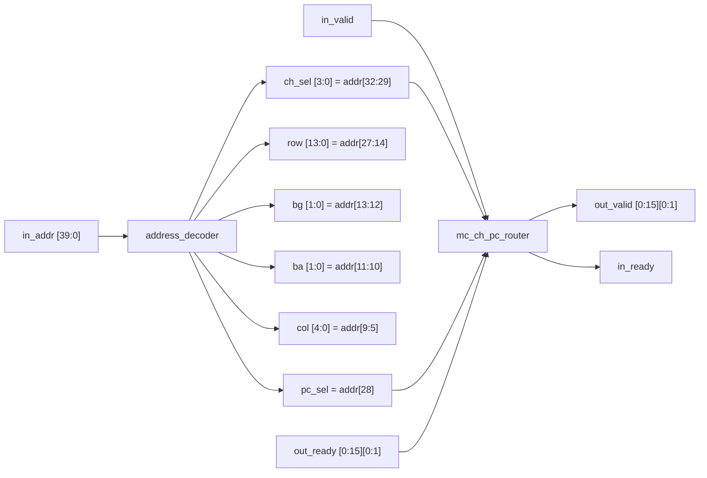
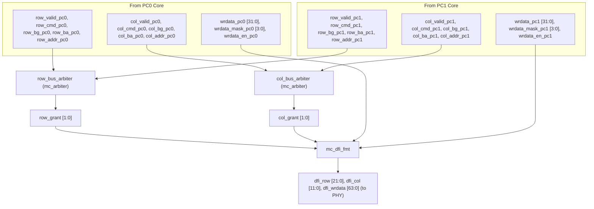

# MC16X2 Memory Controller IP
## Module Hierarchy & I/O Signal Specification (Section 13.1)

---

## 1. Overview & Structural Hierarchy

This document provides a detailed pin-level interface specification for every module and submodule defined in **Section 13.1 (Module Hierarchy)** of the **MC16X2 Microarchitecture Specification (Rev 0.4)**.

```mermaid
flowchart TD
    TOP["mc16x2 (Top Level)"]

    subgraph FrontEnd ["Host & CDC Domain"]
        TOP --> AXI_SUB["mc_axi_sub (AXI4 Slave Port Handler)"]
        AXI_SUB --> ADDR_DEC["mc_addr_decode (Address Decoder & Router)"]
        TOP --> AXI_CDC["mc_axi_cdc (5 Async FIFOs: AW, W, AR, B, R)"]
    end

    subgraph CoreDomain ["Core Scheduling Domain (32 PCs)"]
        TOP --> PC_CORE["mc_pc_core [0:31] (Per-PC Core, 32 Instances)"]
        PC_CORE --> CMDQ["mc_cmdq (Command Queue, 32 entries)"]
        PC_CORE --> WDB["mc_wdb (Write Data Buffer, 16 entries)"]
        PC_CORE --> RDB["mc_rdb (Read Data Buffer, 16 entries)"]
        PC_CORE --> BANK["mc_bank_state (Bank State Table, 16 banks)"]
        PC_CORE --> PC_ARB["mc_arbiter (Credit-Counter Arbiter)"]
        PC_CORE --> TIMING["mc_timing_check (1 GHz Down-Counters)"]
        PC_CORE --> REF["mc_refresh_engine (tREFI Refresh Engine)"]
    end

    subgraph ChannelDomain ["Channel Arbitration & DFI Domain (16 Channels)"]
        TOP --> CH_ARB["mc_ch_arb [0:15] (Channel Arbiter, 16 Instances)"]
        CH_ARB --> ROW_ARB["mc_arbiter (row_bus_arbiter)"]
        CH_ARB --> COL_ARB["mc_arbiter (col_bus_arbiter)"]
        CH_ARB --> DFI_FMT["mc_dfi_fmt (DFI Output Formatter)"]
        
        TOP --> DFI_IF["mc_dfi_if [0:15] (DFI Control / Init / LP / Update)"]
    end

    subgraph ConfigDomain ["Configuration & Telemetry"]
        TOP --> CSR["mc_csr (APB4 Register Block)"]
        CSR --> APB_IF["mc_apb_if (APB Slave Interface)"]
        CSR --> SYNC_DFI["mc_sync_dfi (2-FF Pulse Synchronizers)"]
        TOP --> PERF["mc_perf_mon (Performance Counters)"]
    end
```

---

## 2. Top-Level Module: `mc16x2`

The top-level entity exposes the single host-facing AXI4 slave port, the APB4 configuration port, the interrupt line, and the 16 independent channel DFI 5.0 master interfaces to the external HBM3 PHY.

### 2.1 Clocks & Resets
| Signal Name | Dir | Width | Clock Domain | Description |
| :--- | :---: | :---: | :---: | :--- |
| `aclk` | Input | 1 | `aclk` (500 MHz) | AXI interconnect clock. |
| `aresetn` | Input | 1 | `aclk` | AXI synchronous active-low reset. |
| `pclk` | Input | 1 | `pclk` (50 MHz) | APB configuration clock. |
| `presetn` | Input | 1 | `pclk` | APB asynchronous/synchronous active-low reset. |
| `dfi_clk` | Input | 1 | `dfi_clk` (1 GHz) | Core scheduling and DFI master clock (1.0 ns period). |
| `ctl_reset_n` | Input | 1 | `dfi_clk` | Core controller synchronous active-low reset. |

### 2.2 Host AXI4 Slave Interface
| Signal Name | Dir | Width | Clock Domain | Description |
| :--- | :---: | :---: | :---: | :--- |
| **Write Address Channel (AW)** | | | | |
| `s_axi_awid` | Input | 8 | `aclk` | Write address transaction ID. |
| `s_axi_awaddr` | Input | 40 | `aclk` | Write address (40-bit memory address space). |
| `s_axi_awlen` | Input | 8 | `aclk` | Burst length (0 to 15 supported = 1 to 16 beats). |
| `s_axi_awsize` | Input | 3 | `aclk` | Burst size (must be `3'b101` = 32 bytes/beat). |
| `s_axi_awburst` | Input | 2 | `aclk` | Burst type (must be `2'b01` = `INCR`). |
| `s_axi_awlock` | Input | 1 | `aclk` | Lock type (tied unused, no exclusive access). |
| `s_axi_awcache` | Input | 4 | `aclk` | Memory attribute / bufferable indicators. |
| `s_axi_awprot` | Input | 3 | `aclk` | Protection attributes (Privileged, Secure, Data). |
| `s_axi_awqos` | Input | 4 | `aclk` | Quality of Service (passed through, unused by arbiter). |
| `s_axi_awvalid` | Input | 1 | `aclk` | Write address valid handshake. |
| `s_axi_awready` | Output | 1 | `aclk` | Write address ready handshake (backpressure). |
| **Write Data Channel (W)** | | | | |
| `s_axi_wdata` | Input | 256 | `aclk` | Write data beat (32 bytes). |
| `s_axi_wstrb` | Input | 32 | `aclk` | Write byte strobes (1 bit per byte). |
| `s_axi_wlast` | Input | 1 | `aclk` | Last beat indicator of write burst. |
| `s_axi_wvalid` | Input | 1 | `aclk` | Write data valid handshake. |
| `s_axi_wready` | Output | 1 | `aclk` | Write data ready handshake (backpressure). |
| **Write Response Channel (B)** | | | | |
| `s_axi_bid` | Output | 8 | `aclk` | Write response transaction ID. |
| `s_axi_bresp` | Output | 2 | `aclk` | Write response status (`2'b00` = `OKAY`, `SLVERR`, `DECERR`). |
| `s_axi_bvalid` | Output | 1 | `aclk` | Write response valid handshake (posted). |
| `s_axi_bready` | Input | 1 | `aclk` | Write response ready handshake. |
| **Read Address Channel (AR)** | | | | |
| `s_axi_arid` | Input | 8 | `aclk` | Read address transaction ID. |
| `s_axi_araddr` | Input | 40 | `aclk` | Read address (40-bit memory address space). |
| `s_axi_arlen` | Input | 8 | `aclk` | Burst length (0 to 15 = 1 to 16 beats). |
| `s_axi_arsize` | Input | 3 | `aclk` | Burst size (must be `3'b101` = 32 bytes/beat). |
| `s_axi_arburst` | Input | 2 | `aclk` | Burst type (must be `2'b01` = `INCR`). |
| `s_axi_arlock` | Input | 1 | `aclk` | Lock type (tied unused). |
| `s_axi_arcache` | Input | 4 | `aclk` | Memory attributes. |
| `s_axi_arprot` | Input | 3 | `aclk` | Protection attributes. |
| `s_axi_arqos` | Input | 4 | `aclk` | Quality of Service. |
| `s_axi_arvalid` | Input | 1 | `aclk` | Read address valid handshake. |
| `s_axi_arready` | Output | 1 | `aclk` | Read address ready handshake. |
| **Read Data Channel (R)** | | | | |
| `s_axi_rid` | Output | 8 | `aclk` | Read data transaction ID. |
| `s_axi_rdata` | Output | 256 | `aclk` | Read data beat (32 bytes). |
| `s_axi_rresp` | Output | 2 | `aclk` | Read response status (`OKAY`, `SLVERR`, `DECERR`). |
| `s_axi_rlast` | Output | 1 | `aclk` | Last beat indicator of read burst. |
| `s_axi_rvalid` | Output | 1 | `aclk` | Read data valid handshake. |
| `s_axi_rready` | Input | 1 | `aclk` | Read data ready handshake. |

### 2.3 APB4 Configuration & Interrupt Interface
| Signal Name | Dir | Width | Clock Domain | Description |
| :--- | :---: | :---: | :---: | :--- |
| `paddr` | Input | 20 | `pclk` | Register byte address (`0x00000` to `0xFFFFF`). |
| `psel` | Input | 1 | `pclk` | APB peripheral select. |
| `penable` | Input | 1 | `pclk` | APB transfer strobe (active on 2nd phase). |
| `pwrite` | Input | 1 | `pclk` | Access direction: `1` = Write, `0` = Read. |
| `pwdata` | Input | 32 | `pclk` | APB write data. |
| `pstrb` | Input | 4 | `pclk` | APB byte strobes. |
| `pready` | Output | 1 | `pclk` | Slave ready (extends access phase up to 16 cycles). |
| `prdata` | Output | 32 | `pclk` | APB read data. |
| `pslverr` | Output | 1 | `pclk` | Slave error response (decode/timeout error). |
| `irq` | Output | 1 | `pclk` | Aggregated level-sensitive interrupt line. |

### 2.4 DFI 5.0 PHY Master Interfaces (16 Channel Instances, `CH0` to `CH15`)
*Signals below are replicated for each channel instance `[0:15]`.*
| Signal Name | Dir | Width | Clock Domain | Description |
| :--- | :---: | :---: | :---: | :--- |
| `dfi_reset_n_ch[i]` | Output | 1 | `dfi_clk` | PHY reset sequencing signal for channel `i`. |
| `dfi_row_ch[i]` | Output | 22 | `dfi_clk` | Shared row command: `[21]`=pc_sel, `[20:18]`=cmd, `[17:16]`=bg, `[15:14]`=ba, `[13:0]`=row. |
| `dfi_row_val_ch[i]` | Output | 1 | `dfi_clk` | Row command valid strobe. |
| `dfi_col_ch[i]` | Output | 12 | `dfi_clk` | Shared col command: `[11]`=pc_sel, `[10:9]`=cmd, `[8:7]`=bg, `[6:5]`=ba, `[4:0]`=col. |
| `dfi_col_val_ch[i]` | Output | 1 | `dfi_clk` | Column command valid strobe. |
| `dfi_cs_n_ch[i]` | Output | 1 | `dfi_clk` | Chip select (single rank). |
| `dfi_cke_ch[i]` | Output | 2 | `dfi_clk` | Clock enable: `[0]`=PC0, `[1]`=PC1. |
| `dfi_parity_in_ch[i]` | Output | 2 | `dfi_clk` | Command parity: `[0]`=row bus, `[1]`=col bus. |
| `dfi_wrdata_ch[i]` | Output | 64 | `dfi_clk` | Combined write data: `[31:0]`=PC0 lane, `[63:32]`=PC1 lane. |
| `dfi_wrdata_mask_ch[i]`| Output | 8 | `dfi_clk` | Byte-level write mask: `[3:0]`=PC0, `[7:4]`=PC1. |
| `dfi_wrdata_en_ch[i]` | Output | 2 | `dfi_clk` | Write data valid strobe: `[0]`=PC0, `[1]`=PC1 (`tphy_wrlat` cycles post-command). |
| `dfi_wrdata_cs_ch[i]` | Output | 1 | `dfi_clk` | Write rank select. |
| `dfi_rddata_ch[i]` | Input | 64 | `dfi_clk` | Combined read data: `[31:0]`=PC0 lane, `[63:32]`=PC1 lane. |
| `dfi_rddata_en_ch[i]` | Output | 2 | `dfi_clk` | Expected read enable: `[0]`=PC0, `[1]`=PC1 (`tphy_rdlat` offset). |
| `dfi_rddata_valid_ch[i]`| Input | 2 | `dfi_clk` | PHY read data valid strobe: `[0]`=PC0, `[1]`=PC1. |
| `dfi_rddata_cs_ch[i]` | Output | 1 | `dfi_clk` | Read rank select. |
| `dfi_rddata_dbi_n_ch[i]`| Input | 8 | `dfi_clk` | Data Bus Inversion indicators. |
| `dfi_phyupd_req_ch[i]`| Input | 1 | `dfi_clk` | PHY-initiated update request. |
| `dfi_phyupd_ack_ch[i]`| Output | 1 | `dfi_clk` | Controller acknowledge of PHY update. |
| `dfi_phyupd_type_ch[i]`| Input | 2 | `dfi_clk` | PHY update type code. |
| `dfi_ctrlupd_req_ch[i]`| Output | 1 | `dfi_clk` | Controller-initiated periodic update request. |
| `dfi_ctrlupd_ack_ch[i]`| Input | 1 | `dfi_clk` | PHY acknowledge of controller update. |
| `dfi_lp_ctrl_req_ch[i]`| Output | 2 | `dfi_clk` | Low-power control request: `[0]`=PC0, `[1]`=PC1. |
| `dfi_lp_data_req_ch[i]`| Output | 2 | `dfi_clk` | Low-power data request: `[0]`=PC0, `[1]`=PC1. |
| `dfi_lp_ack_ch[i]` | Input | 2 | `dfi_clk` | PHY low-power acknowledge: `[0]`=PC0, `[1]`=PC1. |
| `dfi_lp_wakeup_ch[i]` | Output | 3 | `dfi_clk` | Encoded wake latency requirement. |
| `dfi_init_start_ch[i]` | Output | 1 | `dfi_clk` | Controller-initiated PHY initialization trigger. |
| `dfi_init_complete_ch[i]`| Input| 1 | `dfi_clk` | PHY initialization complete flag. |
| `dfi_error_ch[i]` | Input | 2 | `dfi_clk` | PHY-reported error status. |
| `dfi_alert_n_ch[i]` | Input | 1 | `dfi_clk` | CA parity / CRC alert line from DRAM. |

---

## 3. Host Ingress Submodules

### 3.1 `mc_axi_sub` (AXI4 Slave Port Handler)
Manages AXI channel handshaking, burst legality validation, write completion posting, and error tracking.

* **Clock & Reset**: `aclk`, `aresetn`.
* **Host Ports**: Connects directly to `s_axi_*` signals on `mc16x2`.
* **Internal Ports (to `mc_addr_decode`)**:
  * Outputs: `decode_addr[39:0]`, `decode_valid`.
  * Inputs: `decode_ready`, `decoded_ch[3:0]`, `decoded_pc`, `decoded_row[13:0]`, `decoded_bg[1:0]`, `decoded_ba[1:0]`, `decoded_col[4:0]`.
* **Internal Ports (to `mc_axi_cdc`)**:
  * Drives write address, write data, read address payloads into `mc_axi_cdc`.
  * Samples write response from `u_b_fifo` and read data from `u_r_fifo`.

---

### 3.2 `mc_addr_decode` (Address Decoder & Router)
*Implemented in [`afe.v`](file:///home/dell/MC16/afe.v).*

| Signal Name | Dir | Width | Clock Domain | Description |
| :--- | :---: | :---: | :---: | :--- |
| `in_valid` | Input | 1 | `aclk` | Ingress transaction valid. |
| `in_ready` | Output | 1 | `aclk` | Demultiplexed backpressure ready from target PC. |
| `in_addr` | Input | 40 | `aclk` | Host address bus. |
| `ch_sel` | Output | 4 | `aclk` | Channel index (0–15). |
| `pc_sel` | Output | 1 | `aclk` | Pseudo-Channel select (`0`=PC0, `1`=PC1). |
| `row` | Output | 14 | `aclk` | Bank row address. |
| `bg` | Output | 2 | `aclk` | Bank group index. |
| `ba` | Output | 2 | `aclk` | Bank index. |
| `col` | Output | 5 | `aclk` | Column address. |
| `byte_offset` | Output | 5 | `aclk` | Byte position inside beat (`addr[4:0]`). |
| `out_valid` | Output | [0:15][0:1] | `aclk` | 2D valid flag routed to target `[channel][pc]`. |
| `out_ready` | Input | [0:15][0:1] | `aclk` | 2D backpressure ready from each `[channel][pc]`. |

---

### 3.3 `mc_axi_cdc` (AXI-to-Core CDC Bridge)
*Implemented in [`mc_axi_cdc.sv`](file:///home/dell/MC16/mc_axi_cdc.sv).* Bridges the 5 AXI channels across `aclk` (500 MHz) and `dfi_clk` (1 GHz).

| Signal Group | Signal Name | Dir | Width | Domain | Description |
| :--- | :--- | :---: | :---: | :---: | :--- |
| **Clocks/Resets** | `aclk`, `aresetn` | Input | 1, 1 | `aclk` | AXI domain clock and reset. |
| | `dfi_clk`, `ctl_reset_n` | Input | 1, 1 | `dfi_clk` | Core domain clock and reset. |
| **AXI Ingress (AW)** | `s_axi_aw*` (id, addr, len, size, burst, qos, cache, prot) | Input | 72 | `aclk` | Packed write metadata vector. |
| | `s_axi_awvalid` / `s_axi_awready` | In/Out | 1, 1 | `aclk` | AW handshake. |
| **Core Egress (AW)** | `core_aw*` (id, addr, len, size, burst, qos, cache, prot) | Output | 72 | `dfi_clk` | Cross-domain write metadata. |
| | `core_awvalid` / `core_awready` | Out/In | 1, 1 | `dfi_clk` | Core AW handshake. |
| **AXI Ingress (W)** | `s_axi_wdata`, `s_axi_wstrb`, `s_axi_wlast` | Input | 289 | `aclk` | Packed write data beat. |
| | `s_axi_wvalid` / `s_axi_wready` | In/Out | 1, 1 | `aclk` | W handshake. |
| **Core Egress (W)** | `core_wdata`, `core_wstrb`, `core_wlast` | Output | 289 | `dfi_clk` | Cross-domain write data beat. |
| | `core_wvalid` / `core_wready` | Out/In | 1, 1 | `dfi_clk` | Core W handshake. |
| **Core Ingress (B)** | `core_bid[7:0]`, `core_bresp[1:0]` | Input | 10 | `dfi_clk` | Core write commit completion. |
| | `core_bvalid` / `core_bready` | In/Out | 1, 1 | `dfi_clk` | Core B handshake. |
| **AXI Egress (B)** | `s_axi_bid[7:0]`, `s_axi_bresp[1:0]` | Output | 10 | `aclk` | Posted AXI write response. |
| | `s_axi_bvalid` / `s_axi_bready` | Out/In | 1, 1 | `aclk` | AXI B handshake. |
| **AXI Ingress (AR)** | `s_axi_ar*` (id, addr, len, size, burst, qos, cache, prot) | Input | 72 | `aclk` | Packed read metadata vector. |
| | `s_axi_arvalid` / `s_axi_arready` | In/Out | 1, 1 | `aclk` | AR handshake. |
| **Core Egress (AR)** | `core_ar*` (id, addr, len, size, burst, qos, cache, prot) | Output | 72 | `dfi_clk` | Cross-domain read metadata. |
| | `core_arvalid` / `core_arready` | Out/In | 1, 1 | `dfi_clk` | Core AR handshake. |
| **Core Ingress (R)** | `core_rid[7:0]`, `core_rdata[255:0]`, `core_rresp[1:0]`, `core_rlast` | Input | 267 | `dfi_clk` | Reassembled read return data. |
| | `core_rvalid` / `core_rready` | In/Out | 1, 1 | `dfi_clk` | Core R handshake. |
| **AXI Egress (R)** | `s_axi_rid[7:0]`, `s_axi_rdata[255:0]`, `s_axi_rresp[1:0]`, `s_axi_rlast` | Output | 267 | `aclk` | AXI read data beat. |
| | `s_axi_rvalid` / `s_axi_rready` | Out/In | 1, 1 | `aclk` | AXI R handshake. |
| **Telemetry** | `*_fifo_occupancy` (AW:4b, W:5b, AR:4b, B:4b, R:5b) | Output | Various | `aclk`/`dfi_clk`| Real-time occupancy exported to CSRs. |

---

## 4. Per-PC Scheduling Core (`mc_pc_core [0:31]`) & Submodules

`mc_pc_core` is instantiated **32 times** (16 channels × 2 PCs). Everything runs synchronously in `dfi_clk` (1 GHz).

### 4.1 `mc_pc_core` Top-Level Ports
| Signal Name | Dir | Width | Domain | Description |
| :--- | :---: | :---: | :---: | :--- |
| `dfi_clk` | Input | 1 | `dfi_clk` | 1 GHz core clock. |
| `ctl_reset_n` | Input | 1 | `dfi_clk` | Synchronous core reset. |
| **Request Ingress (from CDC)** | | | | |
| `cmd_valid` | Input | 1 | `dfi_clk` | Enqueue strobe for this PC. |
| `cmd_ready` | Output | 1 | `dfi_clk` | PC queue availability (backpressure). |
| `cmd_is_write` | Input | 1 | `dfi_clk` | `1` = Write, `0` = Read. |
| `cmd_axi_id` | Input | 8 | `dfi_clk` | AXI transaction ID. |
| `cmd_row` | Input | 14 | `dfi_clk` | Target row address. |
| `cmd_bg` | Input | 2 | `dfi_clk` | Target bank group. |
| `cmd_ba` | Input | 2 | `dfi_clk` | Target bank. |
| `cmd_col` | Input | 5 | `dfi_clk` | Target column address. |
| `cmd_wdata` | Input | 256 | `dfi_clk` | Write data beat. |
| `cmd_wstrb` | Input | 32 | `dfi_clk` | Write byte strobes. |
| `cmd_wlast` | Input | 1 | `dfi_clk` | Last write beat flag. |
| **Channel Arbiter Interface (to `mc_ch_arb`)** | | | | |
| `row_valid` | Output | 1 | `dfi_clk` | Candidate row command ready. |
| `row_refresh` | Output | 1 | `dfi_clk` | Candidate is a high-priority `REF` command. |
| `row_cmd` | Output | 3 | `dfi_clk` | Row command opcode (`ACT`, `PRE`, `REF`). |
| `row_bg` | Output | 2 | `dfi_clk` | Target bank group for row command. |
| `row_ba` | Output | 2 | `dfi_clk` | Target bank for row command. |
| `row_addr` | Output | 14 | `dfi_clk` | Target row address for row command. |
| `row_grant` | Input | 1 | `dfi_clk` | Grant from channel row arbiter. |
| `col_valid` | Output | 1 | `dfi_clk` | Candidate column command ready. |
| `col_cmd` | Output | 2 | `dfi_clk` | Column opcode (`RD`, `WR`). |
| `col_bg` | Output | 2 | `dfi_clk` | Target bank group for column command. |
| `col_ba` | Output | 2 | `dfi_clk` | Target bank for column command. |
| `col_addr` | Output | 5 | `dfi_clk` | Target column address. |
| `col_grant` | Input | 1 | `dfi_clk` | Grant from channel column arbiter. |
| **DFI Data Path Connections** | | | | |
| `wrdata_pc` | Output | 32 | `dfi_clk` | 32-bit serialized write data for this PC's lane. |
| `wrdata_mask_pc` | Output | 4 | `dfi_clk` | 4-bit byte strobe for write data. |
| `wrdata_en_pc` | Output | 1 | `dfi_clk` | Write data valid strobe (`tphy_wrlat` aligned). |
| `rddata_pc` | Input | 32 | `dfi_clk` | 32-bit read data returning from PHY. |
| `rddata_valid_pc` | Input | 1 | `dfi_clk` | Read data strobe from PHY. |
| `rddata_en_pc` | Output | 1 | `dfi_clk` | Read data expected strobe (`tphy_rdlat` aligned). |
| **AXI Completion Return (to CDC)** | | | | |
| `rdata_axi` | Output | 256 | `dfi_clk` | Reassembled 256-bit read beat. |
| `rid_axi` | Output | 8 | `dfi_clk` | Read transaction ID. |
| `rresp_axi` | Output | 2 | `dfi_clk` | Read response (`OKAY`, `SLVERR`). |
| `rlast_axi` | Output | 1 | `dfi_clk` | Last beat flag for read burst. |
| `rvalid_axi` | Output | 1 | `dfi_clk` | Read data valid strobe to R CDC FIFO. |
| `rready_axi` | Input | 1 | `dfi_clk` | Backpressure from R CDC FIFO. |
| `write_committed` | Output | 1 | `dfi_clk` | Enqueue commit strobe to post AXI `bresp`. |

---

### 4.2 Submodule: `mc_cmdq` (Command Queue — 32 Entries)
* **Inputs**: `clk`, `reset_n`, `enqueue_valid`, `cmd_type`, `row[13:0]`, `bg[1:0]`, `ba[1:0]`, `col[4:0]`, `axi_id[7:0]`, `wdb_ptr[3:0]`, `slot_pop_ack[31:0]`.
* **Outputs**:
  * `queue_full`: Backpressures upstream ingest.
  * `occupancy[5:0]`: Real-time queue count (0 to 32).
  * `slot_valid[31:0]`: Valid mask of active entries.
  * `slot_cmd[31:0]`, `slot_row[31:0][13:0]`, `slot_bg[31:0][1:0]`, `slot_ba[31:0][1:0]`, `slot_col[31:0][4:0]`, `slot_id[31:0][7:0]`: Per-slot decoded fields exposed to scheduler.

### 4.3 Submodule: `mc_wdb` (Write Data Buffer — 16 Entries)
* **Inputs**: `clk`, `reset_n`, `wdata_push`, `wdata[255:0]`, `wstrb[31:0]`, `wlast`, `wdb_alloc_req`, `dfi_pop_strobe`.
* **Outputs**:
  * `wdb_full`: Backpressures write transaction acceptance.
  * `wdb_alloc_ptr[3:0]`: Buffer entry assigned to incoming write command.
  * `data_ready[15:0]`: Indicates which WDB entries have complete data buffered.
  * `dfi_wrdata[31:0]`, `dfi_wrdata_mask[3:0]`, `dfi_wrdata_en`: Serialized 32-bit beat streaming to DFI formatter.

### 4.4 Submodule: `mc_rdb` (Read Data Buffer — 16 Entries)
* **Inputs**: `clk`, `reset_n`, `dfi_rddata[31:0]`, `dfi_rddata_valid`, `rdb_pop_strobe`.
* **Outputs**:
  * `rdata_axi[255:0]`, `rid_axi[7:0]`, `rresp_axi[1:0]`, `rlast_axi`, `rvalid_axi`: Reassembled 256-bit AXI beats dispatched to R CDC FIFO.

### 4.5 Submodule: `mc_bank_state` (16-Bank State Tracker)
Tracks 4 Bank Groups × 4 Banks = 16 Banks total.
* **Inputs**: `clk`, `reset_n`, `cmd_issued_strobe`, `issued_cmd_type[2:0]`, `issued_bg[1:0]`, `issued_ba[1:0]`, `issued_row[13:0]`.
* **Outputs**:
  * `bank_active[3:0][3:0]`: 16-bit status mask indicating which banks have open rows.
  * `open_row[3:0][3:0][13:0]`: Active row address registered in each bank's sense amps.
  * `page_hit_mask[31:0]`: Vector flagging which CMDQ entries match the open row in their target bank.
  * `page_conflict_mask[31:0]`: Vector flagging which CMDQ entries require `PRE` (row conflict).

### 4.6 Submodule: `mc_timing_check` (1 GHz Down-Counters)
* **Inputs**: `clk`, `reset_n`, command issue strobes (`act_issued`, `pre_issued`, `rd_issued`, `wr_issued`, `ref_issued`), target `bg[1:0]`, `ba[1:0]`.
* **CSR Configuration Inputs**: `cfg_trcd[5:0]`, `cfg_tras[5:0]`, `cfg_trp[5:0]`, `cfg_trc[5:0]`, `cfg_trrd[3:0]`, `cfg_tfaw[5:0]`, `cfg_tccd[3:0]`, `cfg_twtr[3:0]`, `cfg_twr[5:0]`, `cfg_trtp[3:0]`, `cfg_trfc[8:0]`.
* **Outputs**:
  * `slot_timing_legal[31:0]`: Mask qualifying each CMDQ slot as ready for arbitration. Only slots with all down-counters at `0` assert their bit.

### 4.7 Submodule: `mc_refresh_engine`
* **Inputs**: `clk`, `reset_n`, `cfg_trefi[15:0]` (default 3900 cycles), `refresh_grant`.
* **Outputs**:
  * `refresh_pending`: Top-priority request to arbiter.
  * `ref_cmd[2:0]`: Issues `PREALL` (`3'b011`) then `REF` (`3'b100`).
  * `trefi_deadline_miss`: Error strobe asserted if refresh is blocked beyond safety margin.

### 4.8 Submodule: `mc_arbiter` (Credit-Counter Core)
*Implemented in [`mc_arbiter.sv`](file:///home/dell/MC16/mc_arbiter.sv).*
* **Inputs**: `clk`, `reset_n`, `candidate_valid[1:0]`, `refresh_pending[1:0]`.
* **Outputs**: `grant[1:0]`.

---

## 5. Channel Integration & Formatting Submodules

### 5.1 `mc_ch_arb [0:15]` (Channel-Level Arbiter)
*Implemented in [`mc_ch_arb.sv`](file:///home/dell/MC16/mc_ch_arb.sv).* Instantiated 16 times (one per physical channel).

| Signal Name | Dir | Width | Domain | Description |
| :--- | :---: | :---: | :---: | :--- |
| `dfi_clk`, `dfi_reset_n` | Input | 1, 1 | `dfi_clk` | Core domain clock and active-low reset. |
| **From PC0 Core** | | | | |
| `row_valid_pc0`, `row_refresh_pc0` | Input | 1, 1 | `dfi_clk` | PC0 row command valid and refresh flags. |
| `row_cmd_pc0`, `row_bg_pc0`, `row_ba_pc0`, `row_addr_pc0` | Input | 3, 2, 2, 14 | `dfi_clk` | PC0 row command fields. |
| `col_valid_pc0`, `col_cmd_pc0`, `col_bg_pc0`, `col_ba_pc0`, `col_addr_pc0` | Input | 1, 2, 2, 2, 5 | `dfi_clk` | PC0 column command fields. |
| `wrdata_pc0`, `wrdata_mask_pc0`, `wrdata_en_pc0` | Input | 32, 4, 1 | `dfi_clk` | PC0 write data stream. |
| `rddata_en_pc0` | Input | 1 | `dfi_clk` | PC0 read data expected strobe. |
| **From PC1 Core** | | | | |
| *Identical ports for PC1* | Input | Various | `dfi_clk` | PC1 row, col, and data signals. |
| **Grants & Returns to Cores** | | | | |
| `row_grant`, `col_grant` | Output | 2, 2 | `dfi_clk` | Arbiter grants: `[0]`=PC0, `[1]`=PC1. |
| `rddata_pc0`, `rddata_pc1` | Output | 32, 32 | `dfi_clk` | Demuxed read return data. |
| `rddata_valid` | Output | 2 | `dfi_clk` | Read data strobes: `[0]`=PC0, `[1]`=PC1. |
| **To DFI Boundary (to PHY)** | | | | |
| `dfi_row`, `dfi_row_val` | Output | 22, 1 | `dfi_clk` | Formatted row command bus and strobe. |
| `dfi_col`, `dfi_col_val` | Output | 12, 1 | `dfi_clk` | Formatted col command bus and strobe. |
| `dfi_wrdata`, `dfi_wrdata_mask`, `dfi_wrdata_en` | Output | 64, 8, 2 | `dfi_clk` | Combined 64-bit data path. |
| `dfi_rddata`, `dfi_rddata_valid`, `dfi_rddata_en` | In/In/Out| 64, 2, 2 | `dfi_clk` | Read data path from PHY. |

---

### 5.2 `mc_dfi_fmt [0:15]` (DFI Output Formatter)
*Implemented in [`mc_dfi_fmt.sv`](file:///home/dell/MC16/mc_dfi_fmt.sv).*
* **Inputs**: `dfi_clk`, `dfi_reset_n`, `row_valid`, `row_pc_sel`, `row_cmd[2:0]`, `row_bg[1:0]`, `row_ba[1:0]`, `row_addr[13:0]`, `col_valid`, `col_pc_sel`, `col_cmd[1:0]`, `col_bg[1:0]`, `col_ba[1:0]`, `col_addr[4:0]`, `wrdata[63:0]`, `wrdata_mask[7:0]`, `wrdata_en[1:0]`, `dfi_rddata[63:0]`, `dfi_rddata_valid[1:0]`, `rddata_en[1:0]`.
* **Outputs**: `dfi_row_val`, `dfi_row[21:0]`, `dfi_col_val`, `dfi_col[11:0]`, `dfi_wrdata[63:0]`, `dfi_wrdata_mask[7:0]`, `dfi_wrdata_en[1:0]`, `dfi_rddata_en[1:0]`, `rddata_pc0[31:0]`, `rddata_pc1[31:0]`, `rddata_valid[1:0]`.

---

### 5.3 `mc_dfi_if [0:15]` (DFI Low-Power / Update / Init FSM)
* **Inputs**: `dfi_clk`, `ctl_reset_n`, `csr_init_start`, `csr_lp_req[1:0]`, `dfi_init_complete`, `dfi_ctrlupd_ack`, `dfi_phyupd_req`, `dfi_phyupd_type[1:0]`, `dfi_lp_ack[1:0]`, `dfi_error[1:0]`, `dfi_alert_n`.
* **Outputs**: `dfi_init_start`, `dfi_ctrlupd_req`, `dfi_phyupd_ack`, `dfi_lp_ctrl_req[1:0]`, `dfi_lp_data_req[1:0]`, `dfi_lp_wakeup[2:0]`, `csr_init_done`, `csr_dfi_error_strobe`, `csr_parity_error_strobe`.

---

## 6. Configuration & Telemetry Submodules

### 6.1 `mc_csr` (APB4 Register Block)
* **Host APB Ports**: Connects to `paddr[19:0]`, `psel`, `penable`, `pwrite`, `pwdata[31:0]`, `pstrb[3:0]`, `pready`, `prdata[31:0]`, `pslverr`, `irq`.
* **Core Sync Ports**: Connects to `mc_sync_dfi` to distribute configuration parameters (`cfg_t*`) into the 1 GHz core domain and collect status/error events.

### 6.2 `mc_apb_if` (APB Slave Interface)
* Decodes APB address space into Global registers (`0x0000–0x0FFF`), Per-Channel registers (`0x1000–0x1FFF` × 16), Performance monitors (`0xF000–0xF3FF`), and Interrupt registers (`0xF400–0xF4FF`).

### 6.3 `mc_sync_dfi` (APB-to-DFI Domain Synchronizers)
* Contains 2-FF pulse synchronizers bridging write strobe pulses from `pclk` (50 MHz) to `dfi_clk` (1 GHz) and status updates from `dfi_clk` to `pclk`.

### 6.4 `mc_perf_mon` (Performance Monitors)
* **Inputs**: `dfi_clk`, `ctl_reset_n`, transaction issue strobes from all 32 PCs, bank conflict indicators, CMDQ/WDB occupancy watermarks.
* **Outputs**: 32-bit register readback vectors exposed to `mc_csr` (command counts, bank conflict counts, latency averages).
