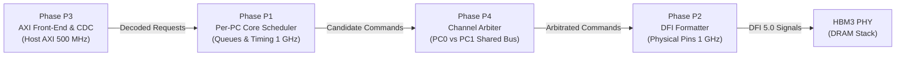
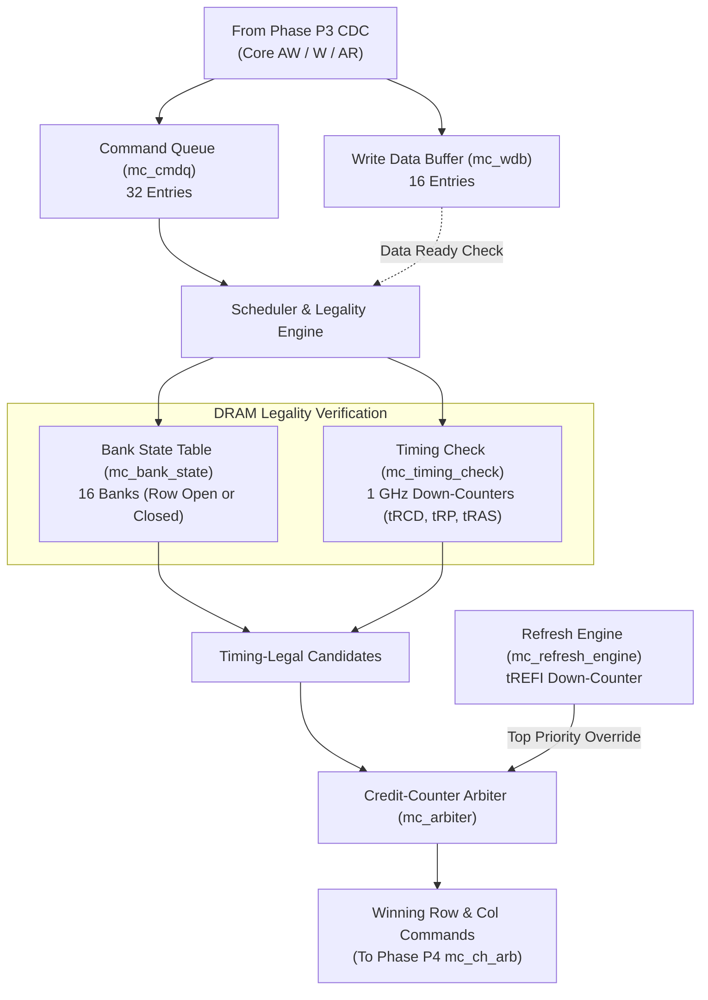
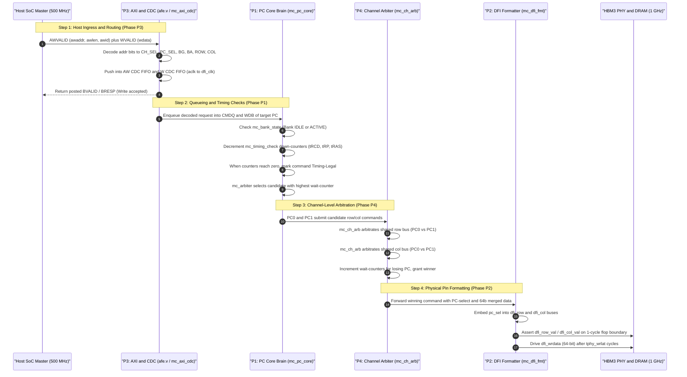

# MC16X2 Memory Controller IP
## Phase P1 Deep Dive & The Complete 4-Phase System: P3 ➔ P1 ➔ P4 ➔ P2

---

## 1. Executive Overview & Intuitive Mental Model

A high-performance memory controller is essentially an **intelligent translation and scheduling factory**:
* It accepts high-level, bursty requests from the processor (SoC).
* It buffers, translates, and schedules those requests around the strict physical laws of DRAM silicon (capacitors leaking charge, banks needing recovery time, bus turnarounds).
* It serializes and delivers them cycle-by-cycle over physical copper pins to the memory stack (HBM3).

To make this complex architecture modular and verifiable, the controller is built in **four interconnected phases**:



### The Real-World Analogy: An International Airport Cargo Terminal
1. **Phase P3 (The Customs & Ingest Terminal)**: Takes shipping containers arriving on slow cargo ships (`aclk` = 500 MHz), inspects their destination labels (address decoding), and drops them onto high-speed internal conveyor belts (Async CDC FIFOs) leading into the automated sorting facility (`dfi_clk` = 1 GHz).
2. **Phase P1 (The Warehouse Manager / The Brain)**: The core of the entire operation. It runs 32 independent warehouse bays (one per Pseudo-Channel). It tracks the status of 16 storage aisles (banks), monitors stopwatches to avoid safety violations (timing down-counters), and decides which box is ready to move next.
3. **Phase P4 (The Runway Traffic Controller)**: Every two warehouse bays (PC0 and PC1) share a single runway (the channel's physical DFI row/col command buses). Phase P4 arbitrates fairly between them using credit counters so neither bay starves, and gives emergency landing rights to maintenance vehicles (Refresh).
4. **Phase P2 (The Loading Gate / PHY Adaptation)**: Takes the cleared cargo from the runway, stamps the final flight tag (`pc_sel`), and loads it directly onto the airplane's cargo hold (the physical DFI 5.0 pins to the HBM3 PHY).

---

## 2. Deep Dive: What is Phase P1? (Single-PC Core Bring-Up)

**Phase P1 is the scheduling and timing brain of the controller.**
In HBM3, the memory stack is divided into 16 channels, and each channel is split into 2 **Pseudo-Channels (PC0 and PC1)**. 
Each Pseudo-Channel operates as a **completely independent memory universe**: it has its own 16 memory banks, its own row/column address space, and its own data buffer.

Phase P1 defines **`mc_pc_core`**, the self-contained scheduling engine that is instantiated **32 times** across the IP.



---

### 2.1 The 7 Sub-Modules of `mc_pc_core`

#### 1. Command Queue (`mc_cmdq`) — 32 Entries
* **Purpose**: Holds decoded read and write requests awaiting scheduling.
* **Fields stored per entry**:
  * `valid`: Slot occupied.
  * `cmd_type`: Read (`RD`) vs Write (`WR`).
  * `bankgroup[1:0]`, `bank[1:0]`: Target bank (0 to 15).
  * `row_addr[13:0]`: Target row address (16,384 rows per bank).
  * `col_addr[4:0]`: Target column address (32 columns per row).
  * `axi_id[7:0]`: AXI transaction ID for completion tagging.
  * `wdb_ptr[3:0]`: Pointer to write data buffer (for writes).
* **Backpressure**: When the CMDQ reaches 32 entries, it signals backpressure to P3, which deasserts `awready` / `arready`.

#### 2. Write Data Buffer (`mc_wdb`) — 16 Entries
* **Purpose**: Holds write data beats (`wdata[255:0]` and strobes `wstrb[31:0]`) arriving from AXI.
* **Write Eligibility Rule**: A write command in the CMDQ **cannot be scheduled** until its write data has physically arrived in the WDB. Once buffered, the command becomes schedule-eligible.

#### 3. Read Data Buffer (`mc_rdb`) — 16 Entries
* **Purpose**: Buffers returning read data from the PHY (`rddata[31:0]`) until it can be reassembled and sent across the R CDC FIFO back to the AXI master in request order.

#### 4. Bank State Table (`mc_bank_state`) — 16 Banks (4 Bank Groups × 4 Banks)
DRAM cells cannot be read directly; an entire row (thousands of bits) must first be activated into sense amplifiers. The Bank State Table tracks the status of each bank:
* **State**: `IDLE` (closed/precharged) or `ACTIVE` (row is open in sense amps).
* **Open Row Register**: Stores `open_row[13:0]`.
* **State Decisions**:
  * **Page Hit** (Best case): Bank is `ACTIVE` and requested row matches `open_row`. Command needs only an immediate Column command (`RD` or `WR`).
  * **Page Empty** (Moderate): Bank is `IDLE`. Must issue `ACT` (Activate) first, wait `tRCD`, then issue `RD`/`WR`.
  * **Page Conflict** (Worst case): Bank is `ACTIVE`, but requested row is different. Must issue `PRE` (Precharge) to close the current row, wait `tRP`, issue `ACT`, wait `tRCD`, then issue `RD`/`WR`.

#### 5. Timing-Legality Checker (`mc_timing_check`) — 1 GHz Down-Counters
* **Why it is simple**: In this IP, `dfi_clk` is fixed at **1 GHz**, meaning **1 clock cycle = exactly 1.0 nanosecond**.
* Every timing rule in the JEDEC specification is implemented as a simple **down-counter**:
  * When a command is issued, its corresponding counter is loaded with its cycle count.
  * Every cycle, the counter decrements by `1` until it hits `0`.
  * A command is **blocked from arbitration** if any of its active counters are non-zero!

| Counter | Parameter Name | Meaning (Simple Terms) | Cycles @ 1 GHz | Scope |
| :---: | :--- | :--- | :---: | :---: |
| `tRCD` | Row-to-Column Delay | "Wait after opening row before reading/writing columns" | **18 ns (18 c)** | Per-Bank |
| `tRAS` | Row Active Time | "Row must stay open for this long before closing" | **34 ns (34 c)** | Per-Bank |
| `tRP` | Row Precharge Time | "Wait after closing a row before opening a new one" | **14 ns (14 c)** | Per-Bank |
| `tRC` | Row Cycle Time | "Minimum time between successive opens to same bank" | **50 ns (50 c)** | Per-Bank |
| `tRRD` | Row Spacing | "Wait between opening two different banks (power limit)" | **6 ns (6 c)** | Per-PC |
| `tFAW` | Four-Activate Window | "At most 4 rows may be opened within this sliding window"| **32 ns (32 c)**| Per-PC |
| `tCCD` | Column-to-Column | "Minimum spacing between back-to-back RD/WR commands" | **4 ns (4 c)** | Per-PC |
| `tWTR` | Write-to-Read | "Wait after write before reading (bus turnaround)" | **8 ns (8 c)** | Per-PC |
| `tWR` | Write Recovery | "Wait after write data completes before closing row" | **18 ns (18 c)** | Per-Bank |
| `tRTP` | Read-to-Precharge | "Wait after read command before closing row" | **8 ns (8 c)** | Per-Bank |
| `tRFC` | Refresh Recovery | "Wait after refresh command finishes before using bank" | **350 ns (350 c)**| Per-PC |

#### 6. Refresh Engine (`mc_refresh_engine`)
* DRAM capacitors lose electrical charge over time. Every bank must be refreshed every 3.9 microseconds.
* Runs a free-running down-counter initialized to **`tREFI = 3900 cycles`** (3.9 µs).
* When it reaches 0, `refresh_pending` asserts.
* The refresh engine automatically claims **top priority**: all banks are closed with `PREALL`, and an all-bank `REF` command is dispatched, locking the PC for `tRFC = 350 cycles`.

#### 7. Credit-Counter Arbiter (`mc_arbiter`)
* Evaluates all CMDQ entries that pass the bank state and timing checks.
* Uses the **8-bit saturating wait counter**:
  * Increments every cycle a legal command waits without being picked.
  * Selects the candidate with the highest counter.
  * Emits the winning Row command (`ACT`, `PRE`, `REF`) and/or Column command (`RD`, `WR`) to Phase P4!

---

## 3. Connecting the 4 Phases (P3 ➔ P1 ➔ P4 ➔ P2)

Here is how data, addresses, and control flow through all four phases from the moment the CPU issues an AXI write to the moment physical bits toggle at the DRAM:



---

## 4. End-to-End Architectural Comparison

| Dimension | Phase P3 (Host Front-End) | Phase P1 (Core Scheduler) | Phase P4 (Channel Arbiter) | Phase P2 (DFI Formatter) |
| :--- | :--- | :--- | :--- | :--- |
| **Primary Module** | [`mc_axi_cdc.sv`](file:///home/dell/MC16/mc_axi_cdc.sv) / [`afe.v`](file:///home/dell/MC16/afe.v) | `mc_pc_core.sv` (`mc_cmdq`, `mc_bank_state`, `mc_timing_check`) | [`mc_ch_arb.sv`](file:///home/dell/MC16/mc_ch_arb.sv) / [`mc_arbiter.sv`](file:///home/dell/MC16/mc_arbiter.sv) | [`mc_dfi_fmt.sv`](file:///home/dell/MC16/mc_dfi_fmt.sv) |
| **Clock Domain** | `aclk` (500 MHz) ↔ `dfi_clk` (1 GHz) | `dfi_clk` (1 GHz, synchronous) | `dfi_clk` (1 GHz, synchronous) | `dfi_clk` (1 GHz, synchronous) |
| **Instance Count** | **1 Global Port** | **32 Instances** (16 CH × 2 PC) | **16 Instances** (1 per Channel) | **16 Instances** (1 per Channel) |
| **Main Job** | Protocol decode, CDC crossing, posted `bresp` | Bank tracking, JEDEC timing legality, CMDQ buffering | Arbitrating shared command buses between PC0 and PC1 | Physical pin vector packing, embedding `pc_sel` |
| **Data Width** | **256 bits** (AXI beat) | **32 bits** (PC stream) | **64 bits** (32b PC0 + 32b PC1) | **64 bits** (DFI physical bus) |
| **Arbitration Scope** | None (FIFO backpressure) | Internal CMDQ candidates (which command in PC wins) | Channel level (PC0 winning command vs PC1 winning command) | None (Registered pipeline stage) |
| **Timing Enforcement**| AXI handshake (`valid`/`ready`) | Strict DRAM cycle down-counters (`tRCD`, `tRP`, `tRC`, etc.) | None (Assumes inputs are already timing-legal) | PHY transport latencies (`tphy_wrlat`, `tphy_rdlat`) |

---

## 5. Code-Wise Signal Trace Across All 4 Phases

Tracing an address from host to physical pins:

```systemverilog
// =========================================================================
// 1. PHASE P3: AXI Address Decoding (afe.v)
// =========================================================================
assign ch_sel      = addr[32:29]; // Routes to 1 of 16 Channels
assign pc_sel      = addr[28];    // Routes to PC0 or PC1 inside that Channel
assign row         = addr[27:14]; // 14-bit row address
assign bg          = addr[13:12]; // 2-bit bank group
assign ba          = addr[11:10]; // 2-bit bank
assign col         = addr[9:5];   // 5-bit column address

// =========================================================================
// 2. PHASE P1: Timing Down-Counters & Legality (mc_pc_core / mc_timing_check)
// =========================================================================
// Per-bank down-counters track whether commands are legal:
always_ff @(posedge dfi_clk or negedge ctl_reset_n) begin
    if (!ctl_reset_n) begin
        trcd_cnt[bg][ba] <= '0;
    end else if (issue_act && (act_bg == bg) && (act_ba == ba)) begin
        trcd_cnt[bg][ba] <= 18; // Load 18 cycles @ 1 GHz
    end else if (trcd_cnt[bg][ba] != '0) begin
        trcd_cnt[bg][ba] <= trcd_cnt[bg][ba] - 1'b1;
    end
end
// RD/WR only legal when trcd_cnt == 0:
wire col_cmd_legal = (trcd_cnt[cmd_bg][cmd_ba] == '0);

// =========================================================================
// 3. PHASE P4: Channel-Level Bus Arbitration (mc_ch_arb.sv)
// =========================================================================
// Selects between PC0's legal command and PC1's legal command:
mc_arbiter col_bus_arbiter (
    .clk             (dfi_clk),
    .reset_n         (dfi_reset_n),
    .candidate_valid ({col_valid_pc1, col_valid_pc0}),
    .refresh_pending (2'b00),
    .grant           (col_grant) // [0]=PC0, [1]=PC1
);

// =========================================================================
// 4. PHASE P2: DFI Pin Vector Formatting (mc_dfi_fmt.sv)
// =========================================================================
// Embeds pc_sel and formats onto physical DFI column bus:
always_ff @(posedge dfi_clk or negedge dfi_reset_n) begin
    if (!dfi_reset_n) begin
        dfi_col_val <= 1'b0;
        dfi_col     <= '0;
    end else begin
        dfi_col_val <= col_valid;
        // dfi_col[11:0] = {pc_sel, col_cmd[1:0], bg[1:0], ba[1:0], col[4:0]}
        dfi_col     <= {col_pc_sel, col_cmd, col_bg, col_ba, col_addr};
    end
end
```

---

## 6. Implementation Summary & Status in Workspace

* **Phase P3**: 
  * `afe.v`: Implemented (fixed address decoder and router).
  * `cdc_sync_2ff.sv`: Implemented (2-FF Gray pointer synchronizer).
  * `async_fifo.sv`: Implemented (parameterized dual-clock FIFO with FWFT).
  * `mc_axi_cdc.sv`: Implemented (the 5 async FIFOs bridging 500 MHz and 1 GHz).
* **Phase P4**:
  * `mc_arbiter.sv`: Implemented (credit-counter starvation-avoidance arbiter).
  * `mc_ch_arb.sv`: Implemented (dual row/col arbitration, 32b/64b data aggregation).
* **Phase P2**:
  * `mc_dfi_fmt.sv`: Implemented (DFI row/col bus packing and registered stage).
* **Phase P1 (Next Step)**:
  * Ready to build: `mc_cmdq.sv`, `mc_bank_state.sv`, `mc_timing_check.sv`, and assemble them into `mc_pc_core.sv`.
