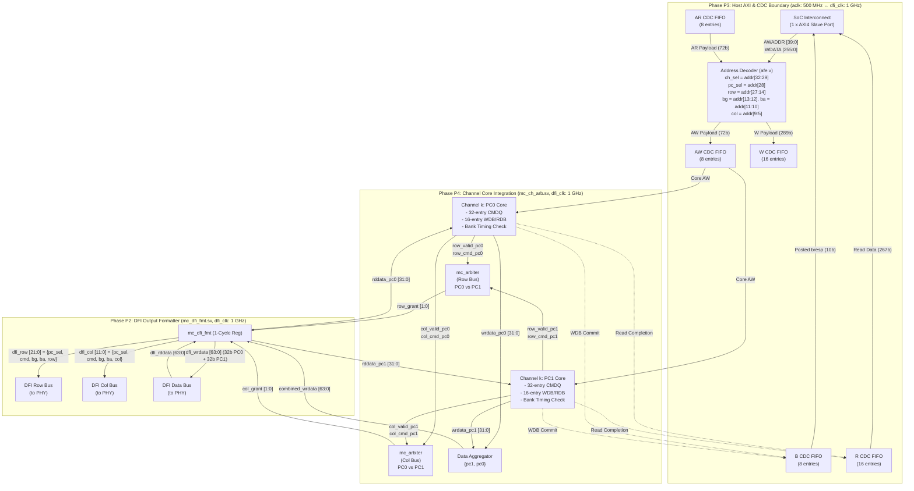

# MC16X2 Memory Controller IP
## End-to-End Microarchitecture: Connecting Phase P3, Phase P4, and Phase P2

---

## 1. Executive Summary & The "Full Picture"

The **MC16X2 Memory Controller** bridges an SoC host to high-bandwidth stacked memory (**HBM3, JESD238**) through a **DFI 5.0 PHY interface**. 

The entire data and command pipeline of the controller is structured around three foundational architectural phases:
* **Phase P3 (Ingress / Host Front-End)**: Receives AXI4 burst transactions in `aclk` (500 MHz), parses the 40-bit address to determine the target Channel and Pseudo-Channel, safely crosses the asynchronous boundary via 5 Gray-coded FIFOs into `dfi_clk` (1 GHz), and returns posted write completions (`bresp`).
* **Phase P4 (Core / Channel Integration & Arbitration)**: Couples the two independent Pseudo-Channels (PC0 and PC1) of each channel. It takes their independently scheduled, timing-legal DRAM commands and arbitrates cycle-by-cycle for the shared row and column command buses using an **8-bit saturating credit-counter algorithm**, while maintaining completely independent, parallel 32-bit data streams.
* **Phase P2 (Egress / PHY Formatting)**: Registers the arbitrated commands and data on the physical DFI boundary, embeds the 1-bit `pc_sel` tag into `dfi_row[21:0]` and `dfi_col[11:0]`, packs the 64-bit data bus (`[31:0]` for PC0, `[63:32]` for PC1), and drives pin-level strobes to the external HBM3 PHY.

```
                      END-TO-END PIPELINE: P3 ──► P4 ──► P2
                      
 ┌─────────────────────────┐      ┌─────────────────────────┐      ┌─────────────────────────┐
 │        PHASE P3         │      │        PHASE P4         │      │        PHASE P2         │
 │     AXI Front-End       │      │   Channel Integration   │      │      DFI Formatter      │
 │  (Host Ingress/Egress)  │      │   (Core Arbitration)    │      │   (PHY Egress/Ingress)  │
 ├─────────────────────────┤      ├─────────────────────────┤      ├─────────────────────────┤
 │ • AXI4 Slave (500 MHz)  │      │ • 1 GHz dfi_clk Domain  │      │ • 1 GHz dfi_clk Domain  │
 │ • 40-bit Address Slice  ├─────►│ • PC0 & PC1 Schedulers  ├─────►│ • Embed pc_sel in DFI   │
 │ • 5 Async CDC FIFOs     │      │ • mc_ch_arb Arbitration │      │ • 22b Row / 12b Col Bus │
 │ • Posted bresp Gen      │◄─────┤ • Credit-Counter Fair   │◄─────┤ • 64b Split Data Bus    │
 │ • APB4 CSR / IRQ Bridge │      │ • Refresh Always Wins   │      │ • 1-Cycle Flop Boundary │
 └─────────────────────────┘      └─────────────────────────┘      └─────────────────────────┘
        (mc_axi_cdc)                     (mc_ch_arb)                      (mc_dfi_fmt)
```

---

## 2. Deep Dive: What is Phase P4?

### 2.1 Scope & Mission of P4
In HBM3, physical memory channels are divided into **two Pseudo-Channels (PC0 and PC1)**. To optimize physical pin count and PHY layout, **PC0 and PC1 share the channel's row command bus and column command bus**, while maintaining separate 32-bit data pins (totalling 64 bits per channel).

Phase P4 implements **Channel-Level Integration (`mc_ch_arb`)**. It solves the contention between PC0 and PC1 with the following rules:

1. **Independent Dual-Bus Arbitration**:
   * HBM3 separates row commands (`ACT`, `PRE`, `REF`) and column commands (`RD`, `WR`).
   * P4 provides **two separate arbiters** per channel:
     * `row_bus_arbiter`: Arbitrates `row_valid_pc0` vs `row_valid_pc1`.
     * `col_bus_arbiter`: Arbitrates `col_valid_pc0` vs `col_valid_pc1`.
   * **Dual Issue**: In any given clock cycle, PC0 can issue a Row command while PC1 issues a Column command (or vice versa). Arbitration is only needed when both PCs target the *same bus* in the *same cycle*.

2. **Credit-Counter Starvation Avoidance (`mc_arbiter`)**:
   * Each PC maintains an 8-bit saturating wait counter (`CREDIT_CTR_WIDTH = 8`, max 255).
   * If a PC has a ready command but loses the shared bus, its counter increments by `+1`.
   * When granted, its counter resets to `0`.
   * The candidate with the highest counter wins. Under sustained contention, this guarantees bounded wait and mathematical starvation freedom.
   * Ties are resolved with fixed priority: **PC0 wins ties over PC1**.

3. **Refresh Preemption**:
   * Refresh commands (`REF`) are critical to prevent DRAM data corruption.
   * If either PC has `refresh_pending`, the arbiter **strictly overrides** wait counters and grants the bus immediately to the refreshing PC.

4. **Unblocked Concurrent Data Lanes**:
   * Even though command issue is serialized across PC0 and PC1 when contention occurs, **data transfers are never serialized**.
   * PC0 write data (`wrdata_pc0[31:0]`) occupies `dfi_wrdata[31:0]`.
   * PC1 write data (`wrdata_pc1[31:0]`) occupies `dfi_wrdata[63:32]`.
   * Both lanes can stream write and read data simultaneously and independently.

---

## 3. End-to-End Architectural Connection (P3 ↔ P4 ↔ P2)

### 3.1 The Complete Signal and Command Flow Diagram



---

## 4. Architectural Matrix: P3 vs. P4 vs. P2

| Feature | Phase P3: AXI Front-End + CDC | Phase P4: Channel Integration | Phase P2: DFI Formatter |
| :--- | :--- | :--- | :--- |
| **Primary Module** | [`mc_axi_cdc.sv`](file:///home/dell/MC16/mc_axi_cdc.sv) / [`afe.v`](file:///home/dell/MC16/afe.v) | [`mc_ch_arb.sv`](file:///home/dell/MC16/mc_ch_arb.sv) / [`mc_arbiter.sv`](file:///home/dell/MC16/mc_arbiter.sv) | [`mc_dfi_fmt.sv`](file:///home/dell/MC16/mc_dfi_fmt.sv) |
| **Clock Domain** | `aclk` (500 MHz) ↔ `dfi_clk` (1 GHz) | `dfi_clk` (1 GHz, synchronous) | `dfi_clk` (1 GHz, synchronous) |
| **Scope** | Global (1 AXI port, 16 Channels) | Per-Channel (1 instance × 16 CH) | Per-Channel (1 instance × 16 CH) |
| **Addressing Role** | Decodes 40b address into CH, PC, BG, BA, ROW, COL | Passes sub-fields to PC0 and PC1 | Embeds `pc_sel` and sub-fields into physical DFI vectors |
| **Command Processing** | Unpacks AXI burst lengths (1–16 beats) | Evaluates DRAM bank timing; arbitrates PC0 vs PC1 | Formats 22-bit row and 12-bit col buses with valid strobes |
| **Data Width** | **256 bits** (32 bytes per AXI beat) | **32 bits per PC** (two parallel streams) | **64 bits** (32b PC0 lane + 32b PC1 lane) |
| **Arbitration Mechanism** | None (FIFO flow control & backpressure) | **Credit-Counter Starvation Avoidance** (8-bit saturating counter) | None (Pure registered output pipeline stage) |
| **Write Completion** | **Posted `bresp`** generated upon WDB enqueue | Manages WDB commit & scheduling eligibility | Drives write data `tphy_wrlat` cycles after column write |

---

## 5. Code-Wise Implementation Linkage

### 5.1 Address Unpacking (P3) ──► Routing (P4) ──► DFI Packing (P2)

The 40-bit address path shows the exact code continuity across all three modules:

```systemverilog
// =========================================================================
// 1. PHASE P3: Address Decoding (afe.v)
// =========================================================================
assign ch_sel      = addr[32:29]; // Selects 1 of 16 Channels (mc_ch_arb [0:15])
assign pc_sel      = addr[28];    // Selects PC0 or PC1 inside that Channel
assign row         = addr[27:14]; // 14-bit row address
assign bg          = addr[13:12]; // 2-bit bank group
assign ba          = addr[11:10]; // 2-bit bank
assign col         = addr[9:5];   // 5-bit column address

// =========================================================================
// 2. PHASE P4: Channel-Level Bus Arbitration (mc_ch_arb.sv)
// =========================================================================
// Two instances of mc_arbiter determine whether PC0 or PC1 gets the bus:
mc_arbiter row_bus_arbiter (
    .clk             (dfi_clk),
    .reset_n         (dfi_reset_n),
    .candidate_valid ({row_valid_pc1, row_valid_pc0}),
    .refresh_pending ({row_refresh_pc1, row_refresh_pc0}),
    .grant           (row_grant) // row_grant[0] = PC0, row_grant[1] = PC1
);

// Multiplex winning command fields based on grant:
always_comb begin
    if (row_grant[0]) begin
        selected_row_cmd  = row_cmd_pc0;
        selected_row_bg   = row_bg_pc0;
        selected_row_ba   = row_ba_pc0;
        selected_row_addr = row_addr_pc0;
    end else if (row_grant[1]) begin
        selected_row_cmd  = row_cmd_pc1;
        selected_row_bg   = row_bg_pc1;
        selected_row_ba   = row_ba_pc1;
        selected_row_addr = row_addr_pc1;
    end
end

// =========================================================================
// 3. PHASE P2: DFI Pin Vector Formatting (mc_dfi_fmt.sv)
// =========================================================================
// Packs the winning command with the embedded PC-select bit into DFI pins:
always_ff @(posedge dfi_clk or negedge dfi_reset_n) begin
    if (!dfi_reset_n) begin
        dfi_row_val <= 1'b0;
        dfi_row     <= '0;
    end else begin
        dfi_row_val <= row_valid; // Asserted if either PC won
        dfi_row     <= {row_pc_sel, row_cmd, row_bg, row_ba, row_addr}; // 22 bits
    end
end
```

### 5.2 The Credit-Counter Arbitration Algorithm ([`mc_arbiter.sv`](file:///home/dell/MC16/mc_arbiter.sv))

The arbitration core that powers P4 enforces the starvation avoidance rule:

```systemverilog
// Combinational Winner Selection
always_comb begin
    grant = 2'b00;
    case (candidate_valid)
        2'b01: grant = 2'b01; // Only PC0 ready
        2'b10: grant = 2'b10; // Only PC1 ready
        2'b11: begin          // Contention!
            if (refresh_pending[0] || refresh_pending[1]) begin
                // Refresh ALWAYS wins
                grant = refresh_pending[0] ? 2'b01 : 2'b10;
            end else if (credit_pc1 > credit_pc0) begin
                grant = 2'b10; // PC1 has waited longer
            end else begin
                grant = 2'b01; // PC0 has waited longer (or tie break to PC0)
            end
        end
        default: grant = 2'b00;
    endcase
end

// Sequential Credit Counter Accumulation
always_ff @(posedge clk or negedge reset_n) begin
    if (!reset_n) begin
        credit_pc0 <= '0;
        credit_pc1 <= '0;
    end else begin
        // Reset counter when granted; increment (saturate at 255) when losing
        if (grant[0])
            credit_pc0 <= '0;
        else if (candidate_valid[0] && grant[1] && credit_pc0 != CREDIT_MAX)
            credit_pc0 <= credit_pc0 + 1'b1;

        if (grant[1])
            credit_pc1 <= '0;
        else if (candidate_valid[1] && grant[0] && credit_pc1 != CREDIT_MAX)
            credit_pc1 <= credit_pc1 + 1'b1;
    end
end
```

### 5.3 Data Path Convergence: 256b ──► 32b ──► 64b

* **In Phase P3**: AXI write data arrives as **256-bit beats**.
* **In Phase P4**: The destination PC core divides each 256-bit beat into **eight 32-bit words**. PC0 drives `wrdata_pc0[31:0]`, and PC1 drives `wrdata_pc1[31:0]`.
* **In Phase P2**: `mc_dfi_fmt` bundles them into the combined 64-bit bus:
  ```systemverilog
  assign combined_wrdata = {wrdata_pc1, wrdata_pc0}; // [63:32]=PC1, [31:0]=PC0
  ```
* On read returns:
  ```systemverilog
  assign rddata_pc0 = dfi_rddata[31:0];
  assign rddata_pc1 = dfi_rddata[63:32];
  ```
  The read data is collected into the respective PC's Read Data Buffer (`RDB`) and repacked into 256-bit beats before crossing P3's R CDC FIFO back to the AXI host.

---

## 6. Synthesis & Timing Budget Considerations

Running the entire P4 channel arbiter and P2 formatter synchronously at **1 GHz (`dfi_clk` = 1.0 ns period)** imposes strict microarchitectural design rules:
1. **Logic Depth Budget (≤ 6 Logic Levels)**:
   * The path from CMDQ candidate extraction → timing legality filter → wait-counter comparison (`credit_pc1 > credit_pc0`) → grant generation → command muxing must not exceed 6 gates.
2. **Dedicated Flop Stage in P2**:
   * [`mc_dfi_fmt.sv`](file:///home/dell/MC16/mc_dfi_fmt.sv) provides a clean registered stage at the DFI pin boundary. This isolates internal arbitration multiplexer delay from the physical DFI pad setup time.
3. **No CDC Crossings in P4 or P2**:
   * All clock domain crossings are strictly confined to P3. P4 and P2 operate in a single, unified 1 GHz clock domain with zero synchronizers, eliminating MTBF concerns inside the scheduling core.

---

## 7. Roadmap & Next Implementation Steps

```mermaid
gantt
    title MC16X2 Development Roadmap Progression
    dateFormat  X
    axisFormat %s
    
    section Complete
    P0 Architecture & Spec Signoff           :done, 0, 1
    P2 DFI Formatter Implementation          :done, 1, 2
    P3 AXI Address Decode & CDC FIFOs       :done, 2, 3
    P4 Channel Arbiter Core (mc_ch_arb)      :done, 3, 4
    
    section Next
    P1 Single-PC Core (CMDQ + Timing Check) :active, 4, 5
    P5 Full 16-Channel Scale-Out            : 5, 6
    P6 Low-Power & Refresh Engine Tuning    : 6, 7
    P7 STA Timing Closure & Gate-Level Sim  : 7, 8
```



1. **Verify P4 Integration**: Run `tb_mc_ch_arb.sv` to confirm arbitration fairness, credit counter saturation, and independent concurrent data streaming under sustained back-to-back traffic.
2. **Implement Phase P1 (Single-PC Core)**: Build `mc_cmdq.sv` (32 entries), `mc_wdb.sv` (16 entries), and `mc_timing_check.sv` (1 GHz down-counters for `tRCD`, `tRAS`, `tRP`, `tRC`, `tCCD`, `tWTR`, `tWR`, `tRFC`, `tREFI`).
3. **Complete Channel Integration**: Connect the completed PC0 and PC1 cores directly to `mc_ch_arb.sv`, creating a fully functional single-channel memory controller.
