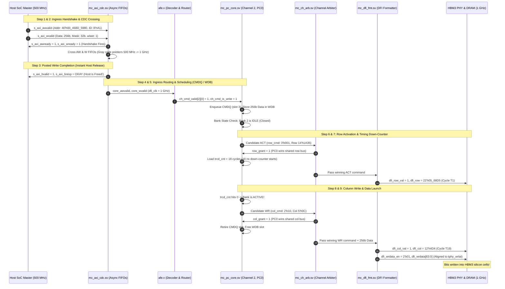

# MC16X2 Memory Controller IP
# 256-bit Write Operation Walkthrough (`write_opn_example.md`)

---

## 1. System Context & Concrete Setup

This document walks through an end-to-end **256-bit write operation** on the **MC16X2 Memory Controller IP** in simple, intuitive terms while strictly adhering to the signal names, module hierarchies, and bit widths defined in the specification.

### 1.1 The Concrete Scenario
* **The Goal:** The SoC Master wants to write a **256-bit data beat** (32 bytes, e.g., `256'hDEAD_BEEF_...`) into HBM3 DRAM.
* **The Target Address:** `s_axi_awaddr[39:0] = 40'h00_468D_5980`.
* **Transaction ID:** `s_axi_awid = 8'hA1`.
* **Decoded HBM3 Hardware Target:**
  * **Channel:** Channel 2 (out of 16 physical channels)
  * **Pseudo-Channel:** `PC0` (out of 2 pseudo-channels per channel)
  * **Bank Group:** `BG1` (out of 4 bank groups)
  * **Bank:** `BA2` (out of 4 banks per bank group)
  * **Row:** `14'h1A35` (Row 6,709 out of 16,384 rows)
  * **Column:** `5'h0C` (Column 12 out of 32 columns)
  * **Byte Offset:** `5'h00` (32-byte aligned beat)
* **The Clock Domains:**
  * **Host AXI Domain:** `aclk = 500 MHz` ($2.0\text{ ns}$ period)
  * **Core Scheduling & DFI Domain:** `dfi_clk = 1 GHz` (exactly $1.0\text{ ns}$ per clock cycle)

---

## 2. End-to-End Execution Flow (Mermaid Sequence)

---

## 3. Step-by-Step Walkthrough in Simple Terms

### Step 1: The Master Knocks on the Door (Host AXI Boundary)
To write data, the SoC Master must deliver two things: **where to write** (the address) and **what to write** (the 256-bit data).

* **The Address Knock:** On the Write Address channel, the master asserts `s_axi_awvalid = 1'b1`, driving the 40-bit address `s_axi_awaddr = 40'h00_468D_5980` and the ticket ID `s_axi_awid = 8'hA1`.
* **The Data Knock:** At the exact same time, on the Write Data channel, the master asserts `s_axi_wvalid = 1'b1`. It places the 256-bit payload onto `s_axi_wdata[255:0]`, activates all 32 bytes using the mask `s_axi_wstrb[31:0] = 32'hFFFF_FFFF`, and marks `s_axi_wlast = 1'b1`.
* **The Handshake:** The controller checks its ingress buffers. Since there is free room, it answers back with `s_axi_awready = 1'b1` and `s_axi_wready = 1'b1`. On the clock tick of `aclk`, both `valid` and `ready` meet, and the controller absorbs the request.

---

### Step 2: Crossing the Speed Divide (CDC — Clock Domain Crossing)
* **The Problem:** The host operates at 500 MHz (`aclk`), but the memory controller’s internal brain operates at 1 GHz (`dfi_clk`). Signals crossing different clock speeds can cause electrical metastability without proper isolation.
* **The Solution (`mc_axi_cdc.sv`):**
  * The address information is pushed into an asynchronous **AW FIFO** (72 bits wide, 8 slots deep).
  * The 256-bit data and 32-bit mask are pushed into an asynchronous **W FIFO** (289 bits wide, 16 slots deep).
  * Write and read pointers are converted to **Gray code** (where only one bit flips at a time) and synchronized across 2 flip-flop stages (`cdc_sync_2ff.sv`).
  * On the 1 GHz side, the signals emerge cleanly as `core_awvalid`, `core_awaddr`, `core_wvalid`, and `core_wdata`.

---

### Step 3: Instant AXI Response (Posted Write Completion)
In standard DRAM, a processor would have to wait dozens of nanoseconds until physical silicon capacitors finished charging before receiving a write response.

The **MC16X2 IP** uses an acceleration technique called **Posted Write Completion**:
* As soon as both the address and 256-bit data safely enter the controller's internal FIFOs, the logic declares `write_fire = 1'b1`.
* It immediately generates `core_bvalid = 1'b1` with `core_bresp = 2'b00` (meaning **`OKAY`**) and `core_bid = 8'hA1`.
* This response passes back through the B CDC FIFO to the host as `s_axi_bvalid = 1'b1`.
* The host sees `OKAY`, asserts `s_axi_bready`, and immediately resumes other tasks. The host considers the write complete, while the memory controller handles physical DRAM delivery in the background.

---

### Step 4: Sorting the Mail — Address Decoding & Routing (`afe.v`)
In the 1 GHz domain, `address_decoder` in `afe.v` slices the 40-bit address `core_awaddr[39:0]`:
* `addr[32:29]` = `4'h2` $\rightarrow$ **Channel 2** (out of 16 channels)
* `addr[28]` = `1'b0` $\rightarrow$ **Pseudo-Channel 0 (`PC0`)**
* `addr[27:14]` = `14'h1A35` $\rightarrow$ **Row 6,709**
* `addr[13:12]` = `2'b01` $\rightarrow$ **Bank Group 1**
* `addr[11:10]` = `2'b10` $\rightarrow$ **Bank 2**
* `addr[9:5]` = `5'h0C` $\rightarrow$ **Column 12**
* `addr[4:0]` = `5'h00` $\rightarrow$ **Byte offset 0**

The router (`mc_ch_pc_router`) asserts `ch_cmd_valid[2][0] = 1'b1` and `ch_cmd_is_write[2][0] = 1'b1`, directing the command and 256-bit data exclusively to **Channel 2, Pseudo-Channel 0**.

---

### Step 5: Inside the Brain — `mc_pc_core.sv`

#### 1. CMDQ (Command Queue) & WDB (Write Data Buffer)
* **`CMDQ` (32 slots deep):** Stores the *instruction* to write (Row `14'h1A35`, BG1, BA2, Col 12, and ID `8'hA1`).
* **`WDB` (16 slots deep):** Stores the *actual payload* (the 256-bit write data `cmd_wdata[255:0]` and mask `cmd_wstrb[31:0]`).
* **The Write Eligibility Rule:** A write command in `CMDQ` is forbidden from being scheduled until its write data has physically landed inside `WDB` (`wdb_occupied = 1`). Since both arrived together, the command is immediately eligible for scheduling.

#### 2. Bank State Table (FSM)
In HBM3 DRAM, data cannot be written directly into a closed bank; the entire row must first be activated into the **Row Buffer**.
* The FSM checks **Bank Group 1, Bank 2**.
* The bank is currently **`IDLE` (Closed)**.
* **FSM Decision:** The controller must first issue an **`ACTIVATE` (`ACT`)** command to open Row `14'h1A35`.

#### 3. Timing Down-Counters (`mc_timing_check`)
Because `dfi_clk` is fixed at 1 GHz, **1 clock cycle = exactly 1.0 nanosecond**.
* The core emits candidate `row_cmd = 3'b001` (`CMD_ROW_ACT`) and `row_valid = 1'b1`.
* When granted, the down-counter `trcd_cnt[1][2]` loads **`18`** ($t_{RCD} = 18\text{ ns}$).
* Every cycle, `trcd_cnt` decrements: $18 \rightarrow 17 \dots \rightarrow 0$.
* While counting down, the Column Write command is strictly blocked.
* At cycle 18, `trcd_cnt` reaches 0! The bank transitions to **`ACTIVE`** with `open_row = 14'h1A35`.
* The FSM advances: *Generate Column Write candidate: `col_cmd = 2'b10` (`CMD_COL_WR`), `col_addr = 5'h0C`, `col_valid = 1'b1`.*

---

### Step 6: The Traffic Cop — Channel Arbitration (`mc_ch_arb.sv`)
`PC0` and `PC1` share the same physical command wires to the PHY.
* **Row Bus Arbitration:** When PC0 wants to activate the row, the arbiter checks PC1. PC1 is idle, so PC0 gets `row_grant = 1'b1`.
* **Column Bus Arbitration:** 18 cycles later, when PC0 wants to write, the arbiter checks for column bus contention using 8-bit saturating wait counters. PC0 wins and gets `col_grant = 1'b1`.
* Upon grant:
  * The write command retires from `CMDQ`.
  * The 256-bit write data slot is cleared in `WDB` (`wdb_occupied <= 0`).

---

### Step 7: Launching to the Pins — DFI Formatter (`mc_dfi_fmt.sv`)
At 1 GHz, combinational decision logic cannot drive external PHY pads directly without violating setup timing ($t_{\text{setup}}$). 

**Phase P2 inserts a 1-cycle registered boundary flop stage:**
* **Cycle $T_0 \rightarrow T_1$ (Activate):**
  Packs the row command:
  $$\mathtt{dfi\_row[21:0]} = \{\mathtt{row\_pc\_sel},\ \mathtt{row\_cmd},\ \mathtt{row\_bg},\ \mathtt{row\_ba},\ \mathtt{row\_addr}\} = \mathbf{22'h05\_68D5}$$
  Flops the value and asserts `dfi_row_val = 1'b1`.
* **Cycle $T_{18} \rightarrow T_{19}$ (Write):**
  Packs the column command:
  $$\mathtt{dfi\_col[11:0]} = \{\mathtt{col\_pc\_sel},\ \mathtt{col\_cmd},\ \mathtt{col\_bg},\ \mathtt{col\_ba},\ \mathtt{col\_addr}\} = \mathbf{12'h4D4}$$
  Flops the value and asserts `dfi_col_val = 1'b1`.

---

### Step 8: Delivering the 256-bit Data to the HBM3 PHY
* Inside `mc_dfi_fmt.sv`, the write data channel drives:
  * `dfi_wrdata[63:0]` (carrying the data bits).
  * `dfi_wrdata_mask[7:0]` (carrying the byte mask).
  * `dfi_wrdata_en[1:0] = 2'b01` (write enable strobe for PC0).
* The controller coordinates the data launch with the configured PHY write latency (`tphy_wrlat`).
* The HBM3 PHY captures the data, drives it across the physical micro-pins to the HBM3 DRAM stack, and commits the bits into the silicon storage capacitors of **Bank Group 1, Bank 2, Row 6,709, Column 12**.

The write operation is complete!
